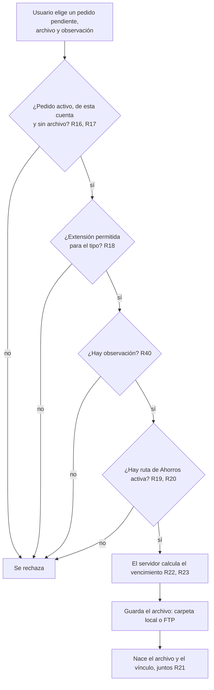

# Explicación: subir y consultar los documentos de una cuenta

> Parte de lógica (paso 1 del [flujo de feature](../../../guia/flujo-de-feature.md)). La parte de código se agrega después de la entrevista. · [← PLAN](./PLAN.md) · Reglas: R16-R24, R26, R27, R40

## Qué se logra

Una cuenta ya tiene **pedidos** (feature 2). Ahora el usuario **sube el archivo** que cumple un pedido y **ve el expediente**: qué está cargado, qué falta y qué venció.

## Subir un archivo

Todo se valida en el **servidor**, contra la base; lo que mande la pantalla no se cree. Si algo falla, **no queda nada**: ni archivo en la carpeta ni filas.

| Decisión | Regla |
|---|---|
| El pedido recibe **un solo archivo en toda su vida** | R17 |
| Firma: solo PDF. Foto: solo imágenes. El resto: 13 extensiones | R18 |
| Los archivos van a la carpeta **de Ahorros**; una ruta de crédito o contabilidad se rechaza; sin ruta, mensaje claro | R19, R20 |
| Subir **no cambia el pedido**: solo nacen archivo y vínculo | R21 |
| Hay que escribir una **observación** | R40 |

## Cuándo vence

El **tipo** decide, y solo por **una** regla:

| El tipo dice | El archivo vence |
|---|---|
| No vence | nunca |
| Fecha manual | en la fecha que escribe el usuario al subir (sin fecha, se rechaza) |
| N días después del cargue | hoy + N. Con 0 nace vencido (R39) |

La fecha la calcula **el servidor**, aunque la pantalla mande otra (R23). "N días después del fin de la cuenta" **no** entra (R25, feature 8).

## Qué se ve

Estado de cada pedido, calculado (R26): pendiente, cargado vigente, cargado eliminado o retirado.

| Pantalla | Qué muestra |
|---|---|
| Documentos de la cuenta (feature 2) | Los pedidos con su estado y las pestañas **Cargados** (con "Ver") y **Eliminados** |
| Archivos de la cuenta | **Cargados**, **Pendientes** y **Vencidos**, y la subida |

**Vencidos** no muestra pedidos retirados (R24). La pestaña **Eliminados** de la pantalla de combos se crea acá pero queda vacía hasta la feature 4 (eliminar).

## Qué toca la subida

| Pedido | Vínculo | Archivo | Carpeta |
|---|---|---|---|
| sin cambios | nuevo, sin banderas | nuevo, vigente | el archivo físico |

Nunca se borra una fila (R27).

## Lo que NO hace esta feature

Eliminar y retirar (4), firmar (5), formato personalizado (6), botón en las demás pantallas de cuentas (7) y vencer después del fin de la cuenta (8).

## Entrevista

Antes de codear, el usuario responde con sus palabras (se registra en el Log del PLAN):

1. ¿Por qué un pedido no puede recibir un segundo archivo?
2. Un PDF subido a un tipo "foto", ¿qué pasa y quién lo decide: la pantalla o el servidor?
3. Un tipo vence a 30 días del cargue y el usuario escribe otra fecha: ¿cuál vale?
4. Si falla el vínculo después de guardar el archivo, ¿qué debe quedar?
5. ¿Qué diferencia hay entre un pedido pendiente y uno retirado?
