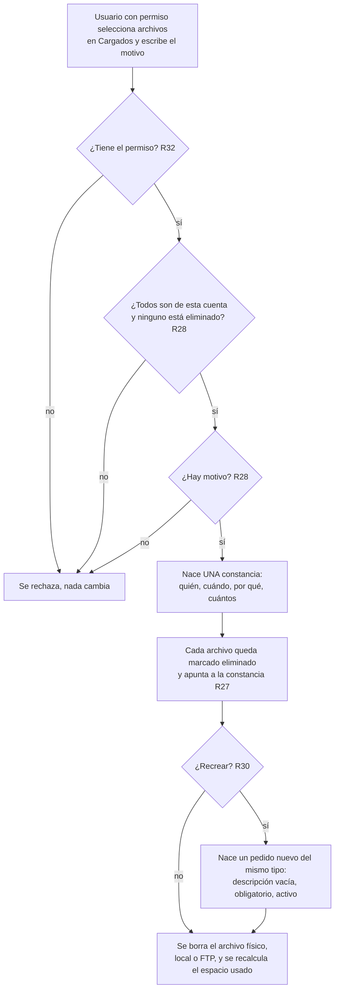

# Explicación: eliminar con constancia

> Parte de lógica (paso 1 del [flujo de feature](../../../guia/flujo-de-feature.md)). La parte de código se agrega después de la entrevista. · [← PLAN](./PLAN.md) · Reglas: R27-R32

## Qué se logra

Una cuenta ya tiene archivos **cargados** (feature 3). Ahora un usuario **con permiso** puede eliminar uno o varios, diciendo **por qué**. Queda una **constancia** para auditar, y si hace falta se pide el documento otra vez con un **pedido nuevo**.

## Eliminar

Constancia, marcas y pedido nuevo van **juntos**: si falla uno, no queda ninguno. El borrado físico va **al final**, cuando la base ya quedó bien.

| Decisión | Regla |
|---|---|
| Eliminar **marca**, no borra filas: el historial queda completo | R27 |
| Varios archivos eliminados juntos comparten **una** constancia | R28 |
| El pedido **no vuelve a pendiente**: queda "cargado eliminado" | R29 |
| "Recrear" es la **única vía** para volver a subir ese documento | R30 |
| Solo con el permiso especial, validado en el **servidor** | R32 |

## Qué se ve después

| Pantalla | Antes | Después |
|---|---|---|
| Archivos de la cuenta, **Cargados** / **Vencidos** | el archivo | ya no está |
| Archivos de la cuenta, **Pendientes** | — | el pedido nuevo, si se recreó |
| Documentos de la cuenta, **Eliminados** | vacía | el archivo con quién, cuándo y por qué |
| Documentos de la cuenta, **Estado** | cargado vigente | cargado eliminado |

## Retirar no es eliminar

| | Eliminar | Retirar |
|---|---|---|
| Sobre qué | un **archivo** | un **pedido** |
| Qué pasa | archivo marcado + constancia | el pedido se apaga (`Esactivo`) |
| Toca lo demás | no | no: ni archivos ni otros pedidos (R31) |
| Dónde | Cargados, con permiso especial | grid de pedidos (ya existía) |

## Lo que no entra

- Imprimir el acta de la constancia.
- Reemplazar el archivo en el mismo pedido (decisión a futuro).
- Borrar una cuenta con expediente (R36, feature 7).
