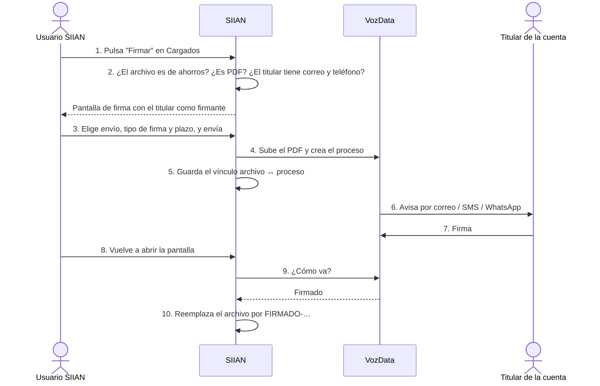
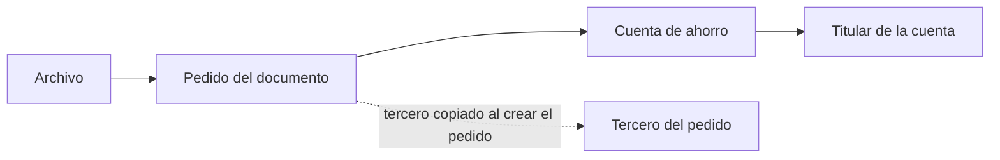

# Explicación: firma electrónica

> Parte de lógica (paso 1 del [flujo de feature](../../../guia/flujo-de-feature.md)). La parte de código se agrega después de la entrevista. · [← PLAN](./PLAN.md) · Reglas: R2, R8, R18, R33 · Base: [firma de contabilidad](../../../contabilidad/archivos-contabilidad/firma-documentos-contables/EXPLICACION.md)

## Qué se logra

Una cuenta ya tiene archivos **cargados** (feature 3). Si el tipo del documento exige **firma electrónica**, el usuario lo envía a firmar por VozData al **titular de la cuenta**, el único firmante (R2). Cuando el titular firma, el expediente se queda con la **versión firmada** en lugar de la original (R33).

Es la misma firma de contabilidad. Lo único propio de ahorros es **de dónde sale el firmante** y **qué archivo se reemplaza**.

## El flujo

**SIIAN no recibe aviso de VozData.** Se entera de la firma solo cuando alguien **reabre la pantalla** (pasos 8-10): ahí, si el estado es "Firmado", reemplaza en el momento. Hasta entonces el expediente tiene el original. Así funcionan crédito y contabilidad, y **se respeta tal cual** en ahorros (decisión del usuario, 2026-11-03). La pantalla además trae un botón manual de reemplazo ("Este proceso eliminará el archivo original…").

## Las piezas y para qué existe cada una

| Pieza | ¿Para qué? |
|---|---|
| **Vínculo archivo ↔ proceso de firma** (tabla nueva) | VozData no sabe qué es un "archivo de ahorros". Sin este vínculo, SIIAN no puede saber qué firma es de qué archivo, ni cuál reemplazar. |
| **Estado de la firma en la grilla** (3 datos en la vista de Cargados) | Para pintar el botón del color correcto sin abrir la pantalla: ¿firmado?, ¿cuál es la firma más reciente?, ¿quedó anulada? |
| **Pantalla de firma** (compartida, ya existe) | Se reutiliza la de crédito y contabilidad. Ahorros solo le dice "soy ahorros" y quién firma. |
| **Botón Firmar** en Cargados | La entrada para el usuario. Sin él, la firma solo se abriría escribiendo la URL. |

## Quién firma

Hay **dos caminos posibles** y casi siempre dan la misma persona: el pedido copia el titular de la cuenta cuando nace. Solo difieren si el titular de la cuenta cambió después de pedir el documento. Decidido: se usa el titular actual de la cuenta (pregunta 1).

El firmante necesita **correo y teléfono principales** registrados. Si le falta alguno, VozData no puede avisarle: SIIAN lo dice con un mensaje claro **antes** de enviar, en vez de mostrar el error crudo de VozData.

## Estados y botón

| Estado de la firma más reciente | Botón Firmar | Qué se puede hacer |
|---|---|---|
| El tipo no exige firma | no aparece | — |
| Sin enviar | normal | enviar |
| Esperando al titular | naranja | reenviar el aviso, anular |
| Firmado | verde | ver; el archivo ya es el firmado |
| Anulado o vencido | rojo | enviar una solicitud nueva |

Un archivo puede tener **varias firmas** (una anulada y otra nueva). Siempre cuenta **la más reciente**, y la grilla muestra **una sola fila** por archivo.

El vencimiento del plazo también se detecta **al abrir la pantalla**, no solo.

## Qué pasa con el archivo al firmarse

- El firmado se guarda en la **misma carpeta**, con `FIRMADO-` delante del nombre, local o FTP.
- El registro del archivo de ahorros pasa a **apuntar al firmado**.
- El documento **sigue en Cargados**, con el mismo pedido. Solo cambia el archivo detrás.

## Casos raros

| Caso | Respuesta |
|---|---|
| El archivo es de crédito o contabilidad | "El archivo no pertenece a una cuenta de ahorro" |
| El archivo no es PDF | No debería pasar: al subir, un tipo con firma solo acepta PDF (R18). La pantalla lo revisa otra vez. |
| El titular no tiene correo o teléfono principal | Mensaje claro, no se envía nada |
| El archivo fue eliminado | La pantalla no se arma |
| Módulo de firmas deshabilitado | "Modulo de firmas no habilitado" |

## Qué no cambia

Crédito, contabilidad, tercero y CRM firman igual. Comparten la pantalla y el envío a VozData; ahorros solo agrega su rama, como hizo contabilidad.

## Heredado de contabilidad, a vigilar

- **Reemplazo local:** no toca `Nombre`, solo `Url`. Es lo que lo mantiene estable al reabrir (ver pregunta 4).
- **FTP:** el nombre nuevo sale del nombre en `Url` (ya con `FIRMADO`), y en FTP el prefijo es `FIRMADO - ` con espacios. Cada reapertura de un archivo ya firmado vuelve a descargar y reemplazar; el nombre podría crecer (`FIRMADO - FIRMADO - …`). Se mira en el caso 5 del PLAN.

## Preguntas para la entrevista

1. **Firmante:** ✅ el **titular actual de la cuenta** (`CuentaAhorro.Idtercero`), no el tercero del pedido. Decidido 2026-11-03.
2. **Permiso:** ✅ sin permiso nuevo, solo sesión, como crédito y contabilidad; sí se valida que el archivo sea de ahorros. Decidido 2026-11-03.
3. **Nombre:** ✅ se corrige `FiirmaArchivoAhorro` → `FirmaArchivoAhorro` (entidad, actor, ViewModel, WebApi, `.csproj`). Decidido 2026-11-03.
4. **Nombre en reemplazo local:** ✅ no se actualiza `Nombre`, solo `Url`, como contabilidad. Así el nombre sale siempre de `Nombre` (`FIRMADO-<original>`) y no crece al reabrir. Decidido 2026-11-03.

## Lo que no entra

- Firmar desde el servicio que usa el helper de crédito (`FirmarDocumentoService`).
- Formato personalizado (feature 6).
- Borrar una cuenta con expediente (feature 7).
