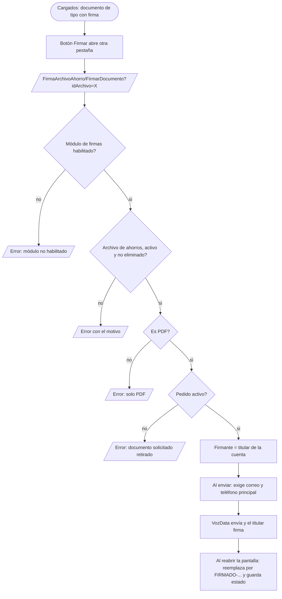

# Implementación — Firma electrónica de ahorros y aportes

> Reference. Refleja el código de la rama `feature/contabilidad-archivos-documento-equivalente` al 2026-11-04, sin commit. Se actualiza al probar. · [← PLAN](./PLAN.md) · [EXPLICACION](./EXPLICACION.md) (la lógica)
> Leyenda: 🟡 escrito, sin validar en pantalla. Feature cerrada 2026-11-04: probados los casos 1, 2 y 9 del PLAN; el resto (envío, reabrir firmada, reenviar/anular, regresión de crédito y contabilidad) quedó sin recorrer.

Es la firma de contabilidad ([IMPLEMENTACION](../../../contabilidad/archivos-contabilidad/firma-documentos-contables/IMPLEMENTACION.md)) con dos diferencias: el firmante es el **titular de la cuenta** y el archivo a reemplazar es `ArchivoAhorro`.

## Flujo 🟡

## Validaciones frente a crédito y contabilidad

Se verificaron leyendo el código de los tres módulos. Ahorros valida más que los otros dos.

| Validación | Crédito | Contabilidad | Ahorros |
|---|---|---|---|
| Módulo de firmas habilitado | Sí | Sí | Sí |
| Archivo eliminado o inactivo | Sí (solo lo revisa) | Sí, con mensaje | Sí, con mensaje |
| Solo PDF (al abrir y al enviar) | No | Sí | Sí |
| Archivo de otro módulo | Sin validación propia | Mensaje claro | Mensaje claro: "El archivo no pertenece a una cuenta de ahorro" |
| Pedido (documento solicitado) activo | No | Sí | Sí: "…el documento solicitado fue retirado" |
| Tipo del catálogo activo | No | No | **No (decisión, ver abajo)** |
| Correo y teléfono principal del firmante antes de enviar | No (falla VozData) | No | **Sí, solo ahorros** |

**Decisión (2026-11-04): no se valida que el tipo del catálogo esté activo.** Desactivar un tipo significa "no lo pidan más", no "invalida lo ya cargado". Subir un archivo nuevo sí lo exige (`ArchivoAhorroReglasActorNegocio.ValidarPedidoYTipo`) porque crea algo; firmar uno cargado no. Además, si el tipo se desactiva con la solicitud ya enviada, bloquear la firma dejaría un proceso pendiente en VozData que nadie puede cerrar. Tampoco se valida que el tipo exija firma: lo controla que el botón solo aparezca en esos tipos, igual que crédito y contabilidad.

Los otros dos campos "activo" están cubiertos de dos maneras: la vista de Cargados filtra `s.esactivo = true` (el botón no aparece en un pedido retirado) y el negocio lo valida por si alguien escribe la URL a mano.

## Base de datos

Script `C:\Users\User\DataGripProjects\scriptsSiian\ahorrosyaportes\scratch\archivos-ahorros\6-firma.sql` (idempotente; reversión en `9-reversion.sql`):

- Tabla `firmas_firmaarchivoahorro` (`idarchivoahorro`, `idprocesomaestro`) con índice por `idarchivoahorro`.
- 3 columnas al final de `ahorrosyaportes_vistadocumentoahorrocargados`: `esfirmadoelectronicamente`, `idfirma`, `esanuladoelectronicamente`. Traen solo la **firma más reciente** de cada archivo (`LEFT JOIN LATERAL ... ORDER BY fechacreacion DESC, id DESC LIMIT 1`), para que una firma anulada y otra nueva no dupliquen la fila.

## Código por capa

| Capa | Archivo | Qué hace |
|---|---|---|
| Datos | `Blip.Data/Firmas/FirmaArchivoAhorro.cs`, `FirmaArchivoAhorroActor.cs` | Vínculo archivo ↔ proceso (12 métodos + `ObtenerPorIdarchivoahorro`, `ObtenerPorIdprocesomaestro`) |
| Datos | `Blip.Data/Ahorrosyaportes/VistaDocumentoAhorroCargados.cs`, `...Actor.cs` | 3 campos de firma de la vista |
| Entidades | `VistaDocumentoAhorroCargadosViewModel.cs`, `FirmaCarpetaVirtualViewModel.cs` (`EsFirmaAhorro`) | |
| Negocio | `Negocio/AhorrosyAportes/DocumentoAhorroArchivoConsultaActorNegocio.cs` | Mapea los 3 campos nuevos en `ObtenerCargados` |
| Negocio | `Negocio/Firmas/FirmaArchivoAhorroActorNegocio.cs` | `FirmarDocumento`, `EnviarSolicitudFirma`, `DescargarYReemplazar` (local o FTP), `ReenviarSolicitudes`, `AnularFirma` y las validaciones de la tabla |
| Web | `Controllers/Firmas/FirmaArchivoAhorroController.cs` | Mismas acciones que contabilidad; `[Log]` a nivel de clase cierra la conexión |
| Web | `SIIAN.VozData/Handlers/FirmarDocumentoCarpetaVirtualHandler.cs` | Rama `EsFirmaAhorro` que inserta el vínculo |
| Vistas | `Views/FirmaProcesoMaestro/FirmarDocumento.cshtml` | Título y controlador para ahorros |
| Vistas | `Views/DocumentoAhorroArchivo/_GridCargados.cshtml`, `_GestionDocumentos.cshtml` | Botón Firmar con color por estado (normal, naranja, verde, rojo); las 3 clases de color van en un `<style>` propio porque ahorros no tiene `_Estilos` |

Se borraron `FirmaArchivoAhorroViewModel` y `FirmaArchivoAhorroWebApiController` (nadie los usaba; contabilidad tampoco los tiene).

## Reglas que conviene recordar

- **SIIAN no recibe aviso de VozData.** El estado se actualiza al abrir `FirmarDocumento`; ahí mismo, si ya firmó, se reemplaza el archivo.
- **Un solo firmante:** `CuentaAhorro.Idtercero` (el titular actual), no el tercero guardado en el pedido.
- **Reemplazo local:** arma `FIRMADO-{Nombre}` y solo actualiza `Url`; `Nombre` no cambia, así reabrir da siempre el mismo nombre. **Reemplazo FTP:** arma `FIRMADO - {nombre en Url}` y sí actualiza `Nombre`; el prefijo puede repetirse al reabrir (caso 5 del PLAN).
- Sin permiso nuevo: solo sesión, como crédito y contabilidad.

## Hallazgos heredados de contabilidad (no corregidos)

- `ReemplazarLocal` y `ReemplazarRemoto` devuelven siempre `false`: `reemplazado` nunca cambia. Nadie parece usar el valor.
- `FirmarDocumento` tiene un `return null` inalcanzable: la rama `else` solo se alcanza con archivo eliminado o inactivo, y justo ahí `ValidarArchivoFirmable` lanza antes.
- `ReemplazarRemoto` borra el original del FTP **antes** de actualizar la base de datos; si el `Update` falla, el registro apunta a un archivo que ya no existe. `ReemplazarLocal` lo hace al revés.
- `EnviarSolicitudFirma`: si `IniciarProceso` falla, la copia temporal del FTP no se borra (no hay `finally`).
- El handler usa el código telefónico del país del titular; sin país en su ficha puede lanzar `NullReference`.

## Pendiente

- Cerrada el 2026-11-04. Vistos en Orca los casos 1, 2 y 9 (capturas en `./evidencia/`); **sin probar** 3-8 y 10 porque enviaban solicitudes reales.
- Encabezado fijo "Firmar Documento Tercero" en la vista compartida (`FirmarDocumento.cshtml:586`).
