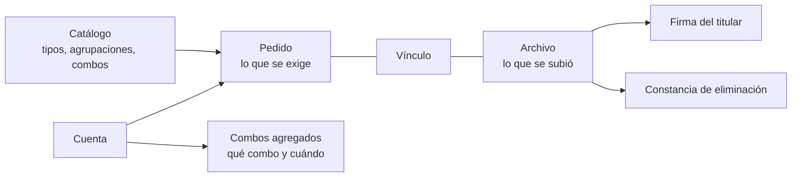
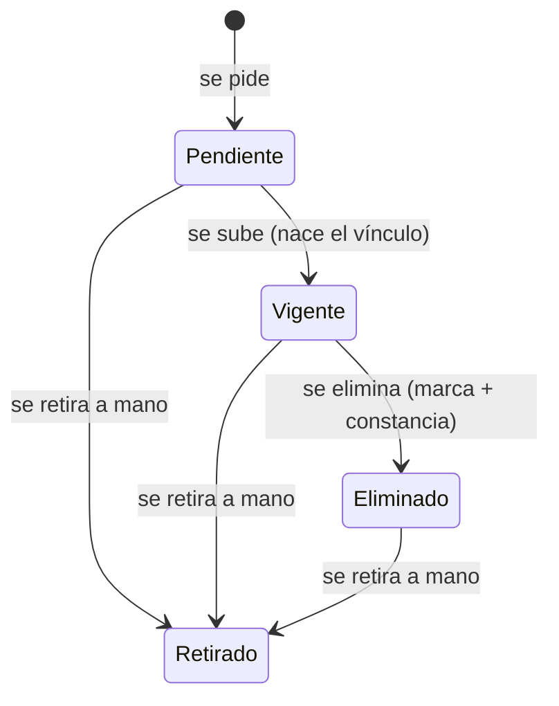

# Análisis: expediente virtual de ahorros y aportes

> [← README](./README.md) · [Reglas](./REGLAS-DE-NEGOCIO.md) · [ADR-001](./ADR.md)
> Lectura de notas y base `demo` del 2026-10-28. Referencias: [plan original](./archivo/PLAN-v1.md) (hechos de crédito y de las cuentas, verificados el 2026-10-23), [área contable](../../contabilidad/archivos-contabilidad/README.md) y [remodelación contable](../../contabilidad/archivos-contabilidad/remodelacion-bd/EXPLICACION.md).

## Qué ya existe

| Pieza | Hoy | Conclusión |
|---|---|---|
| Cuentas | Todas las cuentas (CDT, ahorro, aporte) son del mismo tipo de registro y tienen titular | **Un solo dueño** para todo el expediente; el titular firma |
| Crédito | Expediente completo: catálogo, combos, pedidos, carga, eliminación con constancia y firma | **Referencia de comportamiento** |
| Contabilidad | Mismo comportamiento que crédito, remodelado: el estado del documento ya no se guarda, se calcula, y sus archivos viven aparte de los de crédito | **Referencia del modelo** |
| Ahorros | Nada construido: ni tablas ni pantallas. Hay scripts escritos y sin correr (ver [mapa](#mapa-del-modelo-contabilidad--ahorros)) | Se arranca limpio, sin migrar datos |

No aplica el patrón de dos dueños de contabilidad (comprobante y documento equivalente): ahorros tiene un solo dueño.

## Qué cambia frente al plan original

El plan original copiaba el modelo de crédito. Contabilidad, después, corrigió varias cosas de ese modelo. Ahorros nace ya corregido:

| # | Plan original (crédito) | Alineado con contabilidad |
|---|---|---|
| A1 | El vínculo pedido-archivo tenía su propio "activo" | El vínculo no tiene banderas: existe o no existe. En crédito nadie apaga ese "activo" |
| A2 | Estado implícito | **El estado se calcula**, no se guarda: pendiente, cargado (vigente o eliminado) y retirado (R26) |
| A3 | Un pedido pendiente era "sin archivo activo" | Un pedido es pendiente si está activo y **nunca** recibió un archivo, aunque se haya eliminado. Un pedido recibe un solo archivo en su vida (R17) |
| A4 | Documento único: al subir, apagar los archivos anteriores del pedido | **El tipo único no restringe nada** (R19 contable, 2026-11-05): no se valida al pedir, al agregar combo, al reactivar ni al recrear. `DesactivarAnterioresSiEsUnico` existe al subir, pero no tiene efecto: con A3 nunca hay un archivo anterior en el mismo pedido |
| A5 | — | Eliminar marca el archivo y deja constancia; **el pedido no se toca**. El pedido solo se retira a mano (R28-R31) |
| A6 | Recrear al eliminar | Igual que crédito: pedido nuevo con el mismo tipo y titular, descripción vacía y obligatorio (R30) |
| A7 | Extensiones por definir | Las de contabilidad, validadas en el servidor: firma solo PDF, foto solo imágenes, el resto 13 extensiones (R18) |

Además se copia de contabilidad el **registro de combos agregados** a la cuenta (R13), que el plan original no tenía.

## Cómo funciona

| Pieza | Qué es en negocio |
|---|---|
| **Cuenta** | El dueño del expediente: un CDT, un ahorro a la vista o un aporte. Todas son el mismo tipo de registro |
| **Titular** | La persona de la cuenta. Es de quien se piden los documentos y quien firma |
| **Catálogo** | Qué documentos existen (tipos), cómo se agrupan y qué combos los reúnen. Se configura una vez |
| **Pedido** | "A esta cuenta le falta este documento". Se crea al agregar un combo o un documento suelto |
| **Archivo** | Lo que efectivamente se subió. Vive en su propia tabla de ahorros ([ADR-001](./ADR.md)) |
| **Vínculo** | Une un pedido con el archivo que lo cumple. No tiene banderas: existe o no existe |

### El estado se calcula, no se guarda

Igual que contabilidad. De mirar pedido, vínculo y archivo sale el estado, **una fila por pedido y archivo** (es un historial):

| Estado | Cuándo |
|---|---|
| Pendiente | pedido activo y **nunca** tuvo vínculo |
| Cargado vigente | tiene vínculo y el archivo no está eliminado |
| Cargado eliminado | tiene vínculo y el archivo está marcado eliminado |
| Retirado | alguien apagó el pedido a mano |

Eliminado no vuelve a pendiente: para cargar de nuevo se crea **otro pedido** (al eliminar se ofrece, igual que crédito).

### Qué toca cada acción

Nunca se borra una fila (R27).

| Acción | Pedido | Vínculo | Archivo | Constancia |
|---|---|---|---|---|
| Pedir (combo o suelto) | nuevo | — | — | — |
| Subir | sin cambios | nuevo | nuevo, vigente | — |
| Eliminar, "crear nuevo" = Sí | sin cambios + uno nuevo | sin cambios | marcado eliminado | nueva |
| Eliminar, "crear nuevo" = No | sin cambios | sin cambios | marcado eliminado | nueva |
| Retirar el pedido | apagado | sin cambios | sin cambios | — |

## Lo propio de ahorros (en detalle)

1. **La cuenta no se puede borrar si tiene pedidos** (R34). En contabilidad, si se borra el comprobante, sus pedidos caen con él (`CASCADE`). Acá la base lo impide (`RESTRICT`): una cuenta con expediente no desaparece. Hoy la cuenta se borra de verdad (no hay marca de eliminada), así que sin esta regla se perdería el expediente. El mensaje claro llega en la feature 7 (R35); qué hacer cuando de verdad hay que borrarla sigue abierto (R36).
2. **Dos formas de vencer**, como contabilidad (R22): fecha escrita a mano al subir, o N días después de subirlo. La base rechaza un tipo que "vence" sin regla o con dos reglas. La fecha la calcula el servidor, no la pantalla (R23), porque en crédito la calcula la pantalla y eso permite errores. "N días después del fin de la cuenta" (de crédito) **no entra por ahora** (R25): no hay una fecha única de fin de cuenta — el CDT tiene `fechadevolucion` y `fechacancelacion`, ahorro y aporte solo `fechacancelacion`, y falta ver cómo se llenan.
3. **Extensiones validadas en el servidor** (R18): en crédito cliente y servidor no coinciden (caso `.png`).
4. **Ruta propia** (R19, R20): en la parametrización de carpetas se agrega la marca "carpeta de ahorros", como existe la de contabilidad. Sin ruta configurada se avisa y no se guarda nada.
5. **Formato personalizado** (R10): un tipo puede tener un PDF que el sistema genera solo. Viene de crédito; contabilidad no lo usa.
6. **Un solo firmante** (R2, R33): el titular. Sin codeudores.

## Mapa del modelo (contabilidad → ahorros)

Cada tabla se crea en la feature que la usa (columna **Feature**).

### Catálogo

| Contabilidad | Ahorros | Columnas | Restricciones | Feature |
|---|---|---|---|---|
| `contabilidad_agrupaciondocumentocontable` | `ahorrosyaportes_agrupaciondocumentoahorro` | `id, nombre, esactivo` | — | 1 |
| `contabilidad_documentotipo` | `ahorrosyaportes_documentoahorro` | `id, nombre, esactivo, idagrupaciondocumento, expira, diasvencimientodespuescargue, esdocumentounico, esfechamanual, esfirmaelectronica, esfoto, esformatopersonalizado` | FK agrupación. `CHECK` igual al de contabilidad: si expira, fecha manual **o** días desde el cargue | 1 |
| `contabilidad_combodocumentotipo` | `ahorrosyaportes_combodocumentoahorro` | `id, nombre, esactivo, esparafirmar` | — | 1 |
| `contabilidad_combodocumentocontable` | `ahorrosyaportes_documentosahorrocombo` | `id, idcombo, iddocumento, obligatorio, esactivo` | `UNIQUE (idcombo, iddocumento)`; FK `CASCADE` a combo y tipo | 1 |
| `contabilidad_documentotipoformato` | `ahorrosyaportes_documentoahorroformato` | `id, iddocumentoahorro, idgeneralesformato, fechacreacion, fechamodificacion, esactivo` | `UNIQUE`; FK a `generales_formatos` | 6 |

No se copia `contabilidad_documentotipotipossoporte` (es de soportes contables).

### Por cuenta

| Contabilidad | Ahorros | Columnas | Restricciones | Feature |
|---|---|---|---|---|
| `contabilidad_documentocontablecombo` | `ahorrosyaportes_cuentaahorrocombo` | `id, idcuentaahorro, idcombo` | FK cuenta `RESTRICT`, FK combo | 2 |
| `contabilidad_documentocontablesolicitado` | `ahorrosyaportes_documentoahorrocuenta` (pedido) | `id, idcuentaahorro, iddocumento, descripcion, esobligatorio, esactivo, idtercero, descripcionrespuestacargue` | FK cuenta `RESTRICT` (R34), FK tipo, FK `terceros_terceromaestro` | 2 |
| `contabilidad_archivocontable` | `ahorrosyaportes_archivoahorro` | Las 15 de `generales_archivo` | FK `AspNetUsers` (cargue y modificación), `generales_credencialesftp`, `generales_constanciaeliminacionarchivos` | 3 |
| `contabilidad_documentocontablearchivo` | `ahorrosyaportes_cuentaahorrodocumentacion` (vínculo) | `id, iddocumentoahorrocuenta, idarchivo` | FK pedido `CASCADE`, FK archivo. **Sin banderas** (A1) | 3 |
| `generales_parametroscarpetavirtual.escontabilidad` | `.escarpetavirtualahorros` | `boolean NOT NULL DEFAULT false` | Columna nueva al final (constructor posicional, ver [plantillas](../../guia/plantillas.md)) | 3 |
| `firmas_firmaarchivocontable` | `firmas_firmaarchivoahorro` | `id, idarchivoahorro, idprocesomaestro` | FK archivo y `firmas_procesomaestro` | 5 |

`descripcionrespuestacargue` viene de crédito y la usa la feature 6.

### Vistas

| Vista de ahorros | Copia de (contabilidad) | Para qué | Feature |
|---|---|---|---|
| `ahorrosyaportes_vistadocumentoahorroestado` | `contabilidad_vistadocumentocontablesolicitadoestado` (script 14, con historial) | Base común. Una fila por pedido y archivo: `espendiente = s.esactivo AND a.id IS NULL`, `escargado = a.id IS NOT NULL`, `eseliminado = COALESCE(a.eseliminado, false)`, `esactivo = s.esactivo`; solo tipos activos. Trae también `iddocumentoarchivo` e `idtercero` | 3 |
| Cargados y eliminados de la pantalla de combos | `vistadocumentoscargadoscombo`, `vistadocumentoseliminadoscombo` | Pestañas de la pantalla de pedir documentos | 2 |
| Cargados, pendientes, vencidos | `vistadocumentocontablecargados`, `vistadocumentocontablependientes`, `vistadocumentocontablevencidos` | El expediente de la cuenta | 3 |
| Eliminados con constancia | `vistaarchivoseliminados` | Historial de eliminados | 4 |

Los nombres contables salen de los scripts 14 a 17; se verifican de nuevo al escribir cada vista. **Aviso:** la vista de estado que hoy tiene contabilidad en la base `demo` es la **vieja** (script 11: al eliminar, el pedido vuelve a pendiente). Hay que correr el 14 en `demo` antes de comparar comportamientos.

### Scripts

En `C:\Users\User\DataGripProjects\scriptsSiian\ahorrosyaportes\scratch\archivos-ahorros\`, escritos el 2026-10-28 con el modelo completo y **sin correr**: `1-catalogo.sql`, `2-cuenta.sql`, `3-vista-estado.sql`, `9-reversion.sql`. Se reparten por feature al arrancar cada una (ej. la tabla de formato sale de `1-catalogo.sql` y va a la feature 6). Similar a: `scriptsSiian/contabilidad/scratch/archivos-documento-contable/11-ajustes-documentocontable.sql`.

Reglas para todos los scripts (lecciones de contabilidad: su script tenía una vista inválida y otra que usaba una tabla antes de crearla):

- Idempotentes (`IF NOT EXISTS`, `CREATE OR REPLACE`), cada uno con su reversión.
- Cada tabla se crea antes de que otra la referencie.
- No crean, cambian ni borran nada de crédito ni de contabilidad.
- Cuatro índices sobre las FK que se consultan por cuenta o pedido.
- Los revisa y los corre el usuario (`pg-demo` es de solo lectura para el asistente).

## Decisiones tomadas

- **P1. ¿Dónde viven los archivos subidos?** (2026-10-28): en una tabla propia, como contabilidad. Ver [ADR-001](./ADR.md).
- **P2. ¿Ahorros adopta las diferencias a propósito de contabilidad?** (2026-10-28): "sí, pero de acuerdo a lo de contabilidad, que en el fondo fue lo que se mejoró". Se toman como están hoy en contabilidad, verificado en la base `demo`:

| # | Regla | Cómo está hoy en contabilidad |
|---|---|---|
| DP1 | Cada documento del combo dice si es obligatorio | Columna `obligatorio` en el detalle del combo (R6) |
| DP2 | ~~Un tipo único no se repite en el dueño~~ | **Quitada** (R19 contable, 2026-11-05): no se valida al asignar pedidos |
| DP3 | ~~Recrear copia descripción~~ | Superada: recrear igual que crédito (R30) |
| DP4 | Foto solo acepta imágenes | Regla de extensiones (R18) |
| DP5 | 13 extensiones generales | Regla de extensiones (R18) |
| DP6 | Vencidos no muestra pedidos retirados | Vencidos sale de la vista de cargados, que filtra pedidos activos (R24) |

Lo que sigue abierto está en [Pendientes de las reglas](./REGLAS-DE-NEGOCIO.md#pendientes).
