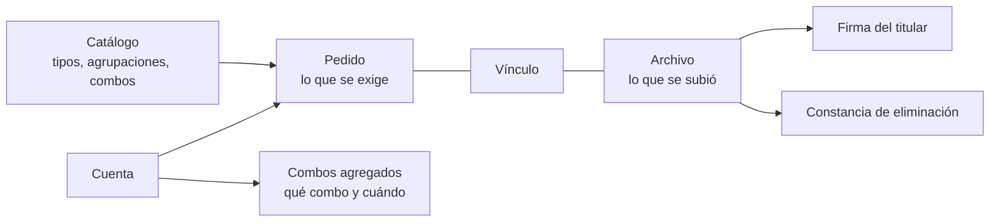
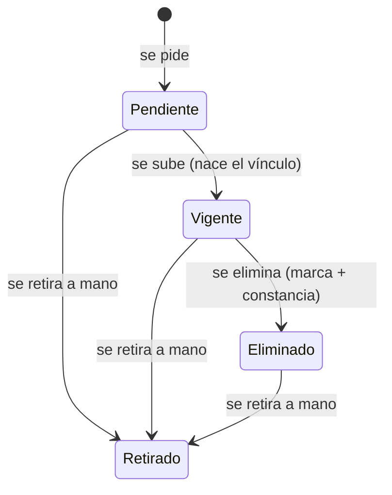

# Explicación: el modelo del expediente de ahorros

> Parte de lógica (paso 1 del [flujo de feature](../../../guia/flujo-de-feature.md)). La parte de código se agrega después de la entrevista.
> Referencia: [modelo contable remodelado](../../../contabilidad/archivos-contabilidad/remodelacion-bd/EXPLICACION.md). Acá solo va lo que cambia o lo que hay que tener presente en ahorros.

## Quién participa

| Pieza | Qué es en negocio |
|---|---|
| **Cuenta** | El dueño del expediente: un CDT, un ahorro a la vista o un aporte. Todas son el mismo tipo de registro |
| **Titular** | La persona de la cuenta. Es de quien se piden los documentos y quien firma |
| **Catálogo** | Qué documentos existen (tipos), cómo se agrupan y qué combos los reúnen. Se configura una vez (feature 2) |
| **Pedido** | "A esta cuenta le falta este documento". Se crea al agregar un combo o un documento suelto |
| **Archivo** | Lo que efectivamente se subió. Vive en su propia tabla de ahorros, aparte de crédito y contabilidad ([ADR-001](./ADR.md)) |
| **Vínculo** | Une un pedido con el archivo que lo cumple. No tiene banderas: existe o no existe |

## El modelo en una mirada

## El estado se calcula, no se guarda

Igual que contabilidad. De mirar pedido, vínculo y archivo sale el estado, **una fila por pedido y archivo** (es un historial):

| Estado | Cuándo |
|---|---|
| Pendiente | pedido activo y **nunca** tuvo vínculo |
| Cargado vigente | tiene vínculo y el archivo no está eliminado |
| Cargado eliminado | tiene vínculo y el archivo está marcado eliminado |
| Retirado | alguien apagó el pedido a mano |

Un pedido recibe **un solo archivo en su vida**. Eliminado no vuelve a pendiente: para cargar de nuevo se crea **otro pedido** (al eliminar se ofrece, igual que crédito).

## Qué toca cada acción

Nunca se borra una fila.

| Acción | Pedido | Vínculo | Archivo | Constancia |
|---|---|---|---|---|
| Pedir (combo o suelto) | nuevo | — | — | — |
| Subir | sin cambios | nuevo | nuevo, vigente | — |
| Eliminar, "crear nuevo" = Sí | sin cambios + uno nuevo | sin cambios | marcado eliminado | nueva |
| Eliminar, "crear nuevo" = No | sin cambios | sin cambios | marcado eliminado | nueva |
| Retirar el pedido | apagado | sin cambios | sin cambios | — |

## Lo propio de ahorros

1. **La cuenta no se puede borrar si tiene pedidos.** En contabilidad, si se borra el comprobante, sus pedidos caen con él. Acá la base lo impide: una cuenta con expediente no desaparece (el mensaje amable llega en la feature 9).
2. **Dos formas de vencer**, como contabilidad. Si un tipo de documento vence, vence por **una sola** de estas:
   - fecha que se escribe a mano al subir,
   - N días después de subirlo.

   La base rechaza un tipo que "vence" sin regla o con dos reglas. "N días después del fin de la cuenta" (de crédito) **no entra por ahora**: no sabemos si hace falta ([P3](./ANALISIS.md)).
3. **Formato personalizado**: un tipo puede tener un formato asociado; se usa en la feature 8. Hoy solo se deja la tabla.
4. **Ruta propia**: en la parametrización de carpetas se agrega la marca "carpeta de ahorros", como existe la de contabilidad.

## Qué NO hace esta feature

Sin pantallas, sin menú, sin permisos, sin código C#. Solo los scripts del modelo y la vista de estado, que el usuario revisa y corre.
