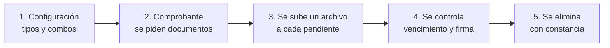
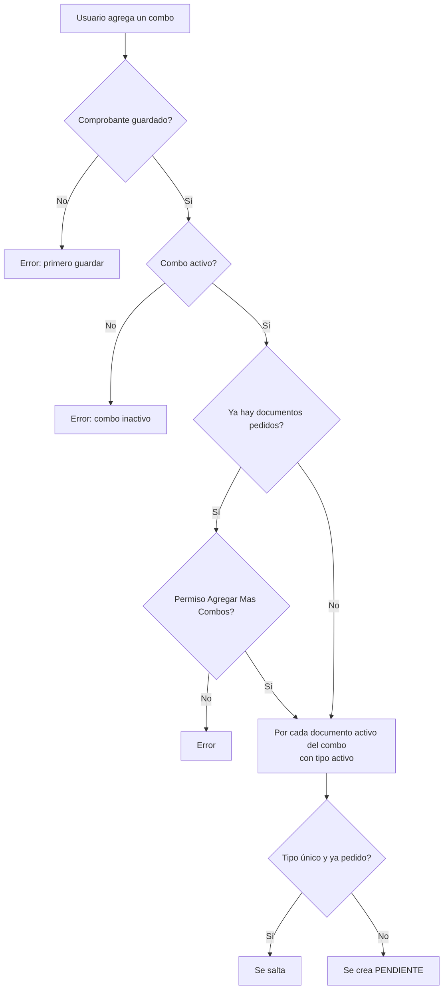
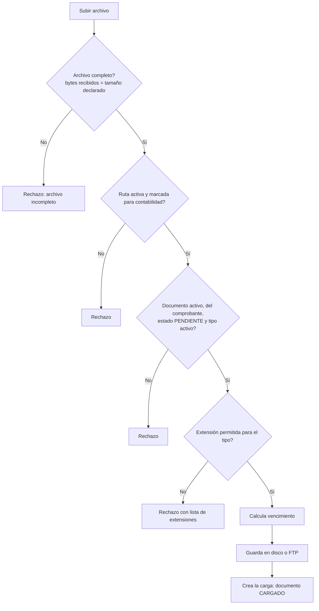
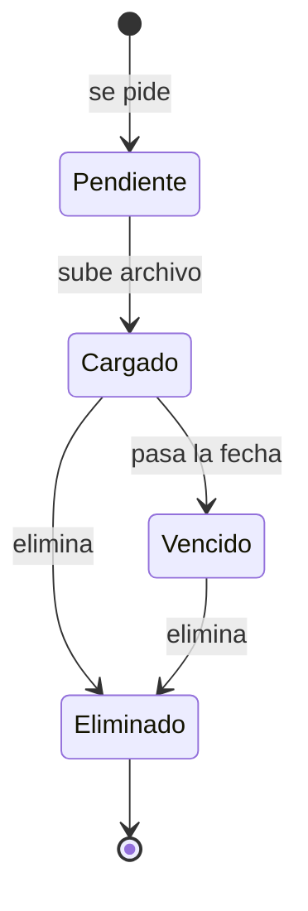

# Documentos de un comprobante contable: cómo funciona

Referencia de cierre. Cada comprobante contable puede pedir documentos (RUT, factura, soporte de pago...), el usuario los sube, y el sistema controla su vencimiento, su firma y su eliminación. Todo se comporta como en crédito, salvo seis diferencias a propósito ([sección 11](#11-diferencias-a-propósito-con-crédito)).

> **Ojo con los permisos.** Agregar más de un combo, agregar o editar documentos sueltos y eliminar archivos solo los puede hacer quien tenga el permiso correspondiente, en pantalla y en el servidor. Ver [sección 10](#10-permisos).

Verificado contra el código de la rama `feature/contabilidad-detalle-constancia-eliminacion` y las notas de las seis features del módulo, el 2026-10-19. Lo que **no** tiene prueba en la app está marcado en la [sección 13](#13-estado-de-cierre).

## 1. El recorrido en 30 segundos

| Paso | Quién | Qué pasa |
|---|---|---|
| 1 | Contabilidad | Define los **tipos de documento** y los arma en **combos** |
| 2 | Usuario del comprobante | Agrega un combo o un documento suelto. Cada documento nace **pendiente** |
| 3 | Usuario | Sube un archivo a un pendiente. El sistema valida y el documento pasa a **cargado** |
| 4 | Sistema | Calcula **vencido** por fecha. Si el tipo lo exige, el documento se envía a **firma electrónica** |
| 5 | Usuario con permiso | Elimina con observación. Queda una **constancia** y el documento queda **eliminado** |

## 2. Conceptos

| Concepto | Qué es | Ejemplo |
|---|---|---|
| **Agrupación** | Solo ordena los tipos de documento | "Documentos del proveedor" |
| **Tipo de documento** | Un documento que se puede pedir, con sus reglas | "RUT" |
| **Combo** | Un paquete de tipos que se piden de una vez | "Expediente de compra" |
| **Documento del combo** | Un tipo dentro de un combo, con su propio "obligatorio" y "activo" | "RUT" dentro de "Expediente de compra" |
| **Documento solicitado** | La línea concreta que pide un comprobante. Tiene estado | "RUT" pedido en el comprobante 168816 |
| **Carga** | La unión entre un solicitado y su archivo. Solo hay una activa por documento | |
| **Archivo** | El fichero en disco o FTP, con su fecha de vencimiento | |

## 3. Configuración

Pantalla de configuración (`expediente-virtual-configuracion`). **Nada se borra: se inactiva**, y el filtro "Activos / Todos" lo muestra u oculta. Así no se rompe lo ya usado en comprobantes viejos.

**Reglas de un tipo de documento**

| Campo | Efecto |
|---|---|
| Expira | Tiene vencimiento. Sin esto, las dos opciones siguientes no aplican |
| Fecha manual | Quien sube escribe la fecha de vencimiento |
| Días desde el cargue | El vencimiento es N días después de subir. **No se combina con fecha manual** |
| Documento único | Solo uno activo por comprobante (ver R11) |
| Firma electrónica | El documento se firma; solo acepta PDF |
| Foto | Solo acepta imágenes |
| Formato personalizado | Habilita plantillas (se guardan, pero **nadie las usa todavía**) |
| Activo | Inactivo: ya no se ofrece ni se ve en Pendientes |

**Reglas de un combo:** un combo "para firmar" solo acepta tipos con firma electrónica; un tipo no se repite dentro del mismo combo.

**Dos "activo" por documento del combo:** el del documento dentro del combo y el del tipo en su catálogo. Un documento se pide solo si **las dos** están activas.

## 4. Pedir documentos

- Todo el combo se agrega **todo o nada** (una transacción).
- El mismo combo se puede agregar más de una vez (R2). Un combo agregado no se quita (R1): los documentos que sobran se inactivan de a uno.
- **Documento suelto:** exige comprobante guardado, tipo activo, el permiso *Agregar Documentos Individuales* (R15) y que no repita un tipo único. Nace obligatorio y sin combo de origen. Sin permiso, el servidor responde 403, no solo la pantalla.
- El "obligatorio" **solo informa** (asterisco): no bloquea nada.

## 5. Subir un archivo

Solo sobre un documento **pendiente**. Todas las validaciones corren en el servidor (`DocumentoContableArchivoController.SubirArchivo`), con datos leídos de la base, no con lo que mande el navegador:

**Extensiones permitidas (R6).** Dependen solo de las marcas del tipo:

| Si el tipo es... | Se acepta |
|---|---|
| Firma electrónica | Solo `.pdf` |
| Foto | `.jpg`, `.jpeg`, `.png` |
| Ninguno | `.pdf .jpg .jpeg .png .doc .docx .xls .xlsx .xml .zip .rar .7z .txt` |

La pantalla de subida recibe esa lista (`Extensiones`) para orientar al usuario, pero el servidor **la recalcula** al validar. Límite: se revisa solo la extensión del nombre, no el contenido real del archivo.

**Vencimiento (R8).** No expira: sin fecha. Manual: obligatoria y no anterior a la fecha del sistema. Por días: fecha del sistema más esos días.

**Un archivo por documento (R5).** Para cambiarlo se elimina con "recrear" y se sube al documento nuevo. No existe "reemplazar".

## 6. Estados y pestañas

**Vencido no se guarda: se calcula** (cargado con vencimiento anterior a la fecha del sistema). Lo guardado es `PENDIENTE`, `CARGADO` y `ELIMINADO`. Un eliminado nunca vuelve a pendiente ni a cargado.

| Pestaña | Muestra |
|---|---|
| **Pendientes** y selector de subida | Solicitado activo, estado `PENDIENTE` y tipo activo |
| **Cargados / Cargados (Remoto)** | Carga activa y archivo no eliminado; separados por si está en FTP. Se edita la descripción del archivo |
| **Vencidos** | Activos, cargados y con vencimiento pasado |
| **Solicitados** (en la solicitud) | Todos, con estado visible |
| **Eliminados** (en la solicitud) | Historial: quién, cuándo y por qué |

Inactivar un documento lo saca de Pendientes y Vencidos; si ya estaba cargado, sigue en Cargados.

## 7. Cómo se arma la lista de pendientes

Una sola consulta SQL: `DocumentoContableSolicitadoActor.ObtenerPendientesPorIddocumentocontable`. Cruza el solicitado con su tipo (`INNER JOIN`), aplica las tres reglas en el `WHERE` y ordena por id. El controlador solo calcula `Extensiones` (la regla vive en `Negocio/`, y `Blip.Data` no puede llamarla). Antes eran dos lecturas y tres filtros en memoria; el JSON no cambió (comparado byte a byte). Detalle: [`consultas-documentos-sql`](./consultas-documentos-sql/IMPLEMENTACION.md).

## 8. Firma electrónica

Un documento cargado de un **tipo con firma** se envía a firmar desde el botón *Firmar* de la grilla de Cargados.

1. Solo PDF.
2. El archivo debe estar ligado a un documento contable.
3. El **firmante** es el tercero del documento solicitado (`idtercero`). Sin tercero, error.
4. VozData envía y firma; el archivo se reemplaza por `FIRMADO-...` y se guarda el vínculo en `firmas_firmaarchivocontable`.

El botón cambia de color según el estado de la firma. Quitar la firma a un tipo que está en un combo "para firmar" da error 400. Detalle: [`firma-documentos-contables`](./firma-documentos-contables/IMPLEMENTACION.md).

## 9. Eliminar y la constancia

Exige el permiso *Eliminar Documentos Cargados Contabilidad* (R14). Se elige uno o varios archivos, una observación y si se **recrea**.

- **Una constancia por acción**, no por documento: 3 archivos marcados = 1 constancia.
- **Nada se borra de la base**: el archivo queda marcado eliminado y ligado a la constancia, la carga queda inactiva, se guarda historial y el documento queda `ELIMINADO`. Solo el archivo físico se borra, sin recuperación.
- **Recrear** no revive el eliminado: crea **otro** documento `PENDIENTE` con el mismo tipo, combo, descripción, obligatorio y tercero.
- Todo corre en una transacción. Al final se actualiza el volumen de almacenamiento.
- El **acta y el detalle** de la constancia leen la vista `contabilidad_vistaarchivoseliminados`.

Detalle y casos raros: [`ELIMINACION.md`](./ciclo-documentos/ELIMINACION.md).

## 10. Permisos

**Tres acciones solo las puede hacer quien tenga el permiso:** agregar más de un combo, agregar o editar documentos sueltos, y eliminar archivos. El resto (subir, ver, editar la descripción de un archivo) no pide permiso propio.

Cada permiso es una *acción de funcionalidad* asignada a un rol. El sistema busca las acciones del usuario y exige que la acción esté **activa**. Sin permiso pasan dos cosas, siempre las dos:

1. **La pantalla** oculta o bloquea el control.
2. **El servidor** rechaza la petición aunque llegue directo, sin pasar por la pantalla.

| Permiso | Qué bloquea | En pantalla | Si llega directo al servidor |
|---|---|---|---|
| **Agregar Mas Combos Documento Contable** (R13) | Agregar un combo a un comprobante que **ya tiene documentos pedidos** | Selector y botón de agregar combo bloqueados | Error "Ya ha sido agregado un combo para este comprobante" |
| **Agregar Documentos Individuales Documento Contable** (R15) | Agregar **y editar** documentos sueltos en la grilla de solicitados | Grilla sin agregar ni editar | HTTP 403 "No tiene permiso para agregar o editar documentos." (`Post` y `Put`) |
| **Eliminar Documentos Cargados Contabilidad** (R14) | Eliminar archivos cargados | Botón "Eliminar seleccionados" oculto | Error "No tiene permisos para eliminar documentos" |

**Detalles que importan**

- **Excepción del primer combo.** Si el comprobante todavía no tiene ningún documento pedido, **cualquiera** puede agregar el primer combo. El permiso solo se pide desde el segundo. Cuenta como "ya tiene documentos" cualquier solicitado, venga de un combo o se haya agregado a mano.
- **Los documentos sueltos no tienen esa excepción.** Sin el permiso no se agrega ni el primero ni se edita ninguno.
- **Son permisos independientes.** Tener el de combos no da el de documentos sueltos, ni al revés.
- **Eliminar** es el único que exige permiso para una acción destructiva; ver [sección 9](#9-eliminar-y-la-constancia).

**Nombres técnicos** (para asignarlos o buscarlos en la base)

| Permiso | Ruta de la funcionalidad | Acción |
|---|---|---|
| Combos | `~/DocumentoContableCombo/AgregarCombo` | `AgregarMasCombosDocumentoContable` |
| Documentos sueltos | `~/DocumentoContableCombo/AgregarDocumentoIndividual` | `AgregarDocumentosIndividualesDocumentoContable` |
| Eliminar | `~/DocumentoContableArchivo/BorrarDocumentosSeleccionados` | `EliminarDocumentosCargadosContabilidad` |

**Alta del permiso de documentos sueltos.** El script `9-permiso-documentos-individuales-contabilidad.sql` crea la funcionalidad y la acción, y la asigna a los roles que ya tenían activo "Agregar Mas Combos Documento Contable". Es idempotente y se corre **antes** de publicar el código; si no, nadie podría agregar documentos sueltos. En la base de demo lo recibió un rol (`03`).

**Qué no pide permiso propio** (según el código revisado): subir un archivo, ver un archivo, editar la descripción de un archivo cargado (igual que crédito) y enviar a firmar. Cualquier usuario con acceso a la pantalla puede hacerlo. No revisé permisos de la pantalla de configuración de tipos y combos.

## 11. Diferencias a propósito con crédito

Crédito es la fuente de verdad. Estas seis se mantienen (ADR-001 de [`ciclo-documentos`](./ciclo-documentos/ADR.md)); cualquier otra necesita un ADR nuevo.

| # | Contabilidad | Crédito |
|---|---|---|
| DP1 | Cada documento del combo dice si es obligatorio | Todo nace obligatorio |
| DP2 | Un tipo único no se repite en el comprobante | Se puede repetir (defecto) |
| DP3 | Recrear copia descripción y obligatorio | El nuevo nace vacío |
| DP4 | "Foto" solo acepta imágenes | La marca existe pero no se usa |
| DP5 | 13 extensiones generales | 6 |
| DP6 | Vencidos no muestra documentos inactivos | Los muestra |

## 12. Mapa de código

| Qué | Dónde |
|---|---|
| Pantalla de subida y pestañas | `Views/DocumentoContableArchivo/` (`Index`, `_GestionDocumentos`, `_SubirArchivo`, `_PopupObservacion`) |
| Pantalla de combos y solicitados | `Views/DocumentoContableCombo/Index.cshtml`, `DocumentoContableComboController` |
| Subida, validación y eliminación | `DocumentoContableArchivoController`, `Negocio/Contabilidad/DocumentoContableArchivoActorNegocio.cs` |
| Agregar combo | `DocumentoContableComboAsignacionActorNegocio.AgregarCombo` |
| Consultas de solicitados | `Blip.Data/Contabilidad/DocumentoContableSolicitadoActorNegocio.cs` |
| Pestañas (servicios) | `DocumentoContableArchivoWebApiController` (Pendientes, Vencidos), `VistaDocumentoContableCargadosWebApiController` (Cargados, editar descripción) |
| Firma | `Negocio/Firmas/FirmaArchivoContableActorNegocio.cs`, `FirmaArchivoContableController`, `SIIAN.VozData` |
| Constancia | `ConstanciaEliminacionArchivosActorNegocio`, `CreditoMaestroReportesNegocio`, vista `contabilidad_vistaarchivoseliminados` |

## 13. Estado de cierre

**Hecho y verificado en esta rama**
- Lista de pendientes en una sola consulta: casos A, C y D comparados byte a byte antes y después; B probado a mano. Dos commits en `SIIAN` (`50348040d`, `9ec22b4d6`).
- Firma electrónica: implementada y probada a mano.
- C1 (archivo incompleto) y C2 (solo se carga un pendiente): hechos y compilados, **sin pruebas manuales** por decisión (cambios pequeños).

**Sin prueba manual con evidencia** (se dan por cerrados por decisión del 2026-10-19)
- Pruebas de carga (V, E, P, C, T) de [`expediente-virtual-carga/TAREAS.md`](./expediente-virtual-carga/TAREAS.md).
- Paridad con crédito: B1 (M1-M4), B2 (M2-M5), B3, B4, B5, B6. Ver [`paridad-documentos-credito/IMPLEMENTACION.md`](./paridad-documentos-credito/IMPLEMENTACION.md).

**Huecos conocidos**

| # | Qué | Efecto |
|---|---|---|
| A1 | El controlador conserva un `Delete` generado que borra la relación sin constancia | Ninguna pantalla lo llama |
| A2 | `FirmaArchivoContableWebApiController` es un CRUD generado sin uso | Código muerto |
| A3 | Un combo "para firmar" puede recibir un tipo sin firma: solo lo impide la pantalla | Hueco de validación en servidor |
| A5 | El commit `b89d6bcd0` (formato de eliminación) no está documentado | Falta nota |
| A6 | `VistaArchivosEliminadosWebApiController` y su ViewModel, generados, no los usa ninguna pantalla | Código muerto |
| — | Las plantillas ("formato personalizado") se guardan pero nadie las lee | Fuera de alcance |
| — | Elegir solo plantillas "formato contable" | Pendiente: falta la marca en las plantillas |
| — | La extensión se valida por nombre, no por contenido | Un `.exe` renombrado a `.pdf` pasa |

## 14. Dónde está el detalle

| Tema | Nota |
|---|---|
| Reglas R1-R17 y estados | [`ciclo-documentos/ANALISIS.md`](./ciclo-documentos/ANALISIS.md) |
| Diferencias con crédito | [`ciclo-documentos/ADR.md`](./ciclo-documentos/ADR.md) |
| Eliminación paso a paso | [`ciclo-documentos/ELIMINACION.md`](./ciclo-documentos/ELIMINACION.md) |
| Configuración de tipos y combos | [`expediente-virtual-configuracion/FLUJO.md`](./expediente-virtual-configuracion/FLUJO.md) |
| Carga: mapa de archivos y métodos | [`expediente-virtual-carga/IMPLEMENTACION.md`](./expediente-virtual-carga/IMPLEMENTACION.md) |
| Firma | [`firma-documentos-contables/IMPLEMENTACION.md`](./firma-documentos-contables/IMPLEMENTACION.md) |
| Brechas frente a crédito (B1-B6) | [`paridad-documentos-credito/IMPLEMENTACION.md`](./paridad-documentos-credito/IMPLEMENTACION.md) |
| Consulta única de pendientes | [`consultas-documentos-sql/IMPLEMENTACION.md`](./consultas-documentos-sql/IMPLEMENTACION.md) |
