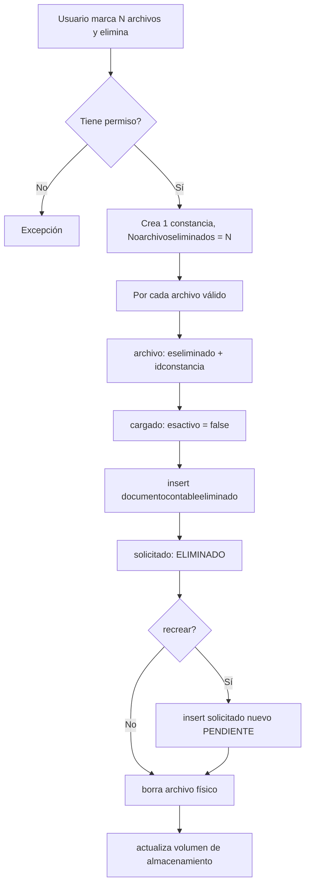

# Flujo de eliminación de documentos contables

Qué pasa cuando alguien elimina archivos cargados en un comprobante contable. Código: `Negocio/Contabilidad/DocumentoContableArchivoActorNegocio.cs`, método `EliminarArchivos(int[] ids, string idUsuario, string observacion, bool recrear = false)`. Todo corre dentro de una transacción (`TransactionManager.ExecuteTransaction`).

## Idea central

- **Una constancia por acción, no por documento.** Si se marcan 3 archivos y se elimina, hay 1 constancia con 3 archivos. Comparten observación, fecha y usuario.
- **Nada se borra de la base.** Se inactiva y se deja historial. Lo único que se borra de verdad es el archivo físico (FTP o disco), sin recuperación.
- **`recrear`** decide si el documento solicitado se vuelve a pedir.

## Paso a paso

1. Valida el permiso `EliminarDocumentosCargadosContabilidad` (ruta `~/DocumentoContableArchivo/BorrarDocumentosSeleccionados`). Sin permiso lanza excepción.
2. Crea **una** `ConstanciaEliminacionArchivos` con observación, fecha, usuario y `ids.Length` en `Noarchivoseliminados`.
3. Por cada `id` de archivo: busca su `DocumentoContableArchivo` y su `Archivo`. Se **salta** el que no tenga relación contable o ya esté eliminado.
4. Por cada archivo válido:

| Tabla | Qué pasa |
|---|---|
| `generales_archivo` | `eseliminado = true`, `idconstanciaeliminacion = constancia.Id` |
| `contabilidad_documentocontablecargado` | `esactivo = false` (la fila se conserva) |
| `contabilidad_documentocontableeliminado` | Se inserta historial: cargado, fecha, usuario, observación |
| `contabilidad_documentocontablesolicitado` | `codigoestadodocumento = "ELIMINADO"` (la fila se conserva) |
| Archivo físico | Se borra: FTP (`BorrarArchivo`) si la URL empieza con `/`; disco si no |

5. Si `recrear = true`: se inserta un solicitado **nuevo** en `PENDIENTE`, copia del eliminado (comprobante, combo, tipo, descripción, obligatoriedad, tercero). El eliminado conserva su carga, archivo e historial. Si `recrear = false`, no se crea otro.
6. Al final actualiza el volumen de almacenamiento (por credencial FTP y local).

## Detalles que sorprenden

- `Noarchivoseliminados` es `ids.Length`, no lo realmente eliminado: si algún archivo se salta, queda mayor que las filas reales.
- La constancia se crea aunque ningún archivo del lote sea válido.
- Un archivo sin fila en `documentocontablecargado` igual se marca eliminado y entra a la constancia, pero no tiene solicitado que cambiar. La vista del acta (`contabilidad_vistaarchivoseliminados`) no lo lista porque hace `JOIN` a `cargado` (caso real: archivo 18319).
- Con `recrear` existen dos solicitados para el mismo comprobante (el `ELIMINADO` con archivo y el nuevo `PENDIENTE` vacío). El acta solo muestra el eliminado.

## Dónde se ve después

- **Acta y detalle de la constancia:** `ObtenerArchivosEliminadosPorConstancia` lee la vista `contabilidad_vistaarchivoseliminados` y se suma a la lista del acta (`CreditoMaestroReportesNegocio.ObtenerValoresParametrosEliminacionArchivos`) y del detalle (`ConstanciaEliminacionArchivosActorNegocio.ContenidoCarpetasVirtuales`). Ver [paridad-documentos-credito](../paridad-documentos-credito/PLAN%20B1.md).
- **Vista sin filtrar `esactivo`:** al eliminar queda en `false`, filtrarlo haría desaparecer la fila.
