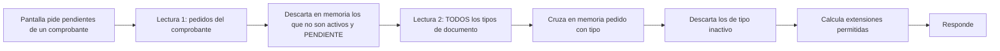
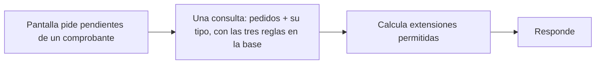

# Explicación: pendientes de un comprobante en una sola consulta

## Parte lógica (sin código)

### Qué es un "pendiente"

Un comprobante contable pide documentos (los "solicitados"). Cada pedido tiene un tipo de documento (`DOCUMENTO 1`, `DOCUMENTO 2`...). Un pedido es **pendiente** cuando cumple las tres cosas a la vez:

1. El pedido está activo.
2. Su estado es `PENDIENTE` (todavía no tiene archivo).
3. Su tipo de documento está activo.

Un pedido eliminado no vuelve a la lista. Si se recreó al eliminar, aparece el pedido nuevo.

La lista alimenta dos pantallas: la pestaña "Pendientes" y el selector "Documento" del popup de subida.

### Cómo se arma hoy

Dos lecturas a la base y tres filtros en C#. Las reglas están repartidas: una parte en la base, otra en el código.

### Cómo queda

Una consulta que ya trae el pedido cruzado con su tipo y filtrado. Lo único que sigue en C# es el cálculo de extensiones, porque esa regla vive en `Negocio/` y la capa de datos no puede llamarla.

### Qué no cambia

- Los mismos documentos, con los mismos datos y el mismo orden (ids ascendentes: 32, 33, 34 en el comprobante 168816).
- La respuesta JSON es idéntica. Está capturada en `evidencia/antes-*.json` para compararla después.
- Un comprobante sin pendientes sigue devolviendo `[]` con HTTP 200.

### Qué se mide al terminar

| Caso | Comprobante | Esperado |
|---|---|---|
| A | 168816 | Los 3 pendientes, igual que antes |
| B | 168816 con `DOCUMENTO 1` inactivo | Solo el id 32 |
| C | 168816 | Los 7 eliminados no aparecen |
| D | 168815 | `[]` |

## Parte de código

Pendiente: se escribe en el paso 1.5, después del código.
