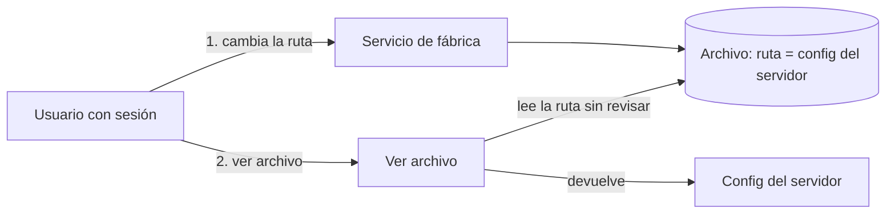
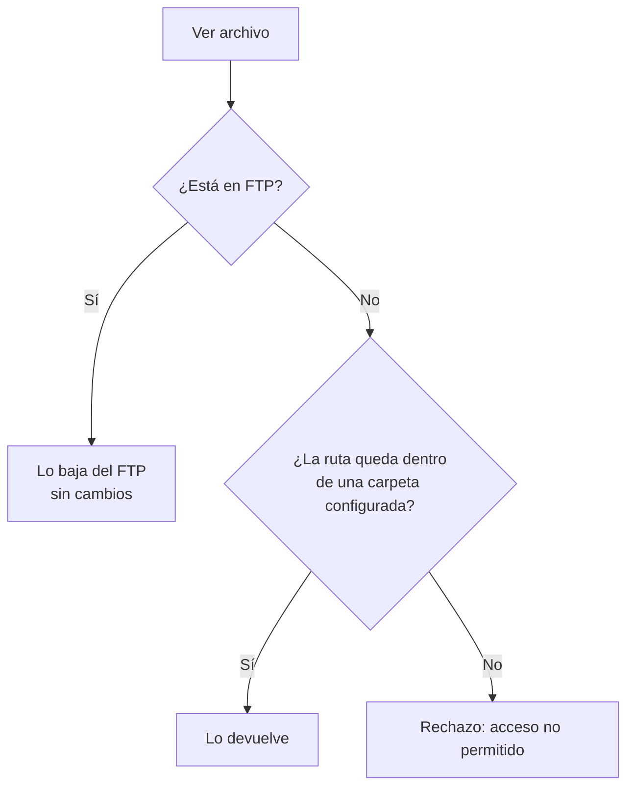
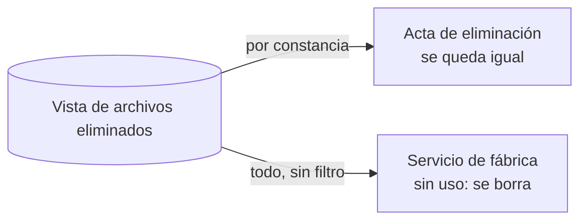

# Explicación: etapa 1

← [PLAN](./PLAN.md#tareas) · Reglas: [R1-R3, R6, R7](../REGLAS-DE-NEGOCIO.md)

Una sección por tarea. T3, T5 y T6 no tienen sección: T3 pasó directo al código por decisión del usuario ("no, pasa directo al codigo"), y T5 y T6 se explicaron en la conversación antes de escribirlas (ver L9, L11 y L13 del PLAN).

## T1: nadie edita un archivo por fuera del expediente

### El problema, en negocio

Cada archivo guarda **dónde está** (su ruta). Esa ruta la escribe el sistema al subir, con un nombre que genera él. Nadie debería poder cambiarla.

Pero quedaron unos servicios "de fábrica" (los que crea la plantilla al generar una tabla) que dejaban a cualquier usuario con sesión:

1. cambiar la ruta de un archivo, marcarlo como no eliminado o sacarlo de su pedido;
2. después usar el botón "ver archivo" del expediente, que abre lo que diga la ruta.

Juntos, permitían pedir **cualquier archivo del servidor**, por ejemplo la configuración con las claves de la base.

### Lo que ya se hizo (parte 1)

Se borraron esos servicios de fábrica en contabilidad (archivo y vínculo pedido-archivo) y en ahorros (archivo). Ninguna pantalla los usaba. Con eso **el paso 1 ya no es posible**: la ruta solo la escribe la subida.

Las pantallas siguen funcionando: cargar rutas, listar pendientes y eliminar usan otros servicios que no se tocaron.

### Lo que falta (parte 2): que "ver archivo" se defienda solo

Es una segunda barrera, por si algún día otra puerta vuelve a dejar escribir la ruta: "ver archivo" solo lee archivos que estén **dentro de alguna carpeta configurada** en Parámetros de Carpeta Virtual. Si la ruta apunta afuera, rechaza.

Se toman **todas** las carpetas locales configuradas, activas o no, porque un archivo viejo puede estar en una carpeta que hoy está inactiva.

### La decisión: dónde poner la barrera

"Ver archivo" es **una sola función que usa todo SIIAN**: crédito, CRM, pagaré, terceros, firmas, buzón tributario, correos, ahorros y contabilidad (21 lugares).

| Opción | Qué protege | Riesgo |
|---|---|---|
| **A. En la función compartida** | Todos los módulos de una vez | Si algún módulo guarda archivos fuera de las carpetas configuradas (buzón tributario y correos no los revisé), "ver" deja de funcionar ahí. Hay que revisar los 21 antes |
| **B. Solo en contabilidad** (ver archivo y firma contable) | El expediente contable y el equivalente | Ninguno fuera de contabilidad. Los demás módulos quedan como hoy |
| **C. No hacerla** | Nada nuevo | La parte 1 ya cerró el ataque conocido; queda sin segunda barrera |

**Recomendación: B.** Cierra la tarea de esta feature sin tocar módulos que no estamos probando. La opción A queda anotada como hallazgo aparte para todo SIIAN.

**Decisión (2026-11-05): C por ahora.** "dejemoslo como hallazgo, por ahora no lo corijamos". Queda como HA1 en [ANALISIS](../ANALISIS.md#hallazgos-anotados-sin-corregir); el caso 3 sale de la prueba.

### Cómo se prueba

| Caso | Qué se hace | Qué debe pasar |
|---|---|---|
| 1 | Llamar a los servicios borrados | No existen (404 o 405) |
| 2 | Subir, ver la lista de pendientes y eliminar en la pantalla | Funcionan igual que antes |
| 3 | En la base de prueba, cambiar la ruta de un archivo contable a una fuera de la carpeta y darle "ver" | Rechazo, no muestra el contenido |
| 3b | "Ver" un archivo contable normal, local y FTP | Lo muestra |

### Parte código (resumen)

- Parte 1, hecha: borrados `ArchivoContableWebApiController`, `ArchivoAhorroWebApiController` (y sus líneas del `.csproj`); quitados `Get`, `Put` y `Delete` de `DocumentoContableArchivoWebApiController`.
- Parte 2, opción B: antes de leer un archivo local en `ArchivoContableAlmacenamientoActorNegocio.VisualizarArchivo` y en la firma contable, validar con `RutaArchivoSegura.AsegurarRutaDentroDe(ruta, carpetas locales configuradas)`. El helper ya existe; no se usa `AsegurarSinTraversal` porque solo bloquea `..`, y una ruta como `~/Web.config` no lo tiene.

## T2: el listado general de eliminados no queda expuesto

### El problema, en negocio

Cuando se eliminan archivos de un comprobante, el sistema guarda una **constancia**. El **acta** de esa constancia lista los archivos eliminados, y se arma desde una vista de la base que junta comprobante, documento equivalente, tipo de documento, tercero, quién eliminó y por qué.

Esa misma vista tiene además un servicio "de fábrica" (de la plantilla) que devuelve **todos** los archivos eliminados de **todos** los comprobantes, sin pedir de qué comprobante es. Ninguna pantalla lo usa. Cualquier usuario con sesión podría llamarlo y ver nombres de archivos, terceros con su identificación y observaciones de eliminación de comprobantes que no le corresponden.

### Qué cambia

- Se borra el servicio de fábrica y su modelo de pantalla, que solo usaba ese servicio.
- **No se toca** la vista de la base ni su lectura por constancia: el acta sigue saliendo igual.
- En ahorros no hay servicio equivalente; no hay nada que hacer.

Para el usuario no cambia nada visible: no había pantalla que lo usara.

### Cómo se prueba

| Caso | Qué se hace | Qué debe pasar |
|---|---|---|
| 4 | Llamar al listado general de eliminados | No existe (404), no lista nada |
| 4b | Generar el acta de una constancia contable | Sale igual que antes |

### Parte código (resumen)

- Se borra `PruebaPostgreSQL/Controllers/WebApi/VistaArchivosEliminadosWebApiController.cs` (solo tiene `Get`, sin filtro de dueño) y `Blip.Entities/Contabilidad.ViewModels/VistaArchivosEliminadosViewModel.cs` (solo lo usa ese controlador), con sus líneas en los `.csproj`.
- Se quedan `VistaArchivosEliminados`, `VistaArchivosEliminadosActor` y `...ActorNegocio` en `Blip.Data/Contabilidad/`: los usa `DocumentoContableArchivoActorNegocio` (`ObtenerPorConstancia`).
