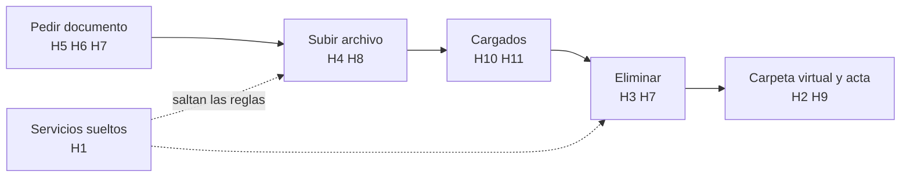

# Análisis: correcciones del expediente virtual contable

← [README](./README.md) · Hallazgos en [REQUERIMIENTO.md](./REQUERIMIENTO.md)

Qué pasa hoy en cada punto, cómo lo hace crédito (referencia) y si ahorros ya lo resolvió. Leído en el código y en la base de demo el 2026-11-05; nada ejecutado en la app.

## Qué hacen hoy los tres módulos

| # | Contabilidad hoy | Crédito | Ahorros |
|---|---|---|---|
| H1 | Quedaron servicios generados por plantilla que dejan editar cualquier archivo (ruta, eliminado) o soltar un archivo de su pedido, solo con sesión iniciada. Cambiar la ruta y luego "ver" el archivo permite descargar archivos del servidor | No tiene servicio sobre su vínculo; al ver un archivo controla que la ruta no se salga de la carpeta | Mismo servicio expuesto |
| H2 | Un listado de todos los archivos eliminados, de todos los comprobantes, sin filtro; ninguna pantalla lo usa | Su historial de eliminados se pide siempre por crédito | — |
| H3 | Eliminar marca la base y borra el físico dentro de la misma transacción. Si falla el FTP a mitad del lote, la base se revierte pero los físicos ya borrados no vuelven | Igual que contabilidad | **Resuelto**: confirma la base primero y borra después; si falla el borrado avisa "eliminados, pero no se pudo borrar el archivo físico" |
| H4 | Guarda el físico, luego registra archivo y vínculo sin transacción. Si falla el registro, el físico queda huérfano. Nada impide dos archivos en un mismo pedido si se sube dos veces a la vez | Igual: sin transacción, sin limpieza | **Mitad**: si falla el registro borra el físico (local y FTP), pero tampoco usa transacción |
| H5 | Reactivar un pedido retirado no revisa el documento único: pueden quedar dos pedidos activos del mismo tipo único | No tiene la regla de tipo único por crédito (DP2) | **Resuelto**: si se reactiva y el tipo es único y ya hay otro activo, rechaza "Este tipo de documento es unico y ya esta solicitado" |
| H6 | Al agregar un documento suelto toma el "activo" que mande el navegador: se puede crear un pedido inactivo | Nace activo | **Resuelto**: lo fuerza activo |
| H7 | Al eliminar sin recrear, el pedido sigue activo con su archivo eliminado. Como "ya hay un pedido activo de ese tipo", el tipo único no se puede volver a pedir a mano ni por combo. Antes de la remodelación los eliminados no contaban | En crédito "documento único" significa otra cosa: al subir, inactiva los archivos anteriores del mismo pedido. No impide repetir el tipo | Mismo error al pedir a mano; al **recrear** solo cuenta pedidos pendientes |
| H8 | El cálculo del espacio local usado no incluye los archivos contables: se puede pasar el límite. Antes de la remodelación sí se contaban | Sus archivos sí se cuentan | Mismo hueco |
| H9 | La carpeta virtual (EV101 eliminar y acta, EV201 consulta) solo junta terceros, créditos y CRM | Aparece en las tres pestañas | Mismo hueco |
| H10 | Si se retira un pedido que ya tenía archivo, el archivo desaparece de Cargados: no se puede ver, firmar ni eliminar hasta reactivar | Lo sigue mostrando | Igual que contabilidad |
| H11 | Se decidió recrear la vista de solicitados con una fila por pedido y sin filtrar tipos inactivos, pero el script no está y la base tiene la versión anterior | Filtra tipos inactivos | Sin cambio (R12) |

## Flujo afectado

## Reglas

| R | Regla | Porqué | Estado |
|---|---|---|---|
| R1 | Un archivo contable solo se modifica por las acciones del expediente (subir, editar descripción, eliminar, firmar); no hay servicio genérico de edición | Las acciones validan permiso, dueño y dejan historial; un servicio genérico las salta | Confirmada |
| R2 | Ver un archivo solo lee dentro de la carpeta configurada | Una ruta manipulada no debe exponer archivos del servidor (como crédito) | Anotada, no se corrige por ahora (HA1) |
| R3 | Al eliminar, primero se confirma la base y después se borran los físicos; si falla el borrado se avisa sin revertir | Mejor un archivo huérfano en disco que un registro vigente sin archivo (como ahorros) | Confirmada |
| R4 | Subir registra archivo y vínculo todo o nada; si el registro falla se borra el físico | No dejar archivos huérfanos ni registros a medias | Confirmada |
| R5 | Un pedido tiene a lo sumo un archivo, también si se sube dos veces a la vez | Regla R5 del área; hoy solo la cuida la pantalla | Por confirmar (restricción en base) |
| R6 | Reactivar un pedido de tipo único se rechaza si ya hay otro activo del mismo tipo | Mantiene DP2 (como ahorros) | Confirmada |
| R7 | Un documento suelto nace activo | Igual que crédito y ahorros | Confirmada |
| R8 | Después de eliminar sin recrear, el tipo único se puede volver a pedir | Si no, el usuario queda bloqueado sin salida | Reemplazada (2026-11-05): eliminar retira el pedido, ver [eliminar-retira-pedido](../eliminar-retira-pedido/ANALISIS.md#reglas) || R9 | Los archivos contables cuentan en el espacio local usado | El límite debe ser real (como crédito) | Confirmada |
| R10 | La carpeta virtual muestra, elimina y consulta archivos contables y de documento equivalente | Paridad con crédito | Por confirmar alcance (necesita un tipo de carpeta propio porque los ids de archivo contable chocan con los generales) |
| R11 | Cargados muestra también los archivos de pedidos retirados | Crédito los muestra; si no, quedan sin forma de verlos ni eliminarlos | Confirmada (2026-11-05) |
| R12 | La lista de solicitados no muestra los tipos inactivos | Igual que crédito | Confirmada (2026-11-05): se queda el filtro, no hay script 17 |

Ahorros comparte H4 (transacción), H7, H8, H9 y H10, y el servicio expuesto de H1 (ya borrado). Se anotan; esta feature corrige contabilidad.

## Hallazgos anotados sin corregir

| # | Hallazgo | Por qué no ahora |
|---|---|---|
| HA1 | "Ver archivo" (la función que usa todo SIIAN, 21 lugares) abre la ruta guardada sin revisar que esté dentro de una carpeta configurada. Una ruta manipulada podría exponer archivos del servidor | Decisión del usuario (2026-11-05). El ataque conocido ya se cerró al borrar los servicios de fábrica (T1). Ponerla en la función compartida podría romper módulos que guardan fuera de las carpetas configuradas (buzón tributario, correos: sin revisar). Detalle y opciones en [EXPLICACION-T1](./EXPLICACION-T1.md#la-decisión-dónde-poner-la-barrera) |
