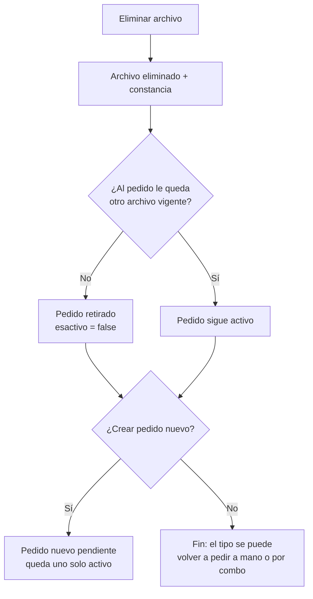

# Análisis: eliminar un archivo retira su pedido

← [README](./README.md)

## Qué pasa hoy

Los dos módulos usan el mismo modelo: **pedido → puente → archivo**. El estado (pendiente, cargado, eliminado) no se guarda: lo calculan las vistas a partir de `pedido.esactivo` y `archivo.eseliminado`.

| Punto | Contabilidad (comprobante y equivalente) | Ahorros |
|---|---|---|
| Eliminar | Marca el archivo como eliminado y deja una constancia. **El pedido sigue activo** | Igual |
| "Ya está solicitado" (tipo único) | Cuenta los pedidos activos, sin mirar si el archivo fue eliminado | Igual |
| Recrear ("Sí") | Crea un pedido nuevo **sin validar el tipo único**: quedan dos activos | Crea el pedido nuevo salvo que ya haya otro **pendiente**. El viejo sigue activo (excepción a R14 anotada en R30 de ahorros) |
| Pestaña Eliminados | Solo muestra archivos de **pedidos activos** | Igual |
| Reactivar un pedido retirado | Permitido; un tipo único solo si no hay otro activo (T5 de correcciones) | Igual (R31 de ahorros) |

### Por qué pasó

El diseño original de contabilidad ya lo decía (script `11-ajustes-documentocontable.sql`, línea 4): *"Eliminar un archivo: archivo.eseliminado = true + constancia + solicitado.esactivo = false"*. Al programarlo se dejó el pedido sin tocar ("El pedido y el puente no se tocan"), y no quedó escrito por qué. Ahorros se armó con contabilidad como plantilla y heredó lo mismo. Antes de la remodelación el pedido tenía su propio estado `ELIMINADO`, que lo sacaba de la cuenta.

## Flujo nuevo

## Reglas

| R | Regla | Porqué | Estado |
|---|---|---|---|
| R1 | Eliminar un archivo **retira su pedido** cuando al pedido no le queda ningún archivo vigente | El pedido ya no tiene nada vivo: deja de contar como "ya solicitado" y no queda un pedido activo con un archivo muerto | ✅ confirmada (2026-11-05) |
| R2 | Con "Sí" nace un pedido nuevo pendiente, igual que hoy. Con R1, queda **uno solo activo** del tipo | Volver a subir el documento sin duplicar | ✅ (ya existía) |
| R3 | La pestaña **Eliminados** muestra el archivo aunque su pedido esté retirado | Es la historia del documento: sí hubo un archivo y se eliminó con constancia | por confirmar |
| R4 | Un pedido cuyo archivo fue eliminado **no se reactiva**: si se necesita otra vez, se pide de nuevo | Reactivarlo lo dejaría activo con un archivo muerto y volvería el bloqueo | por confirmar |
| R5 | Los pedidos que hoy están activos con todos sus archivos eliminados se retiran con un script, una sola vez | Si no, siguen bloqueando su tipo único | por confirmar |
| R6 | "Ya está solicitado" sigue contando los pedidos activos (la consulta no cambia) | Con R1 los activos son exactamente los vivos: pendientes o con archivo vigente | ✅ consecuencia de R1 |

### Reglas de ahorros que cambian

- **R29** (eliminar no devuelve el pedido a pendiente) **se mantiene**: el pedido retirado sigue mostrándose "cargado eliminado".
- **R30**: la excepción a R14 ("el pedido del archivo eliminado sigue activo y no cuenta como duplicado") deja de hacer falta.
- **R31**: retirar deja de ser **solo** a mano; eliminar el último archivo vigente también retira.

Se actualizan en `ahorrosyaportes/archivos-ahorros/REGLAS-DE-NEGOCIO.md` cuando se haga la tarea de ahorros.
