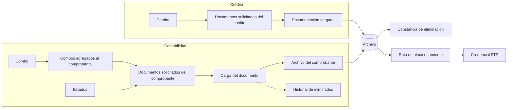
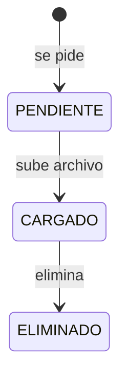

# Análisis — Cómo se manejan hoy los documentos de un comprobante contable, frente a crédito

> **Historia.** Secciones 2 a 5 superadas; se conserva por el mapa de tablas (1) y "obligatorio" (3). Vigente: [ciclo-documentos/ANALISIS.md](../ciclo-documentos/ANALISIS.md).

> Estado: **decisiones tomadas** (sección 5). Las secciones 1 a 4 describen el sistema actual; la 5 fija qué se hace en contabilidad.
> Plan por fases: [`PLAN.md`](./PLAN.md). Configuración de documentos (la parte anterior): [`../expediente-virtual-configuracion/ANALISIS.md`](../expediente-virtual-configuracion/ANALISIS.md).
> Verificado contra el código y la base demo el 2026-10-01 (en demo ya está aplicado el cambio de "seleccionado" a "obligatorio").

## En una frase

Los dos módulos hacen lo mismo (se **piden** documentos, se **suben** archivos, se **eliminan**), pero lo modelan distinto: **crédito no guarda el estado de un documento, lo deduce** de si tiene archivo; **contabilidad sí guarda el estado** y además lleva tablas propias para la carga y para el historial de eliminados.

---

## 1. Qué tablas intervienen

### 1.1 Mapa

### 1.2 Configuración (qué se puede pedir)

| Concepto | Crédito | Contabilidad |
|---|---|---|
| Agrupación | `credito_agrupaciondocumentocredito` | `contabilidad_agrupaciondocumentocontable` |
| Tipo de documento | `credito_documentocredito` | `contabilidad_documentotipo` |
| Formatos asociados al tipo | `credito_documentocreditoformato` | `contabilidad_documentotipoformato` |
| Extensiones permitidas | No existe (se escriben fijas en pantalla) | `contabilidad_documentotipotipossoporte` |
| Combo | `credito_combodocumentocredito` | `contabilidad_combodocumentotipo` |
| Documentos del combo | `credito_documentoscreditocombo` (tipo, activo) | `contabilidad_combodocumentocontable` (tipo, activo y **obligatorio**) |

### 1.3 Uso (lo que pasa en un crédito o en un comprobante)

| Concepto | Crédito | Contabilidad |
|---|---|---|
| Documento pedido | `credito_documentocreditocredito`: crédito, tipo, descripción, obligatorio, activo, tercero, respuesta del cargue | `contabilidad_documentocontablesolicitado`: comprobante, combo de origen, tipo, descripción, obligatorio, activo, **estado** |
| Combos agregados | No se guarda cuál combo se agregó | `contabilidad_documentocontablecombo`: comprobante y combo |
| A qué tercero pertenece | `credito_documentocreditotercero` | No aplica |
| Archivo subido | `credito_creditodocumentacion`: documento pedido, archivo y activo. **Una sola tabla** | **Tres tablas** (abajo) |
| Catálogo de estados | No existe | `contabilidad_estadodocumentocontable`: PENDIENTE, CARGADO, ELIMINADO |

Las tres tablas de la carga contable:

| Tabla | Qué guarda |
|---|---|
| `contabilidad_documentocontablearchivo` | Puente comprobante ↔ archivo: tipo de adjunto, observaciones, usuario y fecha |
| `contabilidad_documentocontablecargado` | Une un documento pedido con ese puente, con su propio "activo" y fecha de cargue |
| `contabilidad_documentocontableeliminado` | Historial: quién eliminó la carga, cuándo y por qué |

### 1.4 Compartido por los dos módulos

| Tabla | Para qué sirve |
|---|---|
| `generales_archivo` | El archivo: nombre, ubicación, **fecha de vencimiento**, activo, **eliminado**, tamaño, credencial FTP si es remoto |
| `generales_constanciaeliminacionarchivos` | Una fila por cada eliminación (observación, fecha, usuario, cuántos archivos) |
| `generales_parametroscarpetavirtual` | Rutas de almacenamiento. Cada ruta se marca para crédito, terceros o contabilidad |
| `generales_credencialesftp` | Acceso a la ruta remota |
| `generales_companias` | La fecha del sistema, contra la que se compara el vencimiento |

---

## 2. Ciclo de vida de un documento

### 2.1 Crédito: el estado se deduce

Crédito no tiene una columna de estado. Lo que se ve en pantalla sale de mirar las tablas:

| Lo que ve el usuario | Cómo se sabe |
|---|---|
| Pendiente | El documento pedido no tiene ninguna fila de documentación |
| Cargado | Tiene documentación con archivo activo |
| Vencido | El archivo tiene fecha de vencimiento anterior a la fecha del sistema y no está eliminado |
| Eliminado | El archivo está marcado como eliminado |

Al eliminar, crédito pregunta si se **crea de nuevo** el documento. Si la respuesta es sí, **inserta una fila nueva** en documentos pedidos (obligatoria y activa) y deja la vieja con su archivo eliminado. Por eso el documento viejo no vuelve a "pendiente": el nuevo es otro registro.

### 2.2 Contabilidad: el estado se guarda

| Transición | Qué toca |
|---|---|
| Se pide | Fila en documentos solicitados con estado PENDIENTE. Viene de un combo o se agrega a mano |
| Sube archivo | Fila en `generales_archivo`, fila puente en el archivo del comprobante, fila (o reactivación) en cargado, y el estado pasa a CARGADO |
| Elimina | Constancia, archivo marcado eliminado, cargado inactivo, fila de historial y estado ELIMINADO. El archivo físico se borra |

Hoy contabilidad **no pregunta si recrear el documento**. Se agrega igual que en crédito: se inserta un documento nuevo (decisión 5.3).

### 2.3 Lo que significa tener el estado guardado

El hecho "este documento está cargado" vive en **tres sitios**: el estado, el "activo" de cargado y el "eliminado" del archivo. Hay que mantenerlos de acuerdo en cada operación. Crédito no tiene ese riesgo porque solo tiene los flags del archivo y de la documentación. A cambio, contabilidad responde más fácil "¿en qué estado está?" y guarda el historial de eliminados.

---

## 3. "Obligatorio"

| | Crédito | Contabilidad |
|---|---|---|
| ¿Existe en la configuración del combo? | **No**. Los documentos de un combo solo tienen tipo y activo | **Sí**, cada documento del combo dice si es obligatorio |
| ¿De dónde sale el valor al pedir el documento? | Siempre obligatorio, salvo el flujo de **convenios**, que lo toma de la configuración del convenio | Se copia del combo; si se agrega a mano, arranca obligatorio |
| ¿Para qué se usa? | Se marca con un asterisco en pendientes. Hay una consulta de obligatorios sin cargar por crédito, y en **convenios** el avance del proceso depende de que estén cargados | Hoy solo se muestra. **No encontré nada que lo exija** |

Dicho de otra forma: en crédito "obligatorio" casi nunca varía y casi siempre es verdadero; en contabilidad **sí puede variar por combo**, pero todavía no tiene consecuencia.

---

## 4. Diferencias que conviene tener presentes

| # | Diferencia | Efecto |
|---|---|---|
| O1 | Crédito deduce el estado; contabilidad lo guarda | Más tablas y más cosas que mantener sincronizadas en contabilidad |
| O2 | Crédito sube a una ruta elegida por el usuario; contabilidad toma la primera ruta marcada como contable, sin orden ni filtro de activa | La ruta puede ser cualquiera. El plan agrega el selector (F3) |
| O3 | Las extensiones permitidas están fijas: en pantalla en crédito, y en pantalla y servidor en contabilidad. Contabilidad tiene además una tabla de tipos de soporte que no se usa al subir | El plan las arma desde el tipo de documento (R6) |
| O4 | En crédito el documento "único" desactiva los archivos anteriores del mismo documento; la carga contable llama a esa misma función con el número del comprobante | Podría desactivar archivos de **un crédito** con ese número (H1 del plan) |
| O5 | Crédito, al eliminar, puede crear un documento nuevo; contabilidad no | Se resuelve igual que crédito: documento nuevo (5.3) |
| O6 | El vencimiento "con fecha manual" se calcula distinto en la pestaña de vencidos de contabilidad | Un documento con fecha manual aparece vencido apenas se carga (R8 del plan) |
| O7 | Contabilidad guarda de qué combo vino cada documento; crédito no | Permite saber el origen y rechazar combos repetidos |

---

## 5. Decisiones

Criterio común: **contabilidad refleja lo que el usuario ya ve en crédito**, sin perder la trazabilidad que contabilidad ya tiene.

### 5.1 "Obligatorio" informa, no bloquea

- Se muestra igual que en crédito: marca visible (asterisco) en pendientes y en la solicitud del comprobante, para que el usuario sepa que el documento es obligatorio.
- **No impide aprobar ni cerrar el comprobante.** Crédito tampoco lo hace (solo convenios ata el avance a los obligatorios) y en contabilidad ninguna regla lo exige hoy.
- Queda disponible el dato (`obligatorio` por documento, copiado del combo) para exigirlo más adelante si negocio lo pide. Eso sería una decisión nueva, no parte de esta feature.

### 5.2 Se mantiene el estado guardado, y se muestran los mismos estados que en crédito

- **Se guarda** PENDIENTE, CARGADO y ELIMINADO. Aporta trazabilidad y responde "¿en qué estado está?" sin recalcular. El costo (tres sitios que mantener de acuerdo) se controla cambiando el estado **solo dentro de las operaciones de subir y eliminar**, en una misma transacción.
- **Lo que ve el usuario** se alinea con crédito: Pendiente, Cargado, **Vencido** y Eliminado. Vencido **no se guarda**: se deduce de la fecha de vencimiento del archivo contra la fecha del sistema, como ya hace crédito.
- Se conserva el historial de eliminados (quién, cuándo y por qué), que crédito no tiene.
- **Cómo se calcula Vencido:** el estado guardado sigue siendo CARGADO aunque el archivo venza; nada se actualiza con el tiempo. Se resuelve en la consulta (Dapper, en `Blip.Data/Contabilidad/...ActorNegocio.cs`) con un único `CASE`: eliminado si el archivo está eliminado; vencido si el estado es CARGADO y la fecha de vencimiento es anterior a la fecha del sistema; si no, el estado guardado. No se crea una vista de base de datos: dejaría la regla en dos sitios.
- **Una sola expresión** para la grilla de solicitados, la pestaña de vencidos y el filtro "solo vencidos". Así se corrige también O6 (la fecha manual calculada distinto en la pestaña de vencidos).

### 5.3 "Recrear" crea un documento nuevo, como en crédito

- Al eliminar con "recrear = sí": el documento viejo queda **ELIMINADO** con su archivo, su carga y su historial intactos; se inserta **una fila nueva PENDIENTE** con el mismo tipo, descripción, obligatorio y combo de origen.
- Con "recrear = no": queda ELIMINADO e inactivo, sin fila nueva.
- **Se elimina la transición ELIMINADO → PENDIENTE.** Un documento eliminado no vuelve: "reactivar" pasa a ser volver a pedirlo desde la solicitud del comprobante (fila nueva).
- Por qué: es el comportamiento de crédito, conserva todo el historial de la fila anterior y evita reciclar una fila cuyo estado, carga y archivo ya dicen otra cosa.

### 5.4 Qué cambia en el plan

| Dónde | Ajuste |
|---|---|
| R9 | "Sí" inserta documento nuevo; deja de "volver a pendientes" el mismo |
| D7 | Sin "recrear": eliminado e inactivo, sin reactivar el mismo |
| F4, paso 9 | "Reactivar" se prueba como pedir de nuevo el documento |
| Diagrama de 2.2 | Quitar la flecha ELIMINADO → PENDIENTE |
| Pantallas | Marca de obligatorio y estado Vencido visibles |
