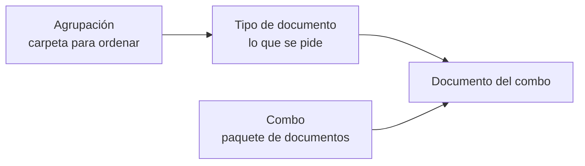
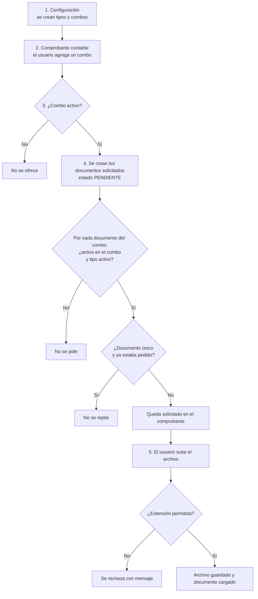

# Flujo — cómo funciona la configuración de documentos contables

> Explicación de negocio, sin código. Para el detalle de reglas: [`ciclo-documentos/ANALISIS.md`](../ciclo-documentos/ANALISIS.md). Para el porqué de cada decisión: [`ANALISIS.md`](./ANALISIS.md).

## La idea en una frase

Cada comprobante contable necesita un **expediente**: un conjunto de documentos que hay que adjuntar (RUT, factura, soporte de pago…). La pantalla de configuración define **qué documentos existen** y **cómo se piden juntos**. Después, el comprobante los pide y el usuario los sube.

## 1. Los cuatro conceptos

| Concepto | Qué es | Ejemplo |
|---|---|---|
| **Agrupación** | Solo ordena los tipos de documento | "Documentos del proveedor" |
| **Tipo de documento** | Un documento que se puede pedir, con sus reglas | "RUT", "Factura de compra" |
| **Combo** | Un paquete de tipos de documento que se piden de una vez | "Expediente de compra" |
| **Documento del combo** | Un tipo de documento metido dentro de un combo | "RUT" dentro de "Expediente de compra" |

El tipo de documento se define **una vez** y se reutiliza en varios combos.

## 2. Reglas de un tipo de documento

| Campo | Qué significa |
|---|---|
| **Expira** | El documento tiene vencimiento. Si no marcás esto, las dos opciones de abajo no aplican |
| **Fecha manual** | Quien sube el documento escribe la fecha de vencimiento |
| **Días desde el cargue** | El vencimiento es N días después de subirlo. **No se combina con fecha manual**: es una cosa o la otra |
| **Documento único** | Se pide una sola vez por comprobante, aunque venga en varios combos |
| **Firma electrónica** | El documento se firma. Habilita que el tipo entre en combos "para firmar" |
| **Foto** | El documento es una foto |
| **Formato personalizado** | El documento usa plantillas. Solo con esto se pueden elegir plantillas |
| **Activo** | Si está inactivo, ya no se ofrece para nuevos usos |

En pantalla: marcar "Expira" habilita fecha manual y días; marcar "Fecha manual" deshabilita los días; desmarcar "Expira" borra ambos.

## 3. Reglas de un combo

- **Para firmar:** el combo solo acepta tipos de documento con firma electrónica.
- **Un tipo una sola vez por combo:** no se puede repetir.
- **Activo (en el documento del combo):** permite sacar un documento de un combo sin borrarlo.

## 4. Nada se borra, se inactiva

Desde esta pantalla no hay botón de borrar. Para retirar algo se **inactiva**, y el filtro "Activos / Todos" lo muestra u oculta. Así no se rompe lo que ya se usó en comprobantes viejos.

Hay **dos "activo" en cada documento del combo**, y por eso confunde:

| Columna | De quién es | Quién lo cambia |
|---|---|---|
| Activo | Del documento **dentro del combo** | Se edita en el combo |
| Tipo activo | Del **tipo de documento** en su catálogo | Solo lectura; se cambia en "Tipos de documento" |

Un documento solo se pide en un comprobante si **las dos** están en sí.

## 5. Recorrido completo: de la configuración al archivo subido

Paso a paso:

1. **Configuración (esta pantalla).** Alguien de contabilidad crea los tipos de documento y arma los combos.
2. **Comprobante.** En la página de documentos del comprobante se agrega un combo. Al agregar solo aparecen combos activos.
3. **Se generan los "documentos solicitados".** Por cada documento del combo que esté activo (y cuyo tipo también esté activo) se crea una línea en estado PENDIENTE. Si el tipo es "documento único" y ya estaba pedido, no se repite.
4. **Se sube el archivo.** El sistema valida la extensión y lo guarda.
5. **Lo ya pedido no desaparece.** Si después se inactiva un tipo, los documentos que ya se habían pedido se siguen viendo con su nombre.

## 6. Qué extensiones se aceptan

Se **quitaron los tipos de soporte**: antes cada tipo de documento decidía qué extensiones aceptaba, y uno sin configurar rechazaba todo. Ahora la extensión depende de las marcas del tipo de documento:

| Si el tipo es... | Se acepta |
|---|---|
| Firma electrónica | Solo pdf |
| Foto | Solo imágenes: jpg, jpeg, png |
| Ninguno de los dos | La lista general: pdf, jpg, jpeg, png, doc, docx, xls, xlsx, xml, zip, rar, 7z, txt |

Crédito tampoco configura esto por tipo. Detalle en la regla R6 de [`ciclo-documentos/ANALISIS.md`](../ciclo-documentos/ANALISIS.md).

## 7. Qué está listo y qué no

| Cosa | Estado |
|---|---|
| Guardar las banderas nuevas (firma, foto, formato personalizado, para firmar) | Hecho |
| Reglas de vencimiento y de no repetir | Hecho |
| Inactivar en vez de borrar, filtro Activos / Todos | Hecho |
| Pantalla igual a crédito | Escrita, falta probar en navegador |
| Los combos y documentos activos se respetan en el comprobante | Escrito, falta probar |
| Elegir solo plantillas "formato contable" | **Pendiente** (falta la marca en las plantillas) |
| **Usar** las banderas de firma y foto al cargar un documento | Hecho: limitan las extensiones (sección 6) |
| **Usar** las plantillas al cargar un documento | **Fuera de alcance**: se guardan, pero nadie las lee |

Por eso, marcar "Firma electrónica" o "Foto" **sí cambia** qué archivos se pueden subir (sección 6). Las plantillas, en cambio, solo dejan la configuración lista para cuando se construya esa parte.
