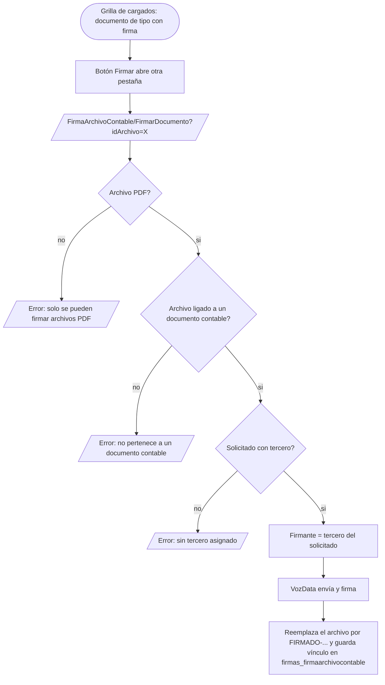

# Implementación — Firma electrónica de documentos contables

> Reference. Refleja el código de la rama `feature/contabilidad-detalle-constancia-eliminacion` al 2026-10-16. La firma entró en los commits `c126b9d75`, `b65dda6ea` y `f51cac4f1` (rama `feature/expediente-virtual-carga-firmas`); `7955091af` volvió a tocar la grilla de cargados sin cambiar la firma. Se actualiza al construir.
> Leyenda: 🟢 hecho, compila y probado a mano.

## Flujo 🟢

El firmante sale de `contabilidad_documentocontablesolicitado.idtercero`. "Firma electrónica" la define el **tipo de documento** (`Esfirmaelectronica`); el flag `Esparafirmar` del combo solo filtra qué tipos se pueden agregar a él.

## Base de datos

Scripts en `C:\Users\User\DataGripProjects\scriptsSiian\contabilidad\scratch\`:

- `6-firma-documentos-contables.sql`: columna `idtercero` en el solicitado, tabla `firmas_firmaarchivocontable` y 4 columnas nuevas al final de `contabilidad_vistadocumentocontablecargados` (`esfirmaelectronica`, `esfirmadoelectronicamente`, `idfirma`, `esanuladoelectronicamente`).
- `7-eliminacion-constrains.sql`: es de la eliminación con "recrear", no de la firma. Ver [ciclo-documentos/ELIMINACION.md](../ciclo-documentos/ELIMINACION.md).

## Código por capa

| Capa | Archivo | Qué hace |
|---|---|---|
| Datos | `Blip.Data/Firmas/FirmaArchivoContable.cs`, `FirmaArchivoContableActor.cs` | Vínculo archivo ↔ proceso de firma (12 métodos + `ObtenerPorIdarchivocontable`, `ObtenerPorIdprocesomaestro`) |
| Datos | `Blip.Data/Contabilidad/DocumentoContableSolicitado.cs`, `...Actor.cs` | Propiedad `Idtercero` (9.º parámetro obligatorio del constructor) |
| Datos | `Blip.Data/Contabilidad/VistaDocumentoContableCargados.cs`, `...Actor.cs` | 4 campos de firma de la vista |
| Datos | `Blip.Data/Contabilidad/ComboDocumentoContableActorNegocio.cs` | `TipoEnComboParaFirmar(idtipo)` |
| Entidades | `VistaDocumentoContableCargadosViewModel.cs`, `FirmaCarpetaVirtualViewModel.cs` (`EsFirmaContable`) | |
| Negocio | `Negocio/Firmas/FirmaArchivoContableActorNegocio.cs` | Copia de crédito sin codeudores; firmante único = tercero del solicitado; mensajes claros de archivo ajeno o sin tercero. `ValidarEsPdf` rechaza firmar un archivo que no sea `.pdf`, en `FirmarDocumento` y en `EnviarSolicitudFirma` |
| Negocio | `Negocio/Contabilidad/DocumentoContableArchivoActorNegocio.cs` | `ObtenerExtensionesPermitidas(esFoto, esFirmaElectronica)`: si el tipo exige firma, solo `.pdf`. `ValidarArchivoConTiposPermitidos` aplica esa regla al subir |
| Web | `Controllers/Firmas/FirmaArchivoContableController.cs` | Mismas acciones que crédito, salvo `Index`. `[Log]` a nivel de clase cierra la conexión, sin `finally` en las acciones |
| Web | `Controllers/WebApi/DocumentoContableArchivoWebApiController.cs` | `ObtenerSolicitadosPendientesPorId` envía a la pantalla de subida las extensiones de `ObtenerExtensionesPermitidas` |
| Web | `SIIAN.VozData/Handlers/FirmarDocumentoCarpetaVirtualHandler.cs` | Rama `EsFirmaContable` que inserta el vínculo |
| Web | `Controllers/Contabilidad/DocumentoContableArchivoController.cs` | `SubirArchivo` pasa `tipo.Esfirmaelectronica` a la validación |
| Web | `Controllers/WebApi/ComboDocumentoContableWebApiController.cs` | `Post`/`Put` rechazan un tipo sin firma en un combo para firmar |
| Web | `Controllers/WebApi/DocumentoTipoWebApiController.cs` | `Put` rechaza quitar la firma a un tipo que está en un combo para firmar |
| Vistas | `Views/FirmaProcesoMaestro/FirmarDocumento.cshtml` | Título y controlador para el caso contable |
| Vistas | `Views/DocumentoContableArchivo/_GestionDocumentos.cshtml`, `_Estilos.cshtml` | Botón Firmar con color por estado (normal, naranja, verde, rojo) |
| Vistas | `Views/DocumentoContableArchivo/Index.cshtml`, `Views/DocumentoContableCombo/Index.cshtml` | "Listar Documentos" y "Adjuntar Archivos" abren pestaña nueva; grillas con scroll horizontal y columnas de comandos fijas |

## Reglas que conviene recordar

- **Quitar la firma a un tipo** que está en un combo para firmar da error 400 (evita subir un `.docx` a un documento que luego no se puede firmar).
- **Agregar tipos a un combo "para firmar"** se filtra en la UI (`GetActivosParaCombo`) y también en el servidor: `ComboDocumentoContableWebApiController` (`Post` y `Put` al reactivar o cambiar tipo/combo) llama a `DocumentoContableComboAsignacionActorNegocio.ValidarTipoEnCombo`, que da 400 si el tipo no tiene firma electrónica.
- **Eliminar con recrear:** el nuevo PENDIENTE hereda `idtercero`. El resto de la eliminación (transacción, borrado del archivo físico) está en [ciclo-documentos/ELIMINACION.md](../ciclo-documentos/ELIMINACION.md).
