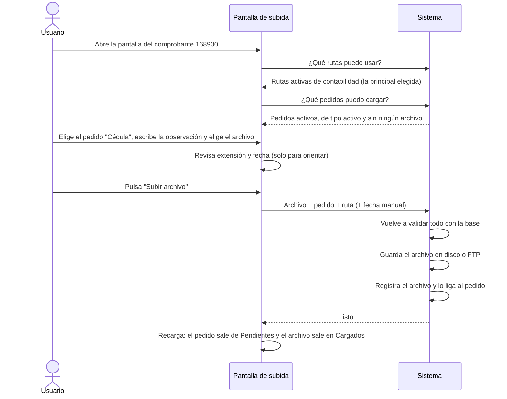

# Etapa 1: subir un archivo (S1-S5)

> Parte de negocio, antes de programar. Specs en [`ANALISIS.md`](../ANALISIS.md), tareas T1.1-T1.4 en [`PLAN.md`](../PLAN.md).

## Quién participa

- **El usuario** del comprobante (o del documento equivalente). Abre la pantalla de subida desde el comprobante.
- **El sistema**, que decide qué se puede cargar y valida todo con lo que tiene la base, no con lo que manda la pantalla.

## Qué pasa y en qué orden

1. **Rutas.** Solo las activas y marcadas para el dueño (contabilidad o documento equivalente). La principal queda elegida.
2. **Pedidos que se pueden cargar.** Un pedido entra si está activo, su tipo está activo y **nunca** tuvo un archivo. Esto último es lo nuevo: hoy la lista no lo mira.
3. **Validar.** La pantalla avisa antes (extensión, fecha), pero quien decide es el sistema, que repite todo: archivo completo, ruta válida, pedido cargable y del comprobante, extensión del tipo, fecha, observación y espacio disponible.
4. **Guardar.** El archivo va a disco o a FTP según la ruta. Se registra como archivo contable vigente, con la observación como descripción y su vencimiento.
5. **Ligar.** Se crea el vínculo pedido → archivo. **El pedido no se modifica**: es el vínculo el que hace que deje de estar pendiente.

## Con datos (sigue el ejemplo de arriba)

| Momento | Pedido 10 (Cédula) | Archivo | Vínculo | ¿Sale en Pendientes? |
|---|---|---|---|---|
| Antes de subir | activo | — | — | Sí |
| Después de subir `cedula.pdf` | activo (sin cambios) | 100, vigente | 10 → 100 | No, sale en Cargados |
| Se elimina el 100 (etapa 3) | activo (sin cambios) | 100, eliminado | 10 → 100 | **No**: ya tuvo archivo |

## Casos raros

- **Dos personas suben al mismo pedido a la vez.** Las dos ven el pedido como pendiente. El sistema valida justo antes de guardar, así que el segundo intento debería rechazarse. Si llegan al mismo milisegundo, podrían quedar dos archivos en el mismo pedido (crédito tiene el mismo hueco).
- **El tipo es documento único.** No hace falta apagar nada al subir: el tipo único no se vuelve a pedir mientras haya un pedido activo, y un pedido con archivo previo se rechaza antes de guardar.
- **El archivo se guarda (disco o FTP) pero falla al registrarlo.** El pedido sigue pendiente (no hay vínculo). Lo ideal sería borrar el archivo físico para no dejar huérfanos, pero **por decisión del usuario (2026-10-27) se ignora por ahora** por ser poco frecuente: queda huérfano, igual que en crédito. Se ajusta más adelante.
- **Ver un archivo de otro comprobante cambiando el número en la dirección.** Se rechaza: solo se abren archivos del dueño de la pantalla.
- **Comprobante y documento equivalente.** Mismo flujo y misma pantalla; solo cambia de quién es el pedido y qué rutas se ofrecen.
