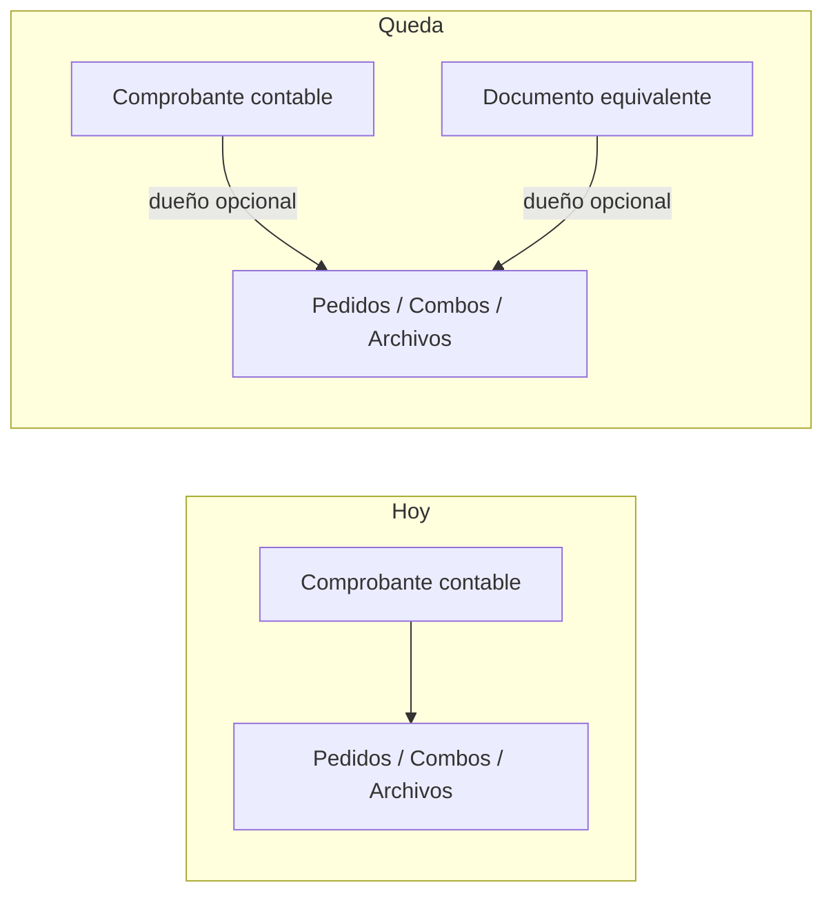
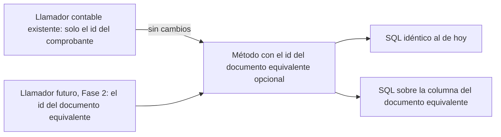

# Explicación: base de datos y código para dos dueños

> [← README](../../README.md) · Plan: [PLAN.md](./PLAN.md) · Decisiones: [ADR-001](../../ADR.md), [ADR-002](../../ADR-002.md)

## Parte lógica (sin código)

### Qué problema resuelve esta fase

Hoy el expediente virtual (documentos pedidos, combos y archivos) cuelga **siempre** de un comprobante contable. Las tres tablas tienen `iddocumentocontable` obligatorio.

Un documento equivalente no tiene comprobante hasta que se contabiliza, y sus archivos son suyos, no del comprobante. Entonces la base necesita aceptar otro dueño. Esta fase solo prepara los datos; **nadie ve ningún cambio**.

### Cómo es hoy y cómo queda

Cada fila tendrá **dos columnas de dueño** y exactamente una llena:

| Fila | `iddocumentocontable` | `iddocumentoequivalente` |
|---|---|---|
| De un comprobante (todo lo que existe hoy) | lleno | vacío |
| De un documento equivalente | vacío | lleno |
| Ninguno o los dos | **la base lo rechaza** | |

Esa regla la impone la base (un CHECK), no el código. Si alguien olvida llenar el dueño, falla al guardar en lugar de dejar un archivo huérfano.

### Qué hace el script 10 (fuera del repo, se corre en demo)

1. Agrega la columna nueva a las tres tablas.
2. Hace opcional `iddocumentocontable`.
3. Crea la FK del documento equivalente **restrictiva**: no se puede borrar un documento equivalente que tenga expediente (el servicio lo traducirá a un 409 en la Fase 2). Las FK contables actuales son `CASCADE` y **no se tocan**.
4. Crea índices sobre la columna nueva. Hoy solicitado y archivo ni siquiera tienen índice sobre el dueño contable; no se agrega porque no es parte de este cambio.
5. Recrea las dos vistas (cargados y eliminados). La de eliminados pasa a `LEFT JOIN`, porque un archivo de documento equivalente no tiene comprobante, y toma el tercero del comprobante **o** del documento equivalente.
6. Es idempotente (se puede correr dos veces) y trae su script de reversión.

### Qué hace el PR1 (código)

El código sigue hablando de un solo dueño, pero ahora sabe que existen dos:

- No hay ningún parámetro de "origen": el dueño lo dice el id que viene. Si viene el del documento equivalente, es de documento equivalente; si viene el del comprobante, es contable. Los dos juntos o ninguno se rechazan.
- Las 7 consultas del actor de solicitados reciben el id del documento equivalente como último parámetro **opcional**. Quien ya las llama no se entera: con solo el comprobante el SQL es el mismo.
- `Iddocumentocontable` pasa de `int` a `int?` en entidades y ViewModels, y aparece `Iddocumentoequivalente`. Esto es lo más pesado de la fase: hay que arreglar cada lugar que usaba el valor como `int`, solo con `.Value` o `?? 0`, sin cambiar la lógica.

### Qué no cambia

- Ninguna pantalla, ningún permiso, ninguna respuesta.
- El comprobante 168816 devuelve el JSON idéntico: 1 pendiente, 0 vencidos, 4 cargados locales, 0 remotos y 7 eliminados (foto en `antes/`).
- La firma, el popup de eliminación y el acta de la constancia 282.

### Qué se mide al terminar

| Paso | Qué se compara | Esperado |
|---|---|---|
| 1.4 | Pruebas SQL antes de aplicar el script | Fallan (la columna no existe) |
| 1.5 | Mismas pruebas después, y script 10 por segunda vez | Pasan y no cambia nada |
| 1.6 | Los JSON de 168816 con el código viejo y la base nueva | Idénticos a `antes/` |
| 1.7 | Reversión dentro de una transacción con `ROLLBACK` | Funciona y no deja rastro |
| 1.20 | Los JSON de 168816 con el código nuevo | Idénticos a `antes/` |
| 1.21 | `git diff --stat` | ~200 líneas, sin tildes rotas en los 9 archivos latin1 |

Si 1.6 o 1.20 difieren, no se avanza.

### Riesgos de esta fase

- El paso a `int?` es el cuello de botella: es mecánico pero toca muchos archivos.
- Compilar actualiza el servidor de pruebas compartido, por eso el script 10 se aplica **antes** del PR1.
- Los archivos latin1 se editan a nivel de bytes, uno por uno, revisando el diff.

## Parte de código

Pendiente: se escribe después de programar la fase.

