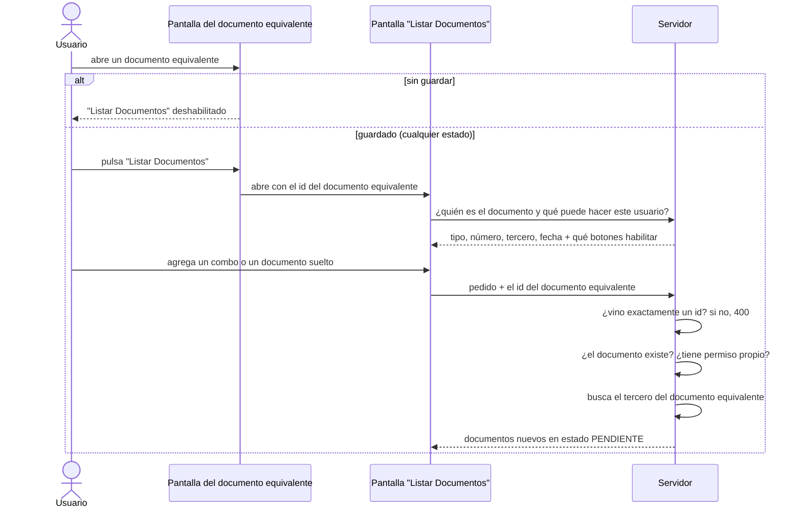
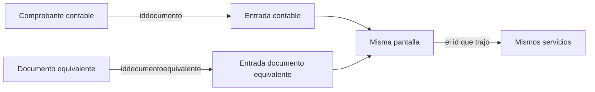

# Explicación: solicitar documentos en el documento equivalente

> [← README](./README.md) · Plan: [PLAN.md](./PLAN.md) · Reglas: [ANALISIS.md](./ANALISIS.md) · Decisiones: [ADR-002](../ADR-002.md)

## Parte lógica (sin código)

### Qué problema resuelve

Después de [01-base-dos-duenos](../01-base-dos-duenos/) la base ya acepta pedidos y combos de un documento equivalente, pero nadie puede crearlos: no hay botón, ni permiso, ni el servidor sabe buscar el tercero del documento equivalente. Esta feature abre la puerta de **pedir** documentos. Subirlos, eliminarlos y firmarlos son las features 03 a 05.

### El recorrido

Es **la misma pantalla** que usa el comprobante contable. Lo único que cambia es con qué id se abre: `iddocumento` (comprobante) o `iddocumentoequivalente`. De ese id salen el encabezado, los permisos y el tercero.

### Las reglas, en concreto

| Situación | Qué pasa |
|---|---|
| Documento equivalente sin guardar | El botón está deshabilitado. Si alguien llama al servidor igual, se rechaza ("Primero debe guardar el documento") |
| Estado del documento (edición, proceso, aprobado, anulado) | No importa. Se pide igual |
| Primer combo | Libre, para cualquiera que entre a la pantalla |
| Segundo combo en adelante | Solo con el permiso **"agregar más combos" del documento equivalente** |
| Documento suelto (sin combo), agregar | Solo con el permiso **"documentos individuales" del documento equivalente**, sin excepción por primero |
| Editar cualquier pendiente (suelto **o nacido de un combo**) | El mismo permiso de documentos individuales. Que el primer combo sea libre no habilita editar lo que creó |
| Usuario con permisos solo de contabilidad | En un documento equivalente es como si no tuviera nada (y al revés en un comprobante) |
| Tercero de los pedidos | El del documento equivalente. Siempre tiene uno (es obligatorio en el documento) |
| Petición con los dos ids o con ninguno | Se rechaza (400) sin tocar nada |
| Editar un documento suelto ya existente | El permiso se decide por **el dueño de la fila**, no por lo que mande la pantalla |
| Combo agregado | Todo o nada: el combo y sus pendientes se crean juntos, o no se crea ninguno |

### Permisos nuevos

Dos permisos nuevos, separados de los contables: "Agregar más combos" y "Agregar documentos individuales", ambos del documento equivalente. El script solo los **crea**; el administrador decide quién los tiene y se los asigna a los roles desde la pantalla de roles (decisión del 2026-10-20, que reemplaza la asignación automática de la decisión 4 del requerimiento). Hasta que se asignen, solo se puede agregar el primer combo.

### Qué no cambia

- El comprobante contable (CO101): abre con `iddocumento`, mismos permisos, mismas respuestas.
- Los documentos del documento equivalente **no aparecen** en su comprobante contable, ni al revés.

### Una pantalla, dos entradas (decidido 2026-10-20)

- **La pantalla es la misma.** Entre contable y documento equivalente solo cambian el título, el encabezado, el id que se manda y los permisos; todo sale del id con que se abre. Una copia serían ~420 líneas duplicadas (la opción B que descartó el [ADR-001](../ADR.md)).
- **La entrada es distinta.** El documento equivalente tiene su propia entrada, que arma su encabezado y sus permisos. La entrada contable no se toca: así la regla 12 se cumple sin riesgo.
- **Los servicios son los mismos** ([ADR-002](../ADR-002.md)): reciben un id o el otro. Separarlos duplicaría las validaciones del documento suelto.

### Lo que la pantalla ya muestra además de pedir (decidido 2026-10-20)

La pantalla de hoy también tiene las pestañas **Cargados** y **Eliminados** y el botón **"Adjuntar Archivos"**, y solo sabían recibir el id de un comprobante. Pasarles el id del documento equivalente como si fuera de un comprobante mostraría los archivos **de otro documento** (el comprobante que tenga ese mismo número de id).

- **Cargados y Eliminados** reciben el mismo id que el resto de la pantalla. En un documento equivalente salen vacías hasta las features 03 y 04, y eso es correcto.
- **"Adjuntar Archivos"** queda oculto en el documento equivalente hasta la feature 03: la pantalla de adjuntar todavía solo entiende comprobantes.

### Qué se mide al terminar

Escenarios E1 a E5b del [ANALISIS](./ANALISIS.md), más: dos ids o ninguno → 400 sin datos nuevos; el comprobante 168816 devuelve lo mismo que en `../antes/`.

## Parte de código

| Pieza | Qué hace | Por qué así |
|---|---|---|
| `DocumentoContableComboAsignacionActorNegocio` (Negocio) | `TienePermisoAgregarMasCombos` y `TienePermisoAgregarDocumentosIndividuales` reciben `idDocumentoEquivalente` opcional y eligen la funcionalidad propia o la contable. `PuedeAgregarCombo` cuenta los pendientes del dueño correcto | Con solo el id contable, mismas consultas que antes |
| `ObtenerTerceroDelDocumento(idContable, idEquivalente)` | 1. exactamente un id (reusa `ObtenerIdDelDocumento` de Blip.Data, ahora `public`); 2. el dueño existe ("Primero debe guardar…"); devuelve su tercero | Una sola validación para el combo y el documento suelto |
| `AgregarCombo` | Dentro de la transacción: tercero → combo activo → permiso → combo + pendientes | Todo o nada; mensaje "…para este documento" en documento equivalente |
| `DocumentoContableSolicitadoWebApiController` y `DocumentoEquivalenteSolicitadoWebApiController` (ADR-003) | Cada uno con `GetPorIdDocumento(iddocumento)`, `Post` y `Put` de **su** dueño. `Post`: permiso fijo → fija el dueño → `AgregarDocumentoIndividual` (Negocio: tercero, tipo activo, tipo único, insert). `Put`: 400 si la fila es del otro dueño, luego su permiso | El dueño lo fija el controlador, no la pantalla; las reglas comunes están en un solo lugar |
| `DocumentoContable{Cargado,Eliminado}WebApiController` | `GetContable(iddocumento)` y `GetEquivalente(iddocumento)` sobre un método privado; 400 si falta el id | La pestaña no muestra archivos de otro documento |
| `DocumentoEquivalenteComboController.Index(iddocumentoequivalente)` | Encabezado (tipo de documento soporte, número, tercero, fecha), permisos propios y la vista compartida | Entrada propia: el `Index` contable no se tocó |
| `Views/DocumentoContableCombo/Index.cshtml` (latin1) | `esEquivalente` según `ViewBag.IdDocumentoEquivalente`; `paramsDueno` en las tres grillas; `campoDueno` para el alta de combo y de fila; título y confirmación según el dueño; "Adjuntar" oculto en documento equivalente | Sin `ViewBag.IdDocumentoEquivalente` todo sale igual que antes |
| `EdicionV2.cshtml` | Botón "Listar Documentos", deshabilitado con `Id == 0`, navega a `~/DocumentoEquivalenteCombo/?iddocumentoequivalente=<id>` | Igual que `listarDocumentos()` de CO101 |
| Script 11 (fuera del repo) | Crea dos funcionalidades con su acción; no asigna roles. Termina con un SELECT que muestra los ids creados | Idempotente, en una transacción. El administrador asigna |

Fuera de esta feature: `GetPorDocumento` del servicio de combos sigue solo contable (ninguna vista lo usa).
