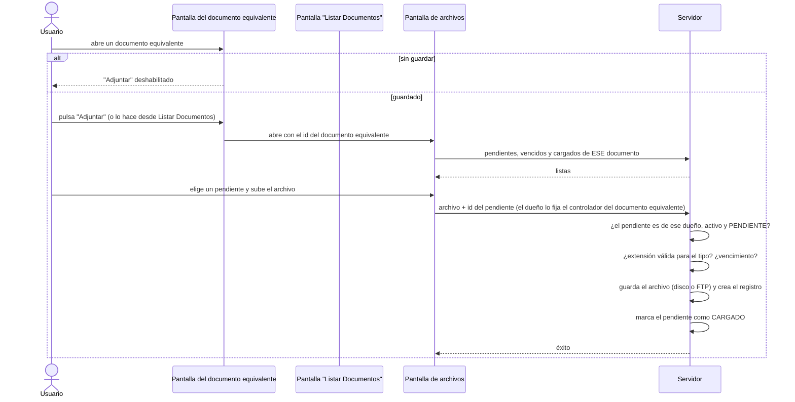

# Explicación: subir archivos al documento equivalente

> [← README](./README.md) · Plan: [PLAN.md](./PLAN.md) · Reglas: [ANALISIS.md](./ANALISIS.md) · Decisiones: [ADR-002](../ADR-002.md)

## Parte lógica (sin código)

### Qué problema resuelve

Con [02-solicitar-documentos](../02-solicitar-documentos/) ya se pueden **pedir** documentos a un documento equivalente, pero quedan en PENDIENTE para siempre: la pantalla de subir archivos solo entiende comprobantes contables. Esta feature abre la puerta de **subir**. Eliminar y firmar son las features 04 y 05.

### El recorrido

Es **la misma pantalla de archivos** del comprobante, igual que en 02. Cambia el id con que se abre: `iddocumento` o `iddocumentoequivalente`. De ese id salen el título, las listas y a quién se ancla el archivo.

### Las reglas, en concreto

| Situación | Qué pasa |
|---|---|
| Documento equivalente sin guardar | "Adjuntar" deshabilitado (regla 2) |
| Dueño de la subida | Lo fija el controlador de cada pantalla con el id de la URL; lo que mande el formulario se ignora. No existe petición con dos dueños o ninguno (regla 11) |
| El pendiente es de otro dueño (aunque el id coincida con uno contable) | Se rechaza: "no corresponde al documento indicado". Se comparan las dos columnas del pendiente contra el dueño del controlador |
| Pendiente que no está en PENDIENTE | Se rechaza (igual que contable) |
| Tipo con firma electrónica y archivo no PDF | Se rechaza listando las extensiones válidas (E6) |
| Tipo sin firma, archivo válido | Pasa a cargado y sale en cargados del documento equivalente (E6b) |
| Vencimiento y almacenamiento (local o FTP, límite) | Igual que el comprobante (R1-R17) |
| Al contabilizar el documento equivalente | Los archivos **no** se copian al comprobante generado (regla 9, E10) |
| Comprobante contable | Sin cambios: abre con `iddocumento` y responde lo mismo (regla 12) |

### Qué se ve en cada pestaña

Pendientes, vencidos y cargados filtran por el dueño que trae la pantalla. Un documento equivalente nunca muestra archivos de un comprobante ni al revés, aunque compartan número de id.

### Qué no cambia

- Contable: mismas rutas, mismos permisos, mismas respuestas.
- Eliminar (04) y firmar (05) siguen sin soporte para el documento equivalente.

### Qué se mide al terminar

E1, E6, E6b y E10 del [ANALISIS](./ANALISIS.md) en pantalla con captura; dos ids o ninguno → 400 sin datos; el mismo recorrido en el comprobante CO101 sale idéntico a `../antes/`.

## Parte de código

| Pieza | Qué hace | Por qué así |
|---|---|---|
| `DocumentoContableArchivoActorNegocio.CrearRelacion` (latin1) | Un solo método arma la relación archivo-dueño; lo usan la subida local y la remota | Hoy hay dos construcciones idénticas copiadas |
| `ArchivoContableUploadViewModel` | `IdDocumentoContable` pasa a opcional (`IdDocumentoEquivalente` ya existe) | Si fuera obligatorio, el modelo sería inválido en un documento equivalente |
| Método común en `Negocio/` | `SubirArchivoAPendiente(doc, idContable, idEquivalente)`: valida pendiente y tipo (con los dos ids), extensión, vencimiento, sube y registra cargado | Hoy ese flujo vive en el controlador; con dos controladores, las reglas quedan en un solo lugar (ADR-003) |
| `DocumentoContableArchivoController` (MVC) | Conserva `Index(iddocumento)` y deja en `ViewBag` dueño, título, ruta de vuelta y acciones de las listas; `SubirArchivo` llama al método común con `(iddocumento, null)` | Mismo comportamiento, verificado con los curls de `../antes/` |
| `DocumentoEquivalenteArchivoController` (MVC, nuevo) | `Index(iddocumentoequivalente)` y `SubirArchivo(iddocumentoequivalente, doc)` que llama con `(null, id)` | Decisión 2026-10-21: controladores independientes. La vista no lleva ternarios, lee el `ViewBag` |
| WebApi de pendientes, vencidos y cargados | Una acción por dueño (`GetContable` / `GetEquivalente`) | La pestaña nunca mezcla dueños |
| `Index.cshtml`, `_GestionDocumentos.cshtml`, `_SubirArchivo.cshtml` (latin1) | Los dos ids en Razor y JS, título según dueño, campos ocultos del dueño, `LoadParams` con el dueño | Sin id de equivalente todo sale igual que antes |
| `DocumentoContableCombo/Index.cshtml` | `adjuntar()` va a archivos con el id del dueño y se muestra también en el documento equivalente | En 02 estaba oculto hasta esta feature |
| `EdicionV2.cshtml` | Botón "Adjuntar", deshabilitado con `Id == 0`, abre `~/DocumentoContableArchivo/?iddocumentoequivalente=<id>` | Igual que `adjuntar()` de `CreateV2.cshtml` |

Sin script SQL: las columnas y la base ya están desde 01.
