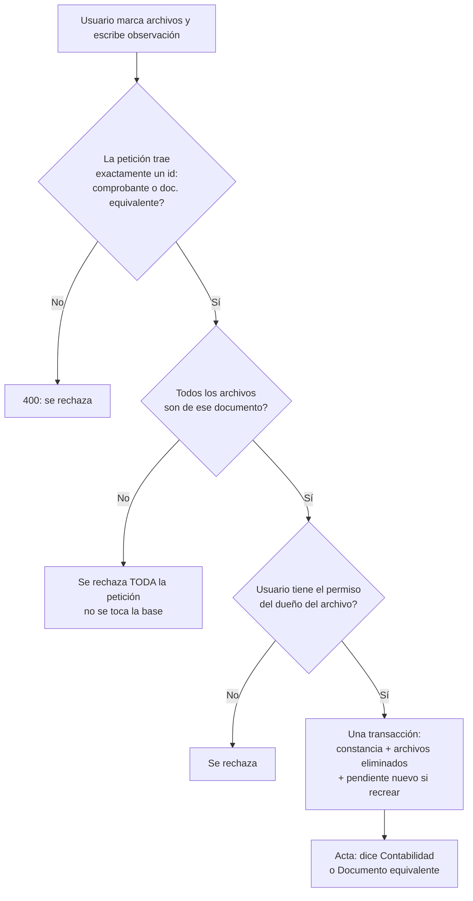

# Explicación: eliminar archivos del documento equivalente

> Parte lógica (negocio, sin código). [← README](./README.md) · [PLAN](./PLAN.md)

## Qué pasa hoy

Eliminar archivos solo existe para comprobantes contables. Un único permiso ("Eliminar Documentos Cargados Contabilidad") decide si el usuario puede borrar, y el servicio asume que todo archivo pertenece a un comprobante.

## Qué cambia

Un archivo ahora puede ser de un **comprobante** o de un **documento equivalente**. Cada dueño tiene su propio permiso de eliminar. El servicio mira de quién es cada archivo y exige el permiso de ese dueño.

## Reglas en lenguaje simple

1. **Permiso propio.** Tener permiso contable no sirve para borrar archivos de un documento equivalente, y al revés (E5c).
2. **Todo o nada.** Si entre los archivos marcados hay uno de otro documento, no se borra ninguno (E5d, E5e). La comprobación va **antes** de abrir la transacción.
3. **Recrear.** Si se marca recrear, el pendiente nuevo nace en el **mismo documento equivalente** del archivo eliminado (E8).
4. **Constancia y acta.** Una constancia por operación. El acta del documento equivalente dice "Documento equivalente" y su tercero, sin número (E9). La de contabilidad queda idéntica.
5. **Servidor manda.** La pantalla solo oculta el botón; el servidor vuelve a validar.

## Qué NO cambia

- El flujo contable: mismos curls, mismo recorrido, mismo acta (constancia 282).
- Cómo se guarda el historial del eliminado (el archivo y su carga se conservan).

## Antes de programar (pendiente tuyo)

Para que el permiso funcione hace falta el script SQL 12 (fuera del repo) que da a los roles contables la ruta `BorrarDocumentosSeleccionadosEquivalente`. Sin él, nadie podría eliminar en documento equivalente.
