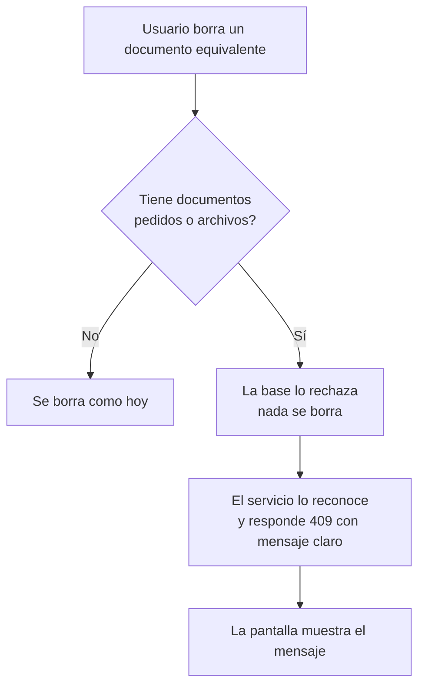

# Explicación: bloquear el borrado de un documento equivalente con expediente

> Parte lógica (negocio, sin código). [← README](./README.md) · [PLAN](./PLAN.md)

## Qué pasa hoy

La base de datos ya impide borrar un documento equivalente que tenga documentos pedidos o archivos (una llave foránea). Pero el servicio de borrado no atrapa ese rechazo: el usuario recibe un error técnico de base de datos.

## Qué cambia

El servicio reconoce ese rechazo y responde con un mensaje claro. No cambia qué se puede borrar, solo cómo se le avisa al usuario.

## Reglas en lenguaje simple

1. **La base manda.** No se agrega una consulta previa: la llave foránea es la que decide, así no hay dos reglas que puedan contradecirse.
2. **Solo este rechazo se traduce.** Cualquier otro error sigue siendo error real y no se disfraza de "tiene expediente".
3. **Nada se borra** si hay expediente (E11, y E11-archivos si solo hay archivos).
4. **Sin expediente** se borra igual que hoy (E11b).

## Qué NO cambia

- El flujo contable: este servicio es solo del documento equivalente.
- Quién puede borrar ni cuándo: solo el mensaje de rechazo.

## Antes de programar (pendiente)

Confirmar cuál es la llave foránea y que cubre documentos pedidos **y** archivos. Si solo cubre una, la regla 10 queda a medias y habría que decidir qué hacer.
