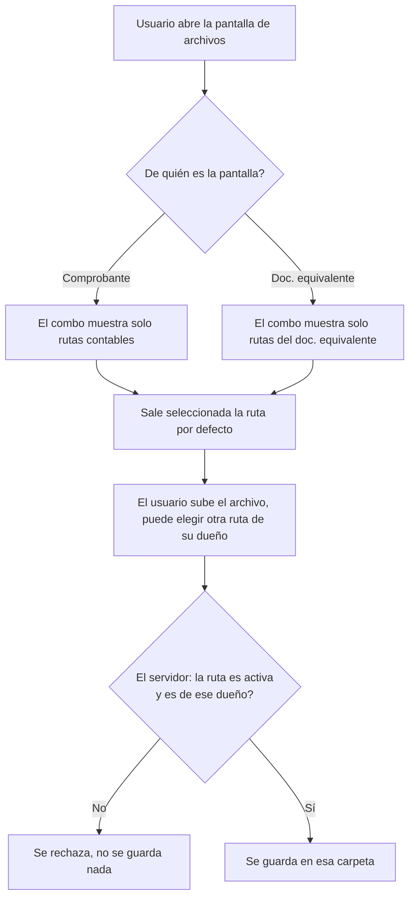

# Explicación: carpeta propia del documento equivalente

> Parte lógica (negocio, sin código). [← README](./README.md) · [ANALISIS](./ANALISIS.md) · [PLAN](./PLAN.md)

## Qué pasa hoy

Los archivos del comprobante y los del documento equivalente se guardan en la **misma carpeta**: `~/Uploads/Contabilidad/`. Lo único que los separa es un dato en la base (a quién pertenece cada archivo). En disco están mezclados.

Además, al subir, el servidor solo acepta rutas "contables", para los dos dueños por igual.

## Qué cambia

Cada dueño tiene **su propia carpeta** y **su propia ruta por defecto**:

| Dueño | Carpeta | Ruta por defecto |
|---|---|---|
| Comprobante | `~/Uploads/Contabilidad/` (la de siempre) | Sí, la marcamos |
| Documento equivalente | `~/Uploads/DocumentoEquivalente/` (nueva) | Sí |

## Reglas en lenguaje simple

1. **Cada dueño ve solo sus rutas**, las que tienen marcada la casilla de ese dueño. Un comprobante nunca ofrece la carpeta del documento equivalente, ni al revés (E1, E2).
2. **El servidor manda.** Aunque alguien mande a mano la ruta del otro dueño, se rechaza (E4).
3. **Sin ruta, no se sube.** Si no hay ruta activa para el dueño, sale un mensaje claro y no se guarda nada. No se "presta" la del otro (E3).
4. **Ruta por defecto.** Es la que sale ya seleccionada. El usuario puede elegir otra de su mismo dueño. Hoy ninguna ruta está marcada así; la feature marca la de contabilidad y la nueva. Si se marca otra como por defecto, la anterior se desmarca. Si el dueño tiene rutas activas pero ninguna por defecto, el combo sale sin selección y se avisa "No hay ruta principal configurada, seleccione una"; el usuario puede elegir y subir igual (no se bloquea).
5. **Lo ya subido no se mueve.** Los archivos viejos del documento equivalente siguen en `Contabilidad/` y se ven y eliminan igual (E5).
6. **Backup.** La carpeta del documento equivalente entra al backup como un módulo más (E6).

## Cómo sabe el sistema de quién es una ruta

Una carpeta no sabe de quién es. Lo dice una **casilla** que tiene cada ruta en la tabla de rutas. Así ya funcionan las demás: créditos tiene su casilla, garantías la suya, contabilidad `escontabilidad`.

| Ruta | Casilla contabilidad | Casilla documento equivalente |
|---|---|---|
| `Contabilidad/` (la 7) | sí | no |
| `DocumentoEquivalente/` (la nueva) | no | sí |

- Para el combo del comprobante, el sistema lista las rutas con la casilla de contabilidad marcada.
- Para el combo del documento equivalente, las rutas con la casilla de documento equivalente marcada.
- Al subir, el servidor repite esa misma comprobación.

La casilla de documento equivalente es **nueva**: hay que agregarla a la tabla.

Marcar bien las casillas es responsabilidad de quien parametriza. La pantalla no lo impide, igual que con las demás rutas.

## Cómo se crea la ruta nueva

Con un script SQL, igual que se creó la de contabilidad: agrega la casilla nueva a la tabla y crea la ruta con esa casilla marcada.

## Qué NO cambia

- El flujo del comprobante: mismas pantallas, mismo recorrido, misma carpeta.
- Lo ya subido: no se toca ni se mueve (son datos de prueba).
- Las rutas de los otros módulos (créditos, terceros, CRM, garantías, pagaré).

## Antes de programar (pendiente tuyo)

- Tu visto bueno a esta explicación y al [PLAN](./PLAN.md).
- Revisar el script SQL 4 antes de correrlo: cambia la base de datos (columna nueva, ruta nueva, y marca la ruta 7 como por defecto).
