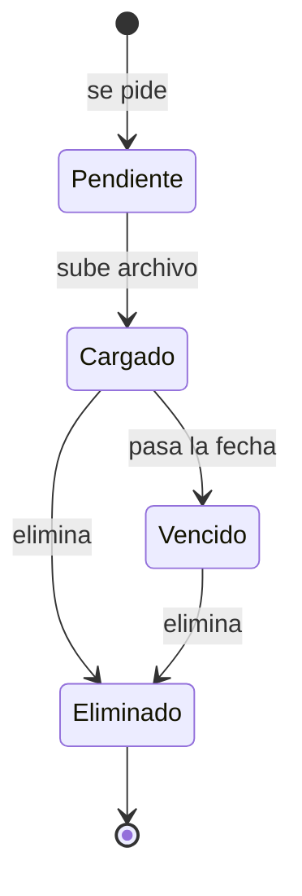

# Análisis: estados y reglas de los documentos contables

Reglas vigentes de los documentos que se piden y se cargan en un comprobante contable, contrastadas con crédito y con el código el 2026-10-16 (lectura de código, nada se ejecutó en la app). Criterio y diferencias a propósito: [`ADR.md`](./ADR.md). Paso a paso de la eliminación: [`ELIMINACION.md`](./ELIMINACION.md).

## Qué ya existe

| Pantalla | Qué hace | Igual que en crédito |
|---|---|---|
| Solicitud del comprobante | Agregar combos y documentos sueltos; editar descripción, obligatorio y activo; ver solicitados (con su estado), cargados y eliminados | Sí, salvo DP1 y DP2 |
| Gestión de documentos | Subir archivo a un pendiente; pestañas Cargados, Cargados (Remoto), Pendientes y Vencidos; editar la descripción de un archivo; eliminar con observación y "¿recrear?" | Sí, salvo DP3 a DP5 |
| Firma electrónica | Enviar a firmar un documento cargado | Ver [firma-documentos-contables](../firma-documentos-contables/) |
| Constancia de eliminación | Acta y detalle de lo eliminado | Ver [`ELIMINACION.md`](./ELIMINACION.md) |

## Estados de un documento pedido

| Transición | Qué pasa |
|---|---|
| Se pide | Entra por un combo o a mano. Nace pendiente y activo |
| Sube archivo | Solo sobre un pendiente. Queda una carga activa y el documento pasa a cargado |
| Pasa la fecha | **No se guarda.** Se calcula: cargado con fecha de vencimiento anterior a la fecha del sistema = vencido |
| Elimina | La carga queda inactiva, el archivo queda marcado como eliminado y se borra el archivo físico. El documento queda eliminado, pero **sigue activo** |
| Recrear (al eliminar) | No revive el eliminado: crea **otro** documento pendiente con el mismo tipo, combo, descripción y obligatorio (DP3) |

Un eliminado nunca vuelve a pendiente ni a cargado.

### Marcas que acompañan al estado

| Marca | Quién la cambia | Efecto |
|---|---|---|
| Documento activo | El usuario, en la solicitud (con permiso) | Inactivo: sale de Pendientes y Vencidos. Si ya estaba cargado, sigue en Cargados (igual que crédito) |
| Tipo de documento activo | Configuración | Inactivo: sus pendientes no se ven en Pendientes ni en el selector de subida. No se puede agregar a mano |
| Carga activa | Subir y eliminar | Solo hay una carga activa por documento |
| Archivo eliminado | Eliminar | No vuelve atrás. Queda ligado a la constancia |

### Qué muestra cada pestaña

| Pestaña | Muestra |
|---|---|
| Pendientes y selector de subida | Documentos activos, pendientes y de tipo activo |
| Cargados / Cargados (Remoto) | Documentos con carga activa y archivo no eliminado, separados por si el archivo está en FTP |
| Vencidos | Documentos activos y cargados cuyo vencimiento ya pasó |
| Solicitados (en la solicitud) | Todos, con su estado visible (incluye vencido) |
| Eliminados (en la solicitud) | Historial: quién eliminó, cuándo y por qué |

## Reglas vigentes

La numeración se conserva de `expediente-virtual-carga` para no romper las referencias. Las nuevas siguen desde R15.

| # | Regla | Frente a crédito |
|---|---|---|
| R1 | Un combo agregado no se quita. Los documentos que sobran se inactivan uno por uno. Desde la solicitud no se borra nada | Igual |
| R2 | Solo se agrega un combo activo. El mismo combo se puede agregar más de una vez | Igual |
| R3 | Cada documento copia el obligatorio de su lugar en el combo. Los agregados a mano arrancan obligatorios. Solo informa (asterisco), no bloquea | **DP1** |
| R4 | Cualquier pendiente se puede cargar, sin pasos previos | Igual |
| R5 | Un documento tiene un solo archivo. Para cambiarlo se elimina con "recrear" y se carga en el documento nuevo | Igual |
| R6 | Si el tipo exige firma electrónica, solo PDF. Si es foto, solo imágenes. Si no, la lista general | Firma: igual. Foto: **DP4**. Lista: **DP5** |
| R7 | Solo se guarda en rutas activas marcadas para contabilidad | Igual |
| R8 | Vencimiento: si el tipo no expira, no hay fecha. Si es manual, es obligatoria y no puede ser anterior a la fecha del sistema. Si es por días, es la fecha del sistema más esos días. Vencido se calcula, no se guarda | Igual (crédito tiene además "días después del fin del crédito", que no aplica) |
| R9 | Eliminar pide observación y si se recrea el documento. Ver la tabla de estados | Igual, con **DP3** |
| R11 | Un tipo único no se repite en el comprobante mientras haya uno activo y no eliminado, ni a mano ni por combo (el combo lo salta). Agregar a mano exige comprobante guardado y tipo activo | **DP2** |
| R13 | Si el comprobante ya tiene algún documento pedido, agregar otro combo exige el permiso "Agregar Mas Combos Documento Contable" | Igual |
| R14 | Eliminar exige el permiso "Eliminar Documentos Cargados Contabilidad" | Igual |
| R15 | Agregar o editar documentos sueltos exige el permiso "Agregar Documentos Individuales" | Igual (B2 de `paridad-documentos-credito`) |
| R16 | Un archivo que llega incompleto se rechaza | **Falta en contabilidad** → C1 |
| R17 | Solo se carga un documento pendiente, aunque la petición llegue directo al servidor | Crédito lo limita en pantalla → C2 |

**Quitadas o movidas:**
- "Un único se puede volver a cargar y reemplaza al anterior" (antes en R5): no existe en crédito ni en la pantalla contable. Se quita ([ADR-001](./ADR.md)).
- R10 (cargar en contabilidad no toca archivos de crédito) y R12 (el estado lo pone el servidor): no son reglas de negocio, son garantías técnicas. Siguen cumpliéndose; su lugar es el `PLAN.md`.

## Hallazgos

- **H1. Contabilidad no valida que el archivo llegó completo.** Crédito compara los bytes recibidos con el tamaño declarado y rechaza si difieren (`Negocio/Credito/CargaArchivosActorNegocio.cs:396-403`). Contabilidad solo revisa que no esté vacío (`DocumentoContableArchivoController.cs:57`). → C1.
- **H2. El servidor deja cargar sobre un documento eliminado.** La validación de la subida revisa que el documento esté activo y que no tenga carga activa, pero no su estado. Un eliminado sigue activo y su carga quedó inactiva, así que pasa. Al registrar, se reactiva la carga vieja y el documento vuelve a cargado (`Blip.Data/Contabilidad/DocumentoContableSolicitadoActorNegocio.cs:15-33` y `:36-70`). La pantalla no lo permite porque el selector solo ofrece pendientes; una petición directa sí. → C2.
- **H3. El reemplazo de único es un camino muerto.** El servidor acepta una segunda carga si el tipo es único y desactiva el archivo anterior (mismas líneas que H2), pero ninguna pantalla ofrece un documento ya cargado. En crédito pasa lo mismo. → C2 lo quita.
- **H4. Comentarios con numeración vieja.** El código cita "R13" para "pendiente = estado PENDIENTE" (`DocumentoContableArchivoWebApiController.cs:258`), pero R13 es el permiso de combos. Ese método lo reescribe [consultas-documentos-sql](../consultas-documentos-sql/); se corrige ahí.

## Detectado en la auditoría de docs (2026-10-16), fuera de C1-C3

No entran en esta feature hasta que se decida. Se anotan para no perderlos.

| # | Qué | Evidencia |
|---|---|---|
| A1 | El controlador de archivos contables conserva el `Delete` generado: borra la relación sin constancia ni historial. Ninguna pantalla lo llama | `DocumentoContableArchivoWebApiController.cs:84` |
| A2 | `FirmaArchivoContableWebApiController` es un CRUD generado sin uso | [firma-documentos-contables](../firma-documentos-contables/IMPLEMENTACION.md) |
| A3 | Un combo "para firmar" puede recibir un tipo sin firma: solo lo impide la pantalla | [firma-documentos-contables](../firma-documentos-contables/README.md) |
| A4 | Pruebas manuales sin evidencia: carga (V, E, P, C, T), B1 M1-M4, B2 M2-M5, B3-B6 | `expediente-virtual-carga/TAREAS.md`, [paridad IMPLEMENTACION](../paridad-documentos-credito/IMPLEMENTACION.md) |
| A5 | El commit `b89d6bcd0` (refactor del formato de eliminación) no está documentado en ninguna nota | `git show b89d6bcd0` |
| A6 | `VistaArchivosEliminadosWebApiController` y su ViewModel, generados en `1510e9b5c`, no los usa ninguna pantalla | [paridad IMPLEMENTACION](../paridad-documentos-credito/IMPLEMENTACION.md) |

## Preguntas abiertas

- **P1. Vencidos de un documento inactivo.** Crédito los muestra en Vencidos; contabilidad no, porque filtra los documentos activos. Por el criterio correspondería alinearlo, pero el impacto es mínimo. ¿Se alinea o se anota como DP6?

## Verificación

| Caso | Evidencia esperada |
|---|---|
| **Dado** un archivo cortado, **cuando** se sube, **entonces** se rechaza con "archivo incompleto" y no queda archivo, carga ni cambio de estado | Respuesta del servicio y consulta de la base antes/después |
| **Dado** un documento eliminado, **cuando** se le carga un archivo con una petición directa, **entonces** se rechaza y sigue eliminado | Respuesta del servicio y estado en la base |
| **Dado** un documento cargado (único y no único), **cuando** se le carga otro archivo con una petición directa, **entonces** se rechaza | Respuesta del servicio |
| **Dado** un pendiente, **cuando** se sube desde la pantalla, **entonces** queda cargado como hoy | Captura y estado en la base |
| **Dado** un eliminado con "recrear", **cuando** se sube al documento nuevo, **entonces** queda cargado y el eliminado no cambia | Estado de los dos documentos en la base |
| **Dado** que se cambia el código, **cuando** se compila, **entonces** hay 0 errores | Salida del build |
