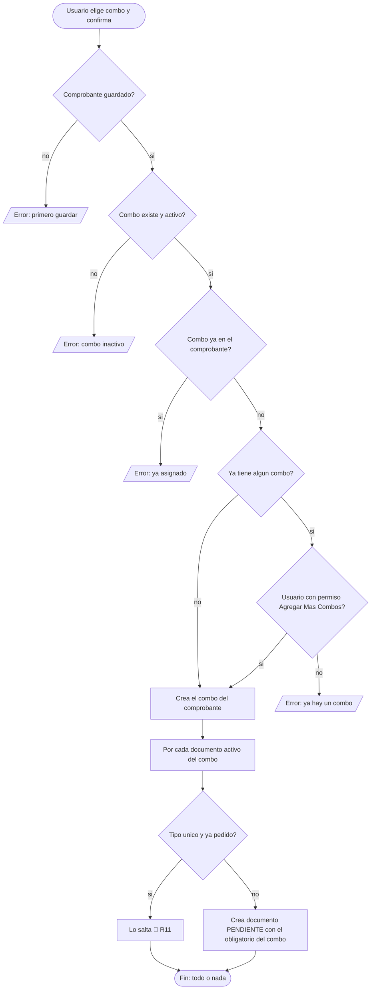
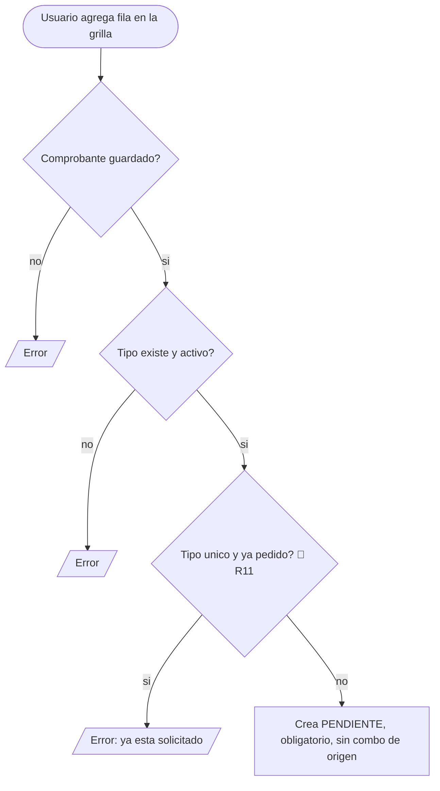
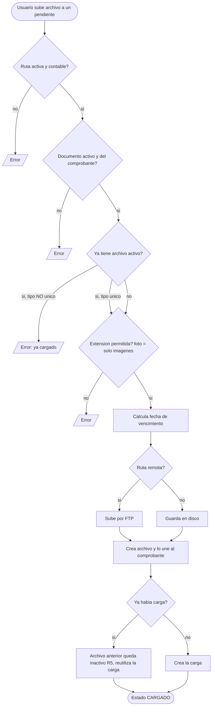
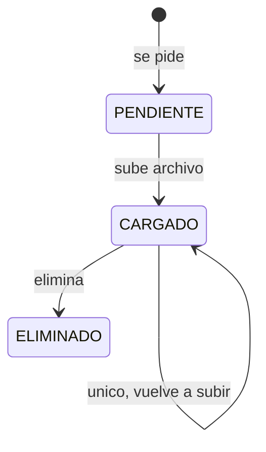

# Implementación — Qué existe hoy (carga de documentos en comprobante)

> Reference. Refleja el código de la rama `feature/expediente-virtual-carga-c1` al 2026-10-02. Se actualiza al construir.
> Leyenda: 🟢 hecho y compila · 🟡 hecho, falta probar en la app · 🔴 decisión abierta.

## 1. Agregar un combo al comprobante 🟡

Pantalla `DocumentoContableCombo/Index` → `PostConSolicitados` → `DocumentoContableComboAsignacionActorNegocio.AgregarCombo` (R13, todo en una transacción).

Si algo falla a mitad, la transacción deshace el combo y sus documentos.

## 2. Agregar un documento a mano 🟢

Grilla de solicitados → `DocumentoContableSolicitadoWebApi.Post`. Sin transacción (es una sola fila).

## 3. Subir un archivo 🟡

`DocumentoContableArchivoController.SubirArchivo`. Sin transacción global: el archivo se guarda antes de registrar el cargado.

## 4. Estados de un documento

Vencido no es un estado guardado: se calcula en la consulta (R8). La eliminación y sus pestañas son F4 y no están en este documento.

## 5. Qué falta decidir o probar

| Punto | Estado |
|---|---|
| Pruebas V1 a V8 del permiso (ver [`TAREAS.md`](./TAREAS.md)) | 🟡 pendiente en la app |
| ¿Se permite repetir un tipo único (como crédito) o se mantiene R11? Afecta los rombos 🔴 de los flujos 1 y 2 y el texto de `_SubirArchivo.cshtml` | 🔴 abierta |
| Flujo de eliminar y "¿recrear?" (R9) | ⬜ F4 |
