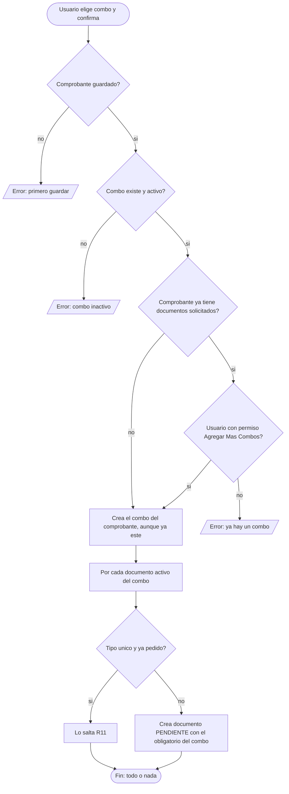
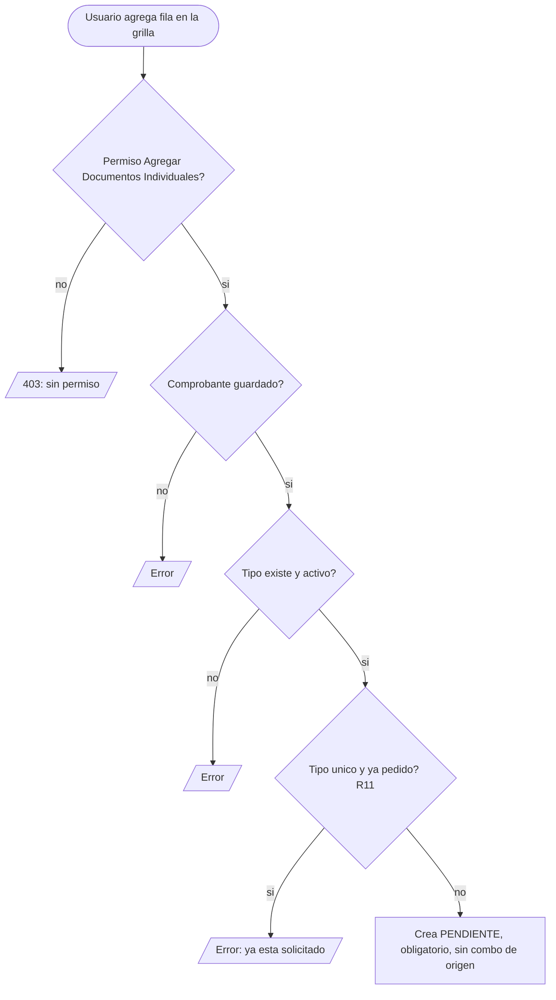
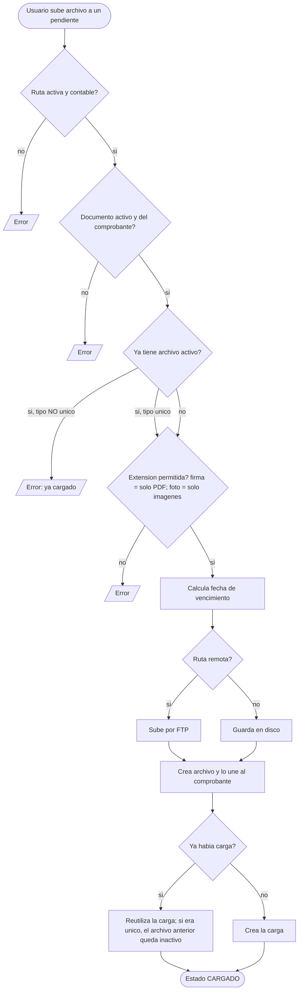

# Implementación — Qué existe hoy (carga de documentos en comprobante)

> Reference. Refleja el código de la rama `feature/contabilidad-detalle-constancia-eliminacion` al 2026-10-16. Se actualiza al construir.
> Reglas y estados vigentes: [`ciclo-documentos/ANALISIS.md`](../ciclo-documentos/ANALISIS.md). Este doc es el mapa de archivos y métodos.
> Leyenda: 🟢 hecho y compila · 🟡 hecho, sin evidencia de prueba en la app.

## 1. Agregar un combo al comprobante 🟡

Pantalla `DocumentoContableCombo/Index` → `DocumentoContableComboWebApi.PostConSolicitados` → `Negocio.Contabilidad.DocumentoContableComboAsignacionActorNegocio.AgregarCombo`, todo en una transacción (`TransactionManager.ExecuteTransaction`). Los documentos los crea `Data.Contabilidad.DocumentoContableComboActorNegocio.InsertarConDocumentosSolicitados`.

La pantalla deja el selector y el botón bloqueados si `ViewBag.PuedeAgregarCombo` es falso (`DocumentoContableComboController`, vía `PuedeAgregarCombo`).

El mismo combo puede repetirse (R2). El permiso se pide si ya hay algún documento solicitado, venga de un combo o se haya agregado a mano (R13).

## 2. Agregar un documento a mano 🟡

Grilla de solicitados → `DocumentoContableSolicitadoWebApi.Post`. Sin transacción (es una sola fila). `Put` exige el mismo permiso.

El permiso (R15) se revisa antes de leer o escribir nada (`RechazarSinPermiso`, que usa `TienePermisoAgregarDocumentosIndividuales`).

## 3. Subir un archivo 🟡

`DocumentoContableArchivoController.SubirArchivo`. Sin transacción global: el archivo se guarda (`DocumentoContableArchivoActorNegocio.SubirArchivoAsync`, local o FTP) antes de registrar la carga (`DocumentoContableSolicitadoActor.RegistrarArchivoCargado`).

| Paso | Método |
|---|---|
| Ruta activa y contable | `DocumentoContableArchivoActorNegocio.ValidarRutaContable` |
| Documento activo, del comprobante, sin carga activa | `DocumentoContableSolicitadoActor.ValidarDocumentoSolicitadoYTipo` |
| Extensión permitida | `DocumentoContableArchivoActorNegocio.ValidarArchivoConTiposPermitidos` |
| Fecha de vencimiento | `DocumentoContableArchivoActorNegocio.CalcularFechaVencimiento` |

**Camino muerto:** la rama "tipo único con archivo activo" (reemplazo de único) sigue en `ValidarDocumentoSolicitadoYTipo` y `RegistrarArchivoCargado`, pero ninguna pantalla la ofrece. La misma rama "ya había carga" deja cargar sobre un eliminado por petición directa. Las dos se quitan con C2 de [ciclo-documentos](../ciclo-documentos/REQUERIMIENTO.md).

## 4. Pestañas de carga 🟡

`Views/DocumentoContableArchivo/_GestionDocumentos.cshtml`:

| Pestaña | Origen |
|---|---|
| Cargados / Cargados (Remoto) | `VistaDocumentoContableCargadosWebApi`, parámetro `remoto` |
| Pendientes | `DocumentoContableArchivoWebApi.ObtenerSolicitadosPendientesPorId` |
| Vencidos | `DocumentoContableArchivoWebApi.ObtenerVencidos` → `DocumentoContableSolicitadoActor.ObtenerVencidosPorIddocumentocontable` |

Vencido no es un estado guardado: lo calcula `CrearCasoEstadoVisible()` (`Blip.Data/Contabilidad/DocumentoContableSolicitadoActorNegocio.cs`), la misma expresión de la grilla de solicitados. "Ver archivo" usa `DocumentoContableArchivoController.Visualizar` → `VisualizarArchivo`, que solo abre archivos ligados a un comprobante contable.

## 5. Eliminar 🟡

Botón "Eliminar seleccionados" → `_PopupObservacion.cshtml` (pide observación y "¿volver a solicitar?") → `DocumentoContableArchivoWebApi.EliminarArchivos` → `DocumentoContableArchivoActorNegocio.EliminarArchivos(ids, idUsuario, observacion, recrear)`.

- Exige el permiso R14 (`PuedeEliminarArchivos`). La pantalla oculta el botón con `ViewBag.PuedeEliminarArchivos`.
- En una transacción: constancia, archivo eliminado, carga inactiva, historial, estado ELIMINADO y borrado del archivo físico.
- Con `recrear`: inserta un documento nuevo PENDIENTE con el mismo tipo, combo, descripción y obligatorio (R9, DP3).

## 6. Estados de un documento

Ver [`ciclo-documentos/ANALISIS.md`](../ciclo-documentos/ANALISIS.md). Lo guardado es PENDIENTE, CARGADO y ELIMINADO.

## 7. Qué falta

| Punto | Estado |
|---|---|
| Pruebas manuales de [`TAREAS.md`](./TAREAS.md) (V, E, P, C, T) | 🟡 sin evidencia |
| Repetir un tipo único | Decidido: no se repite (R11, DP2 de [ciclo-documentos/ADR.md](../ciclo-documentos/ADR.md)) |
| C1 (archivo incompleto) y C2 (solo cargar pendientes) | ⬜ [ciclo-documentos](../ciclo-documentos/REQUERIMIENTO.md) |
