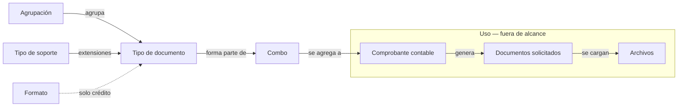
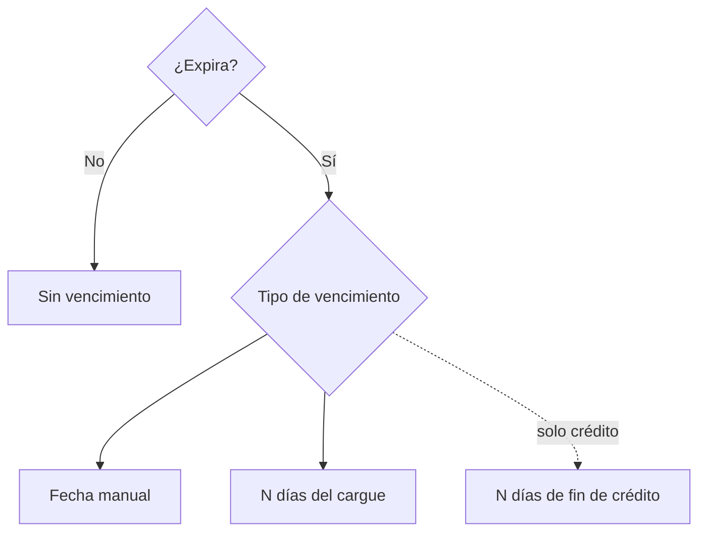

# Análisis — Configuración de documentos contables igual a la de crédito

> **Historia.** La brecha que describe ya se cerró en código y algunos puntos cambiaron al construir (por ejemplo, se quitaron los tipos de soporte). Vigente: [FLUJO.md](./FLUJO.md) para la configuración y [ciclo-documentos/ANALISIS.md](../ciclo-documentos/ANALISIS.md) para la carga.

> Estado: **validado** (decisiones en la sección 7). Explica qué se va a hacer y cómo, sin código.
> Pedido original: [`REQUERIMIENTO.md`](./REQUERIMIENTO.md). Plan por fases: [`PLAN.md`](./PLAN.md).

## En una frase

La pantalla donde se configuran los documentos que se piden en contabilidad (agrupaciones, tipos de documento y combos) debe ofrecer lo mismo que la de crédito. Contabilidad **ya tiene** esa pantalla y sus tablas (expediente virtual contable): el trabajo es **cerrar la brecha**, no construir desde cero.

## Alcance

- **Entra:** la pantalla de configuración — qué se guarda y cómo se edita.
- **No entra:** el uso de esa configuración cuando se cargan documentos a un comprobante contable. Las banderas nuevas quedan guardadas, pero nadie las lee todavía (H4).

---

## 1. Qué se configura

| Concepto | Qué es | Crédito | Contabilidad hoy |
|---|---|---|---|
| Agrupación | Carpeta lógica para ordenar tipos de documento | Sí | Sí, igual |
| Tipo de documento | Lo que se pide (ej. "RUT", "Factura proveedor"), con sus reglas de vencimiento | Sí | Sí, con menos opciones |
| Combo | Paquete de tipos de documento que se pide de una vez | Sí | Sí, con menos opciones |
| Documento del combo | Un tipo de documento dentro de un combo | Sí | Sí, distinto (ver 2.5) |
| Formato | Plantilla asociada al tipo de documento | Sí | No |
| Tipo de soporte | Qué extensiones de archivo se aceptan para el tipo de documento | No | **Sí, solo contabilidad** |

---

## 2. Comparación pieza por pieza

### 2.1 Página

| Comportamiento | Crédito | Contabilidad hoy | Qué se hace |
|---|---|---|---|
| Filtro "Activos / Todos" que aplica a las tres grillas, arranca en "Activos", con botón de ayuda | Sí | No | Se agrega |
| Borrar registros | No se borra: se inactiva | Borrado real en agrupaciones, tipos, combos y documentos del combo | Se cambia a inactivar (P5) |
| Grilla de tipos de soporte (catálogo de consulta) | No existe | Sí | Se quita |
| Botón "Configurar soportes" de cada tipo de documento | No existe | Sí | Se mantiene: sin él ningún archivo se puede cargar (H9) |

### 2.2 Agrupaciones

Mismos datos (nombre, activo). La única diferencia es el borrado (2.1).

### 2.3 Tipos de documento

| Dato o regla | Crédito | Contabilidad hoy | Qué se hace |
|---|---|---|---|
| Nombre, activo, agrupación, documento único | Sí | Sí | — |
| Expira | Sí | Sí | — |
| Vencimiento con fecha manual | Sí | Sí | — |
| Vencimiento a N días del cargue | Sí | Sí (mismo significado) | — |
| Vencimiento a N días de finalizado el crédito | Sí | No | No se replica (P2) |
| Solo un tipo de vencimiento a la vez | Sí | Sí, entre los dos que tiene | — |
| Al desmarcar "expira" se borran fecha manual y días | Sí | No: quedan los valores viejos guardados | Se replica (H3) |
| En pantalla, "expira" habilita las opciones de vencimiento y "fecha manual" deshabilita los días | Sí | No: todo queda editable siempre | Se replica |
| Firma electrónica | Sí | No | Se agrega (P4) |
| Requiere geolocalización | Sí | No | No se replica (P4) |
| Requiere foto | Sí | No | Se agrega (P4) |
| Formato personalizado + formatos asociados | Sí | No | Se agrega (P3). Solo se ofrecen plantillas marcadas como "formato contable" (P7) |
| Tipos de soporte permitidos | No | Sí | Se mantiene (botón por tipo) |

### 2.4 Combos

| Dato o regla | Crédito | Contabilidad hoy | Qué se hace |
|---|---|---|---|
| Nombre, activo | Sí | Sí | — |
| Editar un combo (ej. inactivarlo) | Sí | No: la grilla muestra el lápiz, pero el guardado no está habilitado (H8) | Se habilita |
| "Para convenios" | Sí | No | No se replica (P1) |
| "Para firmar" | Sí | No | Se agrega (P1) |
| "Para firmar" solo si es "para convenios" | Sí (solo en pantalla) | — | No aplica: sin convenios, "para firmar" queda libre |

### 2.5 Documentos dentro del combo

| Dato o regla | Crédito | Contabilidad hoy | Qué se hace |
|---|---|---|---|
| Tipo de documento | Sí | Sí | — |
| Activo dentro del combo (se inactiva en vez de borrar) | Sí | No: se borra | Se agrega (P5) |
| Muestra si el tipo de documento está activo | Sí | No | Se agrega |
| Editar | Sí | No | Se habilita |
| Obligatorio | No | Sí | Se mantiene |
| Qué documentos se ofrecen según el combo | Con o sin firma, según "convenios" y "para firmar" | Todos | Combo "para firmar": solo documentos con firma electrónica. Si no: todos (F1, sección 3) |
| Mismo documento dos veces en el combo | Se permite | Se permite | Se impide (P6) |

---

## 3. Reglas de vencimiento

Es la única parte con reglas cruzadas. Contabilidad ya las tiene casi iguales a crédito (H1); falta limpiar lo que no aplica y que la pantalla guíe al usuario.

| Regla | Detalle |
|---|---|
| V1 | Si no expira, no se guarda fecha manual ni días (se limpian) |
| V2 | Si expira, debe tener **exactamente un** tipo de vencimiento |
| V3 | Con fecha manual, la fecha se digita al cargar el documento; no lleva días |
| V4 | Los días no pueden ser negativos. Crédito no lo valida; garantías sí. Es mejora, no réplica |
| V5 | La pantalla habilita y deshabilita las opciones según lo marcado, igual que crédito |

### Regla de firma en combos

En crédito, el filtro de firma depende de dos marcas: "para convenios" y "para firmar". En contabilidad solo queda "para firmar" (P1), así que la regla se simplifica:

| Regla | Detalle |
|---|---|
| F1 | Si el combo es "para firmar", solo se pueden agregar tipos de documento con firma electrónica. Si no lo es, se ofrecen todos |
| F2 | Si un combo pasa a "para firmar" y ya tiene documentos sin firma, esos documentos se conservan. Mismo manejo que crédito (H7), confirmado |

---

## 4. Cómo se va a hacer

De la base de datos hacia la pantalla, igual que se construyó crédito:

1. **Base de datos.** Verificar las columnas reales de las tablas contables (H11). Agregar lo que falte:
   - en el tipo de documento: firma electrónica, foto y formato personalizado
   - la relación tipo de documento–formato
   - la marca "formato contable" en las plantillas
   - "para firmar" en el combo
   - "activo" en el documento del combo
   - que no se repita el mismo documento en un combo
2. **Guardar y leer.** Que el servidor guarde y devuelva los datos nuevos. Hay que:
   - replicar las reglas V1 y F1
   - cambiar el borrado por inactivar
   - impedir que un documento se repita en el combo
3. **Pantalla.** Igualar las grillas, el filtro "Activos / Todos" y el comportamiento de vencimiento a crédito. Se quita la grilla de tipos de soporte. Se conservan el botón "Configurar soportes" y "obligatorio".

**Qué no se hace:**
- No se copian los errores que tiene crédito (H6, H7).
- No se toca la carga de documentos a comprobantes (sección 6).

---

## 5. Hallazgos

**H1 — El vencimiento ya es casi igual.** Crédito guarda "fecha manual" más dos columnas de días, una por tipo. Los nombres empiezan por "es", pero guardan números. Contabilidad guarda "fecha manual" más una columna de días. La diferencia es solo "días de fin de crédito".
Evidencia: `Blip.Data/Credito/DocumentoCredito.cs:11-13`, `Blip.Data/Contabilidad/DocumentoTipoActorNegocio.cs:33-44`.

**H2 — Crédito no borra; contabilidad sí, sin revisar nada.** La página de crédito no habilita el borrado en ninguna grilla. En contabilidad se borran de verdad las agrupaciones, los tipos, los combos y los documentos del combo, sin revisar si están en uso.
Evidencia: `Views/DocumentoCredito/Index.cshtml:168-174, 281-305, 340-346, 381-387` y `Views/DocumentoTipo/Index.cshtml:93, 168, 224, 241`.

**H3 — Al desmarcar "expira", contabilidad no limpia.** Crédito borra la fecha manual y los días en el servidor. Contabilidad solo valida cuando expira, así que un tipo que deja de expirar conserva sus días viejos.
Evidencia: `DocumentoCreditoWebApiController.cs:61-66` y `DocumentoTipoActorNegocio.cs:33-44`.

**H4 — En crédito las banderas tienen quién las use; en contabilidad no.**
- En crédito:
  - Firma, foto, geolocalización y días se usan al cargar y consultar archivos, en la firma y en el cierre de día.
  - "Para convenios" y "para firmar" se usan al configurar cada comercio.
- En contabilidad, con el alcance acordado, se guardan pero no cambian nada hasta que se trabaje la carga contable.

Evidencia: `Views/CargaArchivos/MostrarArchivos.cshtml:811-824`, `Negocio/Generales/ArchivoActorNegocio.cs:77,118` y `Views/ComercioMaestro/_TabConfiguracion.cshtml:104-120`.

**H5 — Los formatos de crédito son plantillas de pagaré.** El selector solo ofrece formatos marcados como "formato pagaré". Se usan para generar el documento cuando el combo se agrega a un crédito. Contabilidad no tiene plantillas propias.
Evidencia: `Views/DocumentoCredito/Index.cshtml:113` y `Negocio/Credito/ComboDocumentoCreditoActorNegocio.cs:77,91`.

**H6 — Error de crédito que no se debe copiar.** Si se quitan todos los formatos de un tipo de documento, los anteriores quedan activos, porque la desactivación solo corre cuando la lista trae algo.
Evidencia: `Negocio/Credito/DocumentoCreditoActorNegocioViewModel.cs:273`.

**H7 — Otras fallas de crédito que no se deben copiar.**
- "Para firmar requiere para convenios" se valida solo en pantalla (`Index.cshtml:597-610`).
- Al elegir un documento para el combo se ofrecen también tipos inactivos (`Index.cshtml:365`).
- La grilla de agrupaciones usa el modelo de datos de terceros en vez del de crédito (`Index.cshtml:166`). Funciona porque los campos coinciden, pero confunde.

**H8 — En contabilidad no se puede editar un combo.** La grilla muestra el botón de editar, pero el guardado no está habilitado, así que un combo no se puede inactivar ni renombrar.
Evidencia: `Views/DocumentoTipo/Index.cshtml:224, 227`.

**H9 — Tipos de soporte es obligatorio en la práctica.** Un tipo de documento sin tipos de soporte rechaza cualquier archivo al cargar. Por eso se mantiene aunque crédito no lo tenga.
Evidencia: `Negocio/Contabilidad/DocumentoContableArchivoActorNegocio.cs:360-387`.

**H10 — "Obligatorio" es propio de contabilidad.** Crédito no lo tiene. Se mantiene (ver también la sección 6).

**H11 — Columnas sacadas del código, no de la base.** No hay scripts de creación de estas tablas en disco. En esta sesión no hubo acceso a la base de datos. Un comentario menciona una regla de base (CHECK) para los días que no se pudo confirmar.
Evidencia: `DocumentoTipoActorNegocio.cs:27`.
**Primer paso del plan:** comparar contra la base real, con el acceso de solo lectura descrito en [`bases-datos/`](../../bases-datos/).

**H12 — La página contable no está en el menú por código.** Los menús viven en la base de datos. Hay que confirmar desde dónde se entra hoy a la página.
Evidencia: `Controllers/Contabilidad/DocumentoTipoController.cs:10`.

**H13 — Inactivar no tiene efecto fuera de esta vista.**
- La página de documentos de un comprobante ofrece todos los combos y tipos de documento, sin mirar si están activos.
- Al agregar un combo a un comprobante se piden todos sus documentos.
- Hoy eso no pesa porque se borra. Con P5, un combo o un documento inactivado se seguiría pidiendo.

Evidencia: `Views/DocumentoContableCombo/Index.cshtml:196-197, 247-248` y `Blip.Data/Contabilidad/DocumentoContableComboActorNegocio.cs:16-18`.

---

## 6. Fuera de alcance (anotado para después)

- **Uso de las banderas nuevas en la carga contable:** firma, foto, formatos y "para firmar" (H4).
- **Marcar plantillas como "formato contable" desde la pantalla de formatos** (P7). Mientras no se haga, se marcan con un script en la base.
- **Error: agregar un combo a un comprobante ignora "obligatorio".** Todos los documentos quedan sin marcar, aunque la consulta sí marca los obligatorios.
  Evidencia: `Blip.Data/Contabilidad/DocumentoContableComboActorNegocio.cs:37` contra `DocumentoContableSolicitadoWebApiController.cs:69`.
- **Error: un documento con fecha manual aparece vencido apenas se carga.** Se toma la fecha de cargue como vencimiento.
  Evidencia: `DocumentoContableArchivoWebApiController.cs:347-349`.
- **Errores propios de la página de crédito (H6, H7):** se corrigen aparte, en crédito.

---

## 7. Decisiones

El trabajo se centra solo en esta vista.

| # | Pregunta | Decisión |
|---|---|---|
| — | ¿Se mantiene la grilla de tipos de soporte? | Se quita. El botón "Configurar soportes" de cada tipo se mantiene (H9) |
| P1 | ¿"Para convenios" y "para firmar"? | Convenios **no**. Para firmar **sí** (regla F1) |
| P2 | ¿"Días de fin de crédito"? | **No** se replica |
| P3 | ¿Formatos personalizados? | **Sí** se replican. Queda abierto qué plantillas se ofrecen (P7) |
| P4 | ¿Firma electrónica, geolocalización, foto? | Firma **sí**, foto **sí**, geolocalización **no** |
| P5 | ¿Inactivar en vez de borrar? | **Sí**, en las cuatro grillas |
| P6 | ¿Impedir el mismo documento dos veces en un combo? | **Sí** |
| F1-F2 | ¿Cómo se maneja "para firmar"? | Igual que crédito: el filtro solo limita qué se puede agregar y lo que ya está en el combo se conserva |
| P7 | ¿Qué plantillas se ofrecen en formatos? | **Marca nueva de "formato contable"**, sin salir de esta vista: la marca se crea en la base y esta vista solo muestra esas plantillas |

| P7' | ¿Cómo se marcan las plantillas mientras tanto? | Con un script en la base. Hasta que la pantalla de formatos lo permita (fuera de alcance), el selector de esta vista solo muestra lo marcado por script. Confirmado |

| P8 | ¿Los inactivos se dejan de pedir en los comprobantes (H13)? | **Sí, igual que crédito.** Al agregar un combo a un crédito solo se ofrecen combos activos, y se piden solo documentos activos en el combo con tipo activo |

## 8. Preguntas abiertas

Ninguna. El criterio general para lo que surja: **replicar cómo funciona crédito**.
