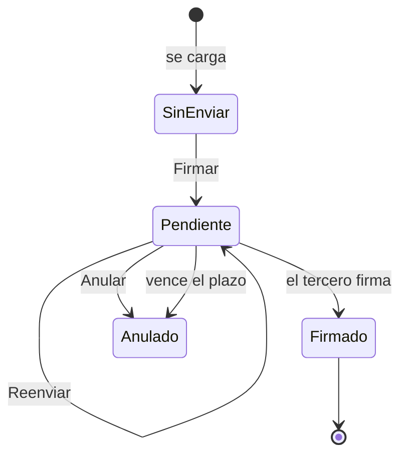

# Análisis — Firma electrónica de documentos contables igual a crédito

> Estado: **validado**. Explica qué se va a hacer, sin código.
> Pedido original: [`REQUERIMIENTO.md`](./REQUERIMIENTO.md). Decisión de enfoque: [`ADR.md`](./ADR.md).

## En una frase

Los documentos que se cargan en un comprobante contable deben poder firmarse electrónicamente igual que los de crédito. Casi todo **ya existe**: el proveedor de firma, la pantalla, los estados y la configuración contable. Lo que falta es conectar los documentos contables con esa maquinaria.

## Alcance

- **Entra:** firmar a mano, desde la web, los documentos cargados en un comprobante cuyo tipo tenga "Firma electrónica": enviar, reenviar, anular, consultar estado y recibir el archivo firmado.
- **No entra:** ver los no-gos en [`REQUERIMIENTO.md`](./REQUERIMIENTO.md#no-gos).

---

## 0. Qué ya existe

| Pieza (en negocio) | Dónde existe hoy | Conclusión |
|---|---|---|
| Proveedor de firma (VozData): subir documento, crear solicitud, consultar, reenviar, anular | Compartido por todos los dominios | Se reutiliza |
| Registro de la solicitud de firma y de sus firmantes | Compartido | Se reutiliza |
| Estados de la firma (pendiente, firmado, anulado) y mensajes | Compartido | Se reutiliza |
| Parámetros del proveedor (usuario, plazo por defecto, tipos de firma y de envío) | Compartido | Se reutiliza, sin parámetros nuevos |
| Pantalla de firma (asunto, tipo, envío, plazo, firmantes, reenviar, anular) | Una sola, usada por crédito, tercero, CRM y pagaré | Se extiende: un caso más para contabilidad |
| Reemplazo del archivo por su versión `FIRMADO-…` (local o FTP) | Crédito, sobre la tabla general de archivos | Se reutiliza: los archivos contables viven en la misma tabla |
| Vínculo "archivo de un dominio ↔ solicitud de firma" | Uno por dominio: crédito, tercero, CRM (2) y pagaré | Se copia: uno nuevo para contabilidad |
| Lógica de "firmar documento" (arma firmantes y valores por defecto, envía, consulta) | Una copia por dominio | Se copia desde crédito |
| Botón "Firmar" con ícono según estado en la grilla de archivos | Crédito | Se copia a la grilla de documentos del comprobante |
| Marca "Firma electrónica" en el tipo de documento contable | Contabilidad, guardada pero sin uso | Se usa: decide si aparece el botón |
| Marca "Para firmar" en el combo contable | Contabilidad, filtro de configuración | No cambia |
| Rutas contables para guardar archivos | Contabilidad | Se reutiliza para el archivo firmado |
| Tercero guardado en cada documento pedido | Crédito sí; contabilidad no (hay que llegar a él por el comprobante) | Se agrega en contabilidad, igual que crédito (H8) |
| Envío automático al cargar | Solo crédito por convenios | No se replica |
| App móvil de firma | Crédito | No se replica |

## 1. Estados de la firma de un documento

| Transición | Detalle |
|---|---|
| Se carga | Solo si el tipo de documento tiene "Firma electrónica"; si no, el documento no entra a este ciclo |
| Firmar | Firmante: el tercero del comprobante. Asunto, tipo de firma, envío y plazo con valores por defecto, editables |
| El tercero firma | El sistema se entera **al abrir la pantalla de firma** (H2). En ese momento reemplaza el archivo por `FIRMADO-…` |
| Vence el plazo | Al abrir la pantalla, si pasó el plazo, la firma queda anulada con motivo "expirado" (H3) |
| Anulado | Igual que crédito |

El estado de la firma **no** afecta el estado del documento solicitado (pendiente, cargado, vencido…).

## 2. Hallazgos

**H1 — Cada dominio es una copia completa.** Tercero y CRM se agregaron copiando crédito: lógica (~400 líneas), controlador y vínculo propios, más un caso nuevo en la pantalla y el servicio compartidos. No hay pieza genérica donde enchufarse.
Evidencia: `Negocio/Firmas/FirmaArchivoCreditoActorNegocio.cs`, `FirmaArchivoTerceroActorNegocio.cs`; `SIIAN.VozData/Handlers/FirmarDocumentoCarpetaVirtualHandler.cs:112-130`; `Views/FirmaProcesoMaestro/FirmarDocumento.cshtml:3-15, 1017-1035`.

**H2 — El estado solo se actualiza al abrir la pantalla de firma.** No hay aviso del proveedor ni tarea programada; la dirección de aviso es de prueba. Se hereda tal cual.
Evidencia: `SIIAN.VozData/Models/Firma.cs:28`; `FirmaArchivoCreditoActorNegocio.cs:255-256`.

**H3 — El vencimiento anula la firma.** Se considera vencida pasada la fecha de expiración más 9h59.
Evidencia: `SIIAN.VozData/Handlers/ActualizarHandlerCarpetasVirtuales.cs:214, 279`.

**H4 — El envío automático de crédito depende de convenios.** Toma tipo de envío, tipo de firma y combos de la configuración de convenios, que contabilidad no tiene.
Evidencia: `PruebaPostgreSQL/Helpers/DocumentoCreditoHelper.cs:87-129`.

**H5 — En crédito, sin firmar no bloquea nada fuera de convenios.** Los únicos chequeos de "pendiente por firmar" están en el flujo de convenios.
Evidencia: `DocumentoCreditoHelper.cs:70, 81`.

**H6 — La grilla de documentos del comprobante no sabe nada de firma.** Ni la consulta ni lo que devuelve traen si el tipo es firmable, si está firmado o su solicitud.
Evidencia: `Views/DocumentoContableArchivo/_GestionDocumentos.cshtml`; `DocumentoContableArchivoWebApi.ObtenerPorDocumento`; vista `contabilidad_vistadocumentocontablecargados`.

**H7 — Los archivos contables usan la misma tabla general de archivos que crédito.** Por eso el reemplazo por `FIRMADO-…` sirve sin cambios.
Evidencia: `Negocio/Contabilidad/DocumentoContableArchivoActorNegocio.cs:19-161`.

**H8 — Crédito guarda el tercero en cada documento pedido; contabilidad no.** En crédito la firma lee el tercero directo del documento. En contabilidad hay que dar la vuelta archivo → documento del comprobante → comprobante → tercero. Se agrega el tercero al documento pedido para consultarlo directo, en la firma y en cualquier consulta posterior (pedido de Yeison). No es una regla de negocio, es facilidad de consulta. Afecta a `expediente-virtual-carga`: los dos puntos donde se pide un documento (agregar combo y agregar a mano) deben guardarlo, y los documentos existentes se completan con el tercero de su comprobante.
Evidencia: `Negocio/Firmas/FirmaArchivoCreditoActorNegocio.cs:186`; `Blip.Data/Contabilidad/DocumentoContableSolicitado.cs:5-8`.

**H9 — "El tercero del comprobante no cambia" es regla de negocio, no del sistema.** La actualización estándar del comprobante sí reescribe el tercero. Si algún día una pantalla lo permite, los documentos ya pedidos conservan el tercero original. Se acepta.
Evidencia: `Blip.Data/Contabilidad/DocumentoContableActor.cs:57`.

## 3. Reglas de negocio confirmadas

| Regla | Detalle |
|---|---|
| R1 | Firma solo el tercero del comprobante, como firmante principal y único |
| R2 | Solo se firma a mano, con el botón "Firmar" |
| R3 | El botón aparece solo si el tipo de documento tiene "Firma electrónica" |
| R4 | Firmar no cambia el estado del documento solicitado |
| R5 | Solo web |
| R6 | Reenviar, anular, vencimiento y reemplazo del archivo se comportan igual que crédito |
| R7 | Cada documento pedido en un comprobante guarda el tercero del comprobante al momento de pedirlo; la firma toma el firmante de ahí. El tercero del comprobante no cambia (H9) |

## 4. Verificación

Manual, sin pruebas automáticas:

| #   | Dado                                   | Cuando                            | Entonces                                                                     |
| --- | -------------------------------------- | --------------------------------- | ---------------------------------------------------------------------------- |
| V1  | Documento cargado de un tipo con firma | se abre la grilla del comprobante | aparece "Firmar"                                                             |
| V2  | Documento cargado de un tipo sin firma | se abre la grilla                 | no aparece "Firmar"                                                          |
| V3  | Documento firmable                     | se pulsa "Firmar"                 | abre la pantalla de firma con el tercero del comprobante como firmante       |
| V4  | Solicitud enviada y firmada en VozData | se reabre la pantalla             | el archivo pasa a `FIRMADO-…` en la ruta contable y el ícono muestra firmado |
| V5  | Solicitud pendiente                    | se reenvía / se anula             | igual que en crédito                                                         |
| V6  | Solicitud con plazo vencido            | se reabre la pantalla             | queda anulada por expirado                                                   |
| V7  | Documento de crédito, tercero o CRM    | se firma                          | funciona igual que antes                                                     |
| V8  | Documento firmado                      | se mira el comprobante            | su estado de solicitado no cambió                                            |
| V9  | Comprobante con tercero                | se agrega un combo o un documento a mano | cada documento pedido queda con el tercero del comprobante            |
| V10 | Documentos pedidos antes del cambio    | se corre el script de completado  | todos quedan con el tercero de su comprobante, ninguno vacío                 |
