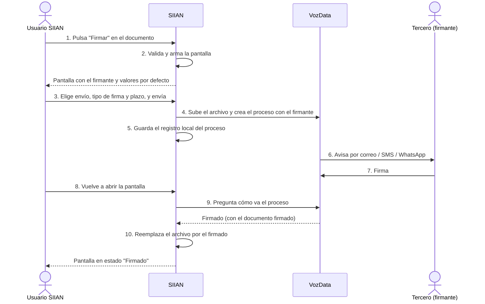
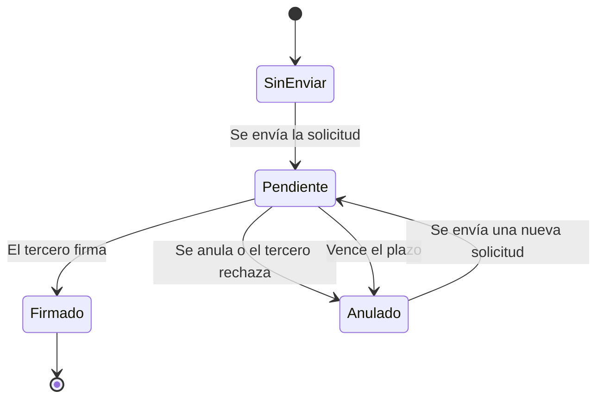
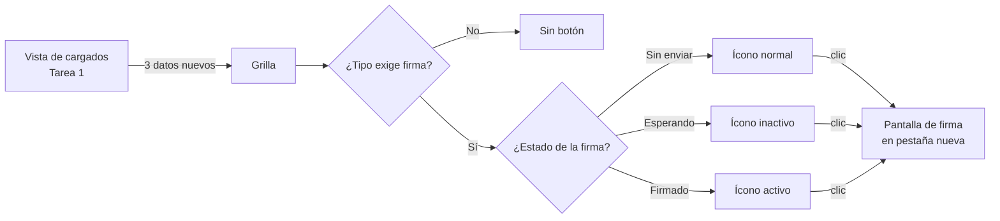

# Firma electrónica de documentos contables: cómo funciona

> Explicación para entender el flujo. **Parte 1: lógica de negocio** (sin código). La **Parte 2: código** se agrega después.

## 1. La idea en una frase

Un documento cargado en un comprobante contable, cuyo tipo exige firma electrónica, se envía a firmar a un proveedor externo (VozData). El tercero del comprobante firma allá. Cuando SIIAN se entera de que firmó, **reemplaza el archivo original por el firmado**.

Es lo mismo que ya hace crédito, con una diferencia: aquí hay **un solo firmante**, el tercero del comprobante. No hay codeudores.

## 2. Quién participa

| Quién | Qué hace |
|---|---|
| **Usuario de SIIAN** (contabilidad) | Abre la pantalla de firma, elige cómo enviar y manda la solicitud. También puede reenviar o anular. |
| **Tercero del comprobante** | Es el único firmante. Recibe la solicitud por correo, SMS o WhatsApp y firma. |
| **VozData** | Servicio externo. Guarda el documento, avisa al firmante y registra quién firmó y cuándo. |
| **SIIAN** | Prepara el envío, guarda un registro local del proceso y reemplaza el archivo cuando está firmado. |

## 3. Qué tiene que existir antes de firmar

1. El **tipo de documento** está marcado con "Firma electrónica".
2. El documento ya está **cargado** en el comprobante, es decir, tiene un archivo.
3. El documento solicitado tiene **tercero asignado**. Se copia del comprobante cuando el documento se crea, sea por combo, a mano o al recrear uno eliminado. Es lo que hicimos en la Tarea 2.
4. El módulo de firmas está **habilitado** (hay credenciales activas de VozData).

Si falta algo, la pantalla avisa con un mensaje claro y no deja firmar.

## 4. El flujo completo

### Paso a paso

**1 y 2. Abrir la pantalla.** SIIAN revisa que el módulo esté habilitado y que el archivo exista y no esté eliminado. Luego busca a qué documento contable pertenece el archivo y de ahí saca el tercero. Con eso muestra:
- el **firmante** (identificación, nombre, teléfono y correo del tercero);
- los **valores por defecto**: asunto, tipo de envío, tipo de firma y plazo.

El asunto por defecto es la descripción del documento. Si no tiene, es el nombre del tipo de documento.

Si el archivo ya se había enviado antes, en vez de valores por defecto la pantalla muestra **lo que se envió** y su estado actual (paso 9).

**3. Enviar.** El usuario confirma o ajusta los datos y envía.

**4. Subir a VozData.** SIIAN toma el archivo y lo sube. Si está en el servidor FTP, primero lo baja a una copia temporal, que borra al terminar. Después crea el proceso de firma con el tercero como firmante.

**5. Registro local.** SIIAN guarda su propia copia del proceso: el estado, el firmante y el **vínculo entre este archivo y este proceso**. Ese vínculo es lo que permite luego saber qué firma corresponde a qué documento.

**6 y 7. Firma.** Ocurre fuera de SIIAN. VozData avisa al tercero y este firma.

**8 a 10. Enterarse de la firma.** SIIAN **no recibe un aviso** de VozData. Se entera cuando alguien **vuelve a abrir la pantalla** y SIIAN pregunta. Si el estado es "Firmado", descarga el documento firmado y **reemplaza el archivo original**.

## 5. Estados de una firma

| Estado         | Qué ve el usuario                                                |
| -------------- | ---------------------------------------------------------------- |
| **Sin enviar** | Pantalla con valores por defecto, lista para enviar.             |
| **Pendiente**  | Solicitud enviada, esperando firma. Se puede reenviar o anular.  |
| **Firmado**    | El archivo ya fue reemplazado por la versión firmada.            |
| **Anulado**    | Se anuló o venció el plazo. Se puede enviar una solicitud nueva. |

El plazo vencido se detecta **al abrir la pantalla**, no por sí solo. Si venció, SIIAN marca la firma como anulada por expirada.

## 6. Qué pasa con el archivo cuando se firma

- El archivo firmado se guarda **en la misma carpeta**, con el prefijo `FIRMADO-` delante del nombre.
- El registro del archivo en SIIAN pasa a **apuntar al firmado**.
- El original se borra (en local) o se reemplaza (en FTP).
- El documento **sigue en la grilla de cargados**, con el mismo estado de solicitado. Solo cambia el archivo detrás.

## 7. Otras acciones

| Acción | Qué hace |
|---|---|
| **Reenviar** | Vuelve a mandar el aviso a los firmantes que no han firmado. No crea un proceso nuevo. |
| **Anular** | Pide a VozData anular el proceso, con un motivo. SIIAN lo refleja la próxima vez que se abra la pantalla. |
| **Enviar de nuevo** | Solo tiene sentido si la anterior se anuló o venció. Crea un proceso nuevo para el mismo archivo. |

## 8. Casos raros y cómo responde

| Caso | Respuesta |
|---|---|
| El documento solicitado no tiene tercero (pedido antes del script) | Mensaje: "El documento solicitado no tiene tercero asignado". |
| El archivo no es de un documento contable (por ejemplo, uno de crédito) | Mensaje: "El archivo no pertenece a un documento contable". |
| El módulo de firmas está deshabilitado | Mensaje: "Modulo de firmas no habilitado". |
| El archivo fue eliminado o está inactivo | La pantalla no se arma. |
| El archivo tiene varias firmas (una anulada y otra nueva) | Se usa la **más reciente**. |
| El archivo firmado ya no está disponible en VozData | Error al reemplazar: "El Archivo firmado ya no esta disponible para su descarga". |

## 9. Qué NO cambia

Crédito, tercero y CRM firman igual que antes. Comparten la pantalla y el envío a VozData, pero cada uno usa su propio vínculo y su propia pantalla de entrada.

## 10. Punto a vigilar (por lectura del código, sin probar)

Cada vez que se abre la pantalla de un documento **ya firmado**, SIIAN vuelve a descargar y reemplazar el archivo.
- **En local** no hay problema: el resultado es siempre el mismo nombre `FIRMADO-…`.
- **En FTP** el nombre podría crecer en cada apertura (`FIRMADO - FIRMADO - …`), porque parte del nombre ya reemplazado.

Crédito se comporta igual. Se confirma con la prueba M5 del plan.

## 11. El botón "Firmar" en la grilla del comprobante (Tarea 4)

Hasta la Tarea 3 la firma solo se abre escribiendo la URL. Esta tarea pone el **botón en la grilla** para que el usuario no tenga que hacerlo.

### Qué ve el usuario

En la grilla de documentos cargados (y en la de remotos/FTP), cada fila tiene una columna de botones. Se agrega uno nuevo, **"Firmar"**, antes de "Ver archivo".

| Situación del documento | Botón "Firmar" |
|---|---|
| Su tipo **no** exige firma electrónica | No aparece |
| Su tipo exige firma y **no se ha enviado** | Aparece, ícono normal |
| Enviado, **esperando que el tercero firme** | Aparece, ícono inactivo |
| **Ya firmado** | Aparece, ícono activo |

Al pulsarlo se abre la pantalla de firma (la de la Tarea 3) en una **pestaña nueva**, ya con el archivo de esa fila.

### De dónde sale cada dato

Los 3 datos nuevos que la grilla necesita saber de cada documento:
1. si su tipo exige **firma electrónica**;
2. si ya está **firmado**;
3. cuál es el **id de la firma más reciente** (por si hay una anulada y otra nueva, cuenta la última).

La vista de la base de datos ya los calcula (Tarea 1). Esta tarea solo hace que **lleguen hasta la pantalla**.

### Qué no cambia

- Un documento firmado **sigue en la grilla de cargados** con el mismo estado de solicitado. Solo cambia el archivo detrás.
- **Exportar** la grilla sigue igual.
- No se inventa nada: el comportamiento y los íconos se copian de lo que ya hace la pantalla de crédito.

### Punto a vigilar

La vista de la grilla es un archivo con codificación antigua (ISO-8859). Se edita con cuidado para **no dañar las tildes**.

---

## Parte 2: código

*(pendiente)*
