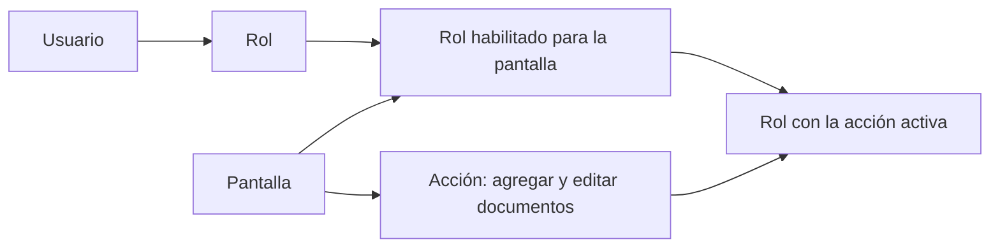
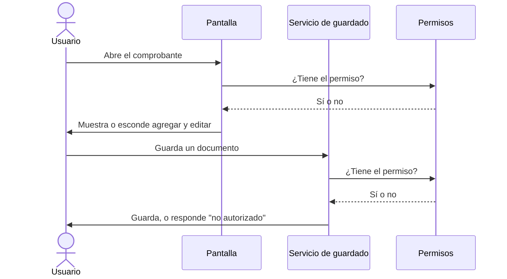

# B2: explicación por etapa

## Tarea 1: crear el permiso y dárselo a quienes ya podían agregar combos

### Qué problema resuelve

Hoy cualquier usuario que abre un comprobante puede agregar documentos sueltos y editar los ya pedidos. Queremos que eso lo haga solo quien tenga un permiso. Antes de que el sistema pueda preguntar "¿tiene el permiso?", ese permiso tiene que **existir** en la base de datos y estar **asignado** a alguien. Esta etapa hace solo eso: no cambia ninguna pantalla.

### Cómo funcionan los permisos en SIIAN

Un permiso no se le da a una persona: se le da a un **rol** (por ejemplo "Contador"), y la persona lo tiene porque tiene ese rol.

Para que un rol pueda hacer la acción hacen falta **dos** marcas: que el rol esté habilitado para la pantalla, y que tenga activa la acción. Con una sola, el sistema responde "no tiene permiso".

### Qué hace el script, en orden

1. **Crea la pantalla-permiso** "Agregar Documentos Individuales Documento Contable", si no existe.
2. **Crea la acción** que cuelga de ella, si no existe.
3. **Busca los roles que hoy pueden agregar más combos** y les da las dos marcas del paso anterior, si todavía no las tienen.

Cada paso verifica antes de insertar. Por eso se puede correr dos veces sin duplicar nada.

### Por qué esos roles (decidido 2026-10-15)

Quien hoy puede agregar combos ya es de confianza para modificar la lista de documentos de un comprobante. Es un punto de partida: después negocio puede quitar o dar el permiso a otros roles desde la administración de siempre.

### Qué pasa en cada caso

| Caso | Resultado |
|---|---|
| Rol con el permiso de combos | Recibe el permiso nuevo |
| Rol sin el permiso de combos | No lo recibe; hasta que se le dé a mano no podrá agregar ni editar |
| Correr el script dos veces | La segunda vez no inserta nada |
| Rol con el permiso de combos **inactivo** | No lo recibe (solo cuentan los activos) |
| Base donde el script no se corrió y el código ya está publicado | Nadie puede agregar ni editar documentos sueltos |

### Lo que esta etapa NO hace

No cambia la pantalla ni el servicio de guardado: eso es la Tarea 2. Al terminar solo se ve el permiso nuevo en la administración de roles, y ningún comportamiento cambia todavía.

### Quién decide cuándo se corre

El script va **antes** de publicar el código en cada base. Si el orden se invierte, hay una ventana en la que nadie puede agregar documentos.

## Tarea 2: que la pantalla y el servicio respeten el permiso

### Qué problema resuelve

Con el permiso ya creado y asignado (Tarea 1), falta que alguien lo **pregunte**. Hoy ni la pantalla ni el servicio de guardado lo hacen. Esta etapa agrega la pregunta en los dos lugares.

### Por qué en dos lugares

La pantalla es lo que el usuario ve. El servicio es lo que realmente guarda. Si solo se esconde el botón, quien llame al servicio directo (con una herramienta, sin abrir la pantalla) se salta la restricción. Si solo se valida el servicio, el usuario vería un botón que siempre falla. Por eso:

- **La pantalla** esconde "agregar" y "editar" a quien no tiene el permiso. Es comodidad: evita el error.
- **El servicio** rechaza el guardado a quien no tiene el permiso. Es seguridad: la regla real.

Las dos preguntas usan la **misma consulta de permiso**. Así no puede pasar que la pantalla diga una cosa y el servicio otra.

### Qué pasa en cada caso

| Caso | Pantalla | Servicio |
|---|---|---|
| Usuario con el permiso | Muestra agregar y editar | Guarda |
| Usuario sin el permiso | No los muestra; sigue viendo la lista y los archivos | Responde "no autorizado" y no cambia nada |
| Sin permiso, comprobante vacío | No muestra agregar documento; **sí** deja agregar el primer combo | Igual: rechaza el documento suelto |
| Documento que vino de un combo | Sin permiso, tampoco se edita | Sin permiso, rechaza |
| Alguien llama al servicio sin pasar por la pantalla | — | Rechaza igual si no tiene el permiso |

### Qué decisiones ya están tomadas

- **Un solo permiso para agregar y editar** (ANALISIS B2, regla 1).
- **No hay excepción de "primer documento"**: a diferencia de los combos, quien no tiene el permiso no agrega documentos sueltos ni en un comprobante vacío (regla 2).
- **Lo único que llama al servicio es esa grilla.** Se revisó: no hay otra pantalla ni proceso automático que lo use, así que rechazar sin permiso no rompe nada más.

### Lo que esta etapa NO hace

No cambia la regla de agregar combos ni el permiso de eliminar archivos. No toca crédito, pagaré, tercero ni CRM.

### Parte de código (Tarea 2)

Compilado el 2026-10-16 (0 errores). La prueba manual está en la Tarea 3 del plan y **no se ha corrido todavía**.

| Paso | Para qué existe | Qué se rompe si se quita |
|---|---|---|
| Consulta del permiso en Negocio | Una sola definición de "quién puede" que usan la pantalla y el servicio | Pantalla y servicio podrían decidir distinto |
| Permiso hacia la vista | La grilla esconde agregar y editar | El usuario vería botones que siempre fallan |
| Guard al inicio de `Post` y `Put` | La regla real: rechaza antes de leer o escribir | Quien llame al servicio directo se salta la restricción |
| Respuesta 403 armada en el controlador | Es un tipo de HTTP; Negocio no debe conocerlo | Negocio dependería de la capa web |

Decisión de diseño: el guard va en un método privado del controlador, no en un filtro. Se pasa a filtro si otro controlador necesita lo mismo.
