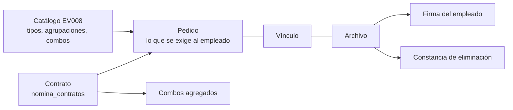

# Análisis: expediente virtual de nómina

> [← README](./README.md) · [Reglas](./REGLAS-DE-NEGOCIO.md) · [ADR-001](./ADR.md)
> Lectura de código (rama `feature/contabilidad-archivos-documento-equivalente`) y base `demo-6-07-2026` del 2026-11-06. Referencia completa: [análisis de ahorros](../../ahorrosyaportes/archivos-ahorros/ANALISIS.md) e [implementación de ahorros](../../ahorrosyaportes/archivos-ahorros/IMPLEMENTACION.md).

## Qué ya existe

| Pieza | Hoy | Conclusión |
|---|---|---|
| Nómina | Ningún expediente: ni tablas, ni pantallas, ni menú | Se arranca limpio, sin migrar datos |
| Ahorros | Expediente completo (catálogo EV007, pedidos, subir, eliminar, firma, acta) | **Plantilla a clonar**: comportamiento, modelo y reparto del código |
| `nomina_documentonomina*` | Existen, pero son el **documento de liquidación de nómina** | Los nombres de ahorros (`documentoahorro` → `documentonomina`) **chocan**. Ver [nombres](#nombres) |

**Aviso:** `pg-demo` apunta hoy a `demo-6-07-2026`, donde no están las tablas de ahorros ni de contabilidad ni los menús EV006/EV007. Las comparaciones de BD contra ahorros se hacen sobre los scripts y el código, no sobre esta base.

## El contrato en nómina

| Tabla | Qué es | Para el expediente |
|---|---|---|
| `nomina_contratos` | El contrato: `id, fechacreacion` | **Dueño** del expediente (R1) |
| `nomina_contratogenerales` | Las versiones: `idcontrato, idtercero, nrocontrato, fechainicio, fechacambio, idestado, fechafinalizacion, fecharetiro...` | El empleado (`idtercero`) es a quien se pide y quien firma (R2) |

- El grid de **Contratos** (`Views/NominaContrato/Contratos.cshtml`, fuente `VistaContratosWebApi`) lista **versiones**: su `Id` es la versión, `Idcontrato` el contrato. El botón "Documentos" se pone junto a "Editar" e "Imprimir", que ya usan `e.row.data.Idcontrato`.
- En `demo`: 19 contratos, 28 versiones, ningún contrato cambia de empleado entre versiones, un empleado con dos contratos.
- Borrar desde el grid (`ContratoGeneralesActorNegocio.EliminarContrato`, línea 74) borra la versión y, si era la última, **borra el contrato de verdad** (`ContratosActor.Delete`). Con FK `RESTRICT` del pedido al contrato, ese borrado falla si hay expediente (R34); el mensaje claro es R35.
- Fin de contrato: hay `fechafinalizacion` y `fecharetiro`, pero vencer por fin de contrato (R25) quedó fuera de alcance.

## Cómo funciona

Igual que ahorros, cambiando cuenta por contrato y titular por empleado:

Estados, acciones y vistas: idénticos a ahorros ([estado calculado](../../ahorrosyaportes/archivos-ahorros/ANALISIS.md#el-estado-se-calcula-no-se-guarda)).

## Nombres

Regla (usuario, 2026-11-07): **los nombres llevan `nomina`** para no chocar con otras partes del código. Se toma el nombre de ahorros y se cambia `ahorro` por `archivonomina` (catálogo, pedidos, archivos) y `cuentaahorro` por `contratonomina` (lo que cuelga del contrato).

No sirve la raíz `documentonomina`: `nomina_documentonomina`, `nomina_documentonominacontrato`, `nomina_tipodocumentonomina` y `nomina_vistadocumentonomina` ya existen (liquidación de nómina) y sus clases también (`TipoDocumentoNomina`, `DocumentoNominaContrato`). Los nombres de abajo se buscaron como clase en el repo y como tabla en `demo`: ninguno existe (2026-11-07).

| Ahorros | Nómina | Clase | Feature |
|---|---|---|---|
| `ahorrosyaportes_agrupaciondocumentoahorro` | `nomina_agrupaciondocumentoarchivonomina` | `AgrupacionDocumentoArchivoNomina` | 1 |
| `ahorrosyaportes_documentoahorro` (tipo) | `nomina_documentoarchivonomina` | `DocumentoArchivoNomina` | 1 |
| `ahorrosyaportes_combodocumentoahorro` | `nomina_combodocumentoarchivonomina` | `ComboDocumentoArchivoNomina` | 1 |
| `ahorrosyaportes_documentosahorrocombo` | `nomina_documentosarchivonominacombo` | `DocumentosArchivoNominaCombo` | 1 |
| `ahorrosyaportes_cuentaahorrocombo` | `nomina_contratonominacombo` | `ContratoNominaCombo` | 2 |
| `ahorrosyaportes_documentoahorrocuenta` (pedido) | `nomina_documentoarchivonominacontrato` (FK `idcontrato` → `nomina_contratos` `RESTRICT`) | `DocumentoArchivoNominaContrato` | 2 |
| `ahorrosyaportes_archivoahorro` | `nomina_archivonomina` | `ArchivoNomina` | 3 |
| `ahorrosyaportes_cuentaahorrodocumentacion` (vínculo) | `nomina_contratonominadocumentacion` | `ContratoNominaDocumentacion` | 3 |
| `generales_parametroscarpetavirtual.escarpetavirtualahorros` | `.escarpetavirtualnomina` | — | 3 |
| vistas `vistadocumentoahorro{estado,cargados,pendientes,vencidos}` | `nomina_vistadocumentoarchivonomina{estado,cargados,pendientes,vencidos}` | `VistaDocumentoArchivoNomina*` | 3 |
| `firmas_firmaarchivoahorro` | `firmas_firmaarchivonomina` | `FirmaArchivoNomina` | 5 |
| `ahorrosyaportes_documentoahorroformato` | `nomina_documentoarchivonominaformato` | `DocumentoArchivoNominaFormato` | 8 |

Clases de negocio y controladores siguen el mismo cambio: `DocumentoAhorro*` → `DocumentoArchivoNomina*`, `ArchivoAhorro*` → `ArchivoNomina*`, `CuentaAhorroCombo*` → `ContratoNominaCombo*`. Menú **EV008** `~/DocumentoArchivoNomina`. Permisos: los de ahorros con sufijo `Nomina` (ej. `AgregarMasCombosNomina`).

## Qué se clona de ahorros

Por módulo (dato de sesiones anteriores): unas 13 tablas, unas 10 clases de `Negocio/` y sus controladores. En ahorros:

- `Negocio/AhorrosyAportes/`: `ArchivoAhorroEliminacion`, `ArchivoAhorroReglas`, `ArchivoAhorroSubida`, `CuentaAhorroComboAsignacion`, `DocumentoAhorroArchivoConsulta`, `DocumentoAhorroCuentaAsignacion`, `DocumentoAhorroCuentaPermisos`, `DocumentoAhorroOpciones`, `DocumentoAhorroValidacion`, `DocumentosAhorroComboAsignacion` (todas `ActorNegocio`).
- MVC: `DocumentoAhorro`, `DocumentoAhorroCuenta`, `DocumentoAhorroArchivo`, `FirmaArchivoAhorro`.
- WebApi: agrupación, combo, tipo, formato, pedido por cuenta, archivo, y las 4 vistas.
- Puntos compartidos que se tocan (no se clonan): parametrización de carpetas (EV001), constancia/acta de eliminación (una línea `AddRange` por módulo, R41), firma VozData.
- Commits de referencia, en orden: `f999fad8f` (plantillas), `8889fef4a` (combos por cuenta), `c4bf62ac3` (archivos), `f7e0f69c8`/`55a4bd3e7` (eliminación), `5cf22f6dd`/`9a2280f18` (firma), `46168ccf8` (acta).

## Scripts

En `C:\Users\User\DataGripProjects\scriptsSiian\nomina\scratch\archivos-nomina\<n>-<feature>\NN-*.sql`, copiando los de `ahorrosyaportes\entregable\archivos-ahorros\` con los nombres de arriba. Idempotentes, con reversión, los corre el usuario. Viven en `scratch/` hasta enviarse a producción; solo entonces pasan a `entregables/YYYY-MM-DD-entregable/`.
