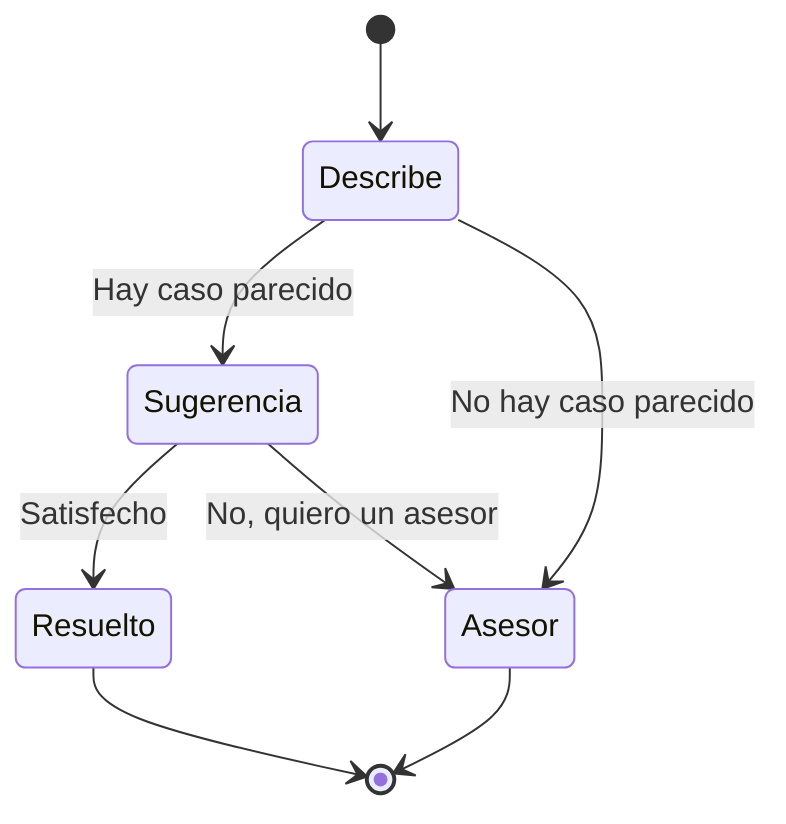

# Requerimiento: asistente que resuelve problemas comunes con lo ya respondido

**Estado:** idea para el futuro. Nace de una conversación (2026-10-08) probando consultas sobre la BD de demo. No está planeada ni tiene fecha.

## 1. La idea

Hoy, cuando un cliente tiene un problema, radica un ticket y espera a un asesor. Muchos problemas se repiten y ya se respondieron antes. La idea es que, **antes** de llegar al asesor, el cliente describa su problema y reciba una respuesta basada en lo que ya se resolvió.

Flujo imaginado:

| Estado | Qué pasa |
|---|---|
| Describe | El cliente cuenta su problema con sus palabras |
| Sugerencia | El asistente responde con la solución de un caso parecido y pregunta si quedó satisfecho |
| Resuelto | El cliente confirma. No se crea ticket, o se crea ya cerrado para tener el registro |
| Asesor | El cliente pide hablar con una persona, o no hay nada parecido. Se crea el ticket con lo ya conversado, para que no tenga que repetirlo |

## 2. Qué encontramos en la BD de demo (2026-10-08)

Se hizo una prueba a mano, consultando tickets cerrados y sus mensajes.

- **Funcionó** con el error de factura electrónica por municipio inválido (TKT-000041): el error exacto estaba guardado en el ticket, el asesor escribió la solución en un mensaje (corregir el código de municipio, que debe ser DANE de 5 dígitos, en la pantalla de ubicación geográfica) y el cliente confirmó que quedó resuelto.
- **Quedó a medias** con el error de condonación (TKT-000023 y TKT-000028): se sabe que pasó dos veces y la causa raíz dice "Modificación rubros de crédito", pero no quedó escrito qué se cambió.
- **No sirvió** con "no permite envío de factura" (TKT-000051): se cerró sin que se vea la solución.
- **La causa raíz casi siempre trae el nombre del cliente**, no la causa (CREDIFUTURO, MICREDITOYA, CONFIAMOS).
- Había 70 tickets de soporte, pocos para tener cobertura amplia. En producción habría más.

**Conclusión:** la calidad del asistente depende de que el cierre del ticket deje escrito *qué se hizo para solucionarlo*. Eso hoy no es una obligación.

## 3. Antecedentes: no es una idea nueva

Es una categoría de producto establecida, llamada "ticket deflection" o agentes de resolución:

- **Intercom Fin** toma lo que dice la documentación y las resoluciones de tickets pasados; si no puede resolver, pasa la conversación a una persona con el resumen. [Fin para Zendesk](https://fin.ai/help/en/articles/13975787-fin-for-zendesk-tickets-how-does-it-work)
- **Zendesk AI Agents** hace lo mismo con fuentes de conocimiento configuradas a mano y entrega a un asesor con el resumen. [Comparativa](https://myaskai.com/blog/zendesk-ai-intercom-ai-comparison-2026)
- **Ticket deflection** como concepto. [Zendesk](https://www.zendesk.com/blog/help-center/self-service/ticket-deflection-currency-self-service/)
- Las cifras de resolución de 80 % o más que citan son **afirmaciones de los propios proveedores**, sin verificar.
- Dos advertencias de esas fuentes que aplican acá: la calidad depende de la documentación (en nuestro caso, de cómo se cierran los tickets) y "deflexión" no es lo mismo que "resuelto" (hay clientes que se rinden ante una mala respuesta).

Falta evaluar si conviene **comprar** una de estas herramientas o construirlo dentro de SIIAN. Esa decisión iría en un `ADR.md`.

## 4. Límites y riesgos

- **Costo por uso.** Cada pregunta de un cliente consumiría tokens. Se busca primero en la BD y solo se envían al modelo los pocos casos relevantes, no todo el historial, así que el costo por pregunta es acotado. Aun así crece con el uso y habría que estimarlo con volumen real antes de decidir.
- **Calidad del historial.** Sin soluciones escritas, no hay respuesta que dar (ver sección 2).
- **Datos de otros clientes.** Los tickets traen nombres, documentos y créditos. Una respuesta nunca debe mostrar datos de otro cliente; hay que anonimizar o dar solo la solución genérica.
- **Respuestas inventadas.** El asistente solo debe responder con lo que existe en casos resueltos y decir "no encontré nada parecido" en lugar de improvisar.
- **Búsqueda por palabras.** "No me deja entrar" y "credenciales inválidas" pueden no encontrarse entre sí. Mejora con búsqueda por significado, que es más trabajo.
- **El cliente siempre puede pedir un asesor**, en cualquier momento.

## 5. Fuera de alcance por ahora

- Acciones automáticas sobre los datos del cliente (solo explica, no ejecuta).
- Sustituir al asesor: el asesor sigue atendiendo todo lo que el asistente no resuelva.

## 6. Preguntas abiertas

- ¿Quién lo usaría primero: el **cliente** al radicar un ticket, o el **asesor** para responder más rápido? Es una decisión que cambia mucho el riesgo (un error frente al cliente cuesta más que frente al asesor).
- ¿Se exige escribir la solución al cerrar un ticket? Es prerrequisito, y vale la pena aunque nunca se construya el asistente.
- ¿Construir dentro de SIIAN o comprar una herramienta?
- ¿Cuántos tickets por mes hay en producción y cuántos son repetidos? Ese dato dice si vale la pena.

## 7. Verificación futura

Antes de planear: medir cuántos tickets cerrados tienen una solución legible escrita y qué porcentaje se repite.
