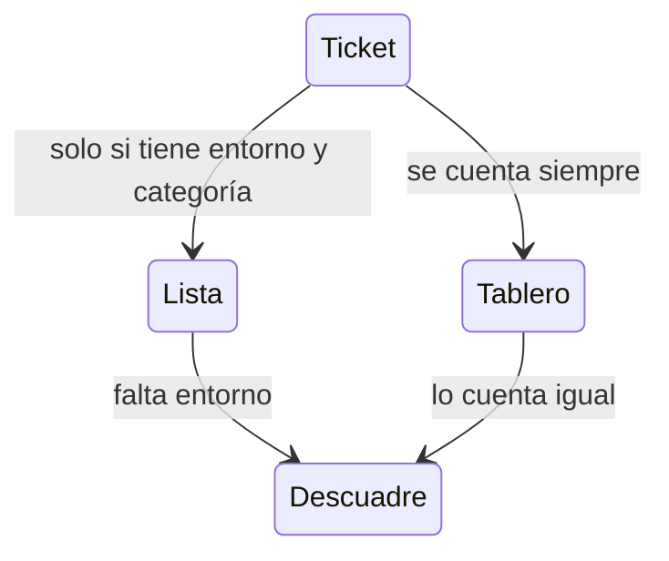

# Análisis

> Negocio, sin código. El detalle técnico va en [PLAN.md](./PLAN.md).

## Qué existe hoy

En el portal, la pantalla de tickets tiene dos partes que se calculan **por separado**:

- **Tablero (tarjetas):** cuenta los tickets de la empresa del usuario, agrupados por estado, más una tarjeta "Vencidos".
- **Lista (grilla):** muestra los tickets de la misma empresa. Al pulsar una tarjeta, la lista se filtra por ese estado.

Las dos parten de los mismos tickets, pero cada una aplica sus propias condiciones. La lista exige que el ticket tenga **entorno** y **categoría** registrados; el tablero no. Un ticket sin entorno se cuenta arriba y desaparece abajo.

El tablero de soporte (interno) ya resolvió esto mejor: su lista no exige entorno, por eso el 705 sí aparece ahí.

## "Vencidos" significa cosas distintas

- **Tablero de soporte:** vencido = ticket **no cerrado ni solucionado** cuya **fecha límite (SLA) ya pasó**. La tarjeta filtra la lista con esa misma condición.
- **Portal:** la tarjeta cuenta con la misma regla, pero **no filtra la lista** (no se puede pulsar) y la lista no sabe qué ticket está vencido. El número no se puede comprobar.
- Además existe un **estado** "VENCIDA" que no tiene tarjeta en ninguno de los dos tableros.

## Causa del caso 705 (hipótesis)

El 705 aparece en soporte, así que su categoría existe. La única condición que lo deja fuera de la lista del portal es el **entorno vacío**. Falta confirmarlo en producción (caso 1 del plan).

## Hipótesis descartadas

- **Categoría inexistente:** descartada, el 705 aparece en el tablero de soporte, cuya lista también exige categoría.
- **Filtro de pantalla guardado:** descartada, no aparece ni con "Todos" ni buscándolo.
- **Alcance distinto (empresa):** descartada, tablero y lista del portal filtran por la misma empresa.

## Reglas

| # | Regla | Porqué | Estado |
|---|---|---|---|
| R1 | Cada número del tablero del portal sale de los **mismos tickets** que lista la grilla: al pulsar una tarjeta, la lista muestra exactamente esa cantidad. | Caso 705; no es el primer reporte. Dos cálculos separados se desalinean con cada cambio. | se cumple con R2; contar el tablero sobre la grilla queda fuera por ahora |
| R2 | Un ticket del cliente aparece en su lista **aunque le falte el entorno o la categoría** (se muestran vacíos). | Un dato opcional faltante no puede esconder un ticket. | acordada (causa por confirmar en producción) |
| R3 | "Vencido" en el portal significa lo mismo que en el tablero de soporte: no cerrado ni solucionado y con la fecha límite pasada. | Pedido textual: "deberia de significar lo mismo que significa aca". | acordada |
| R4 | La tarjeta "Vencidos" filtra la lista como las demás. | Sin eso, R1 no se cumple para Vencidos. | propuesta |
| R5 | Las tarjetas **no** tienen que sumar el Total: Vencidos se cruza con los estados abiertos, y los estados "VENCIDA" y "ANULADA" no tienen tarjeta. | Igual que el tablero de soporte hoy. | propuesta, confirmar en la entrevista |

## Fuera de alcance

- El tablero de soporte tiene el mismo riesgo con la categoría (la lista la exige y las tarjetas no). Hoy no hay casos reportados; queda como seguimiento aparte.
- Usuarios del portal sin empresa asignada: sus tickets no se ven en ninguna parte. Es otro problema (ver [tickets-por-empresa](../tickets-por-empresa/)).
