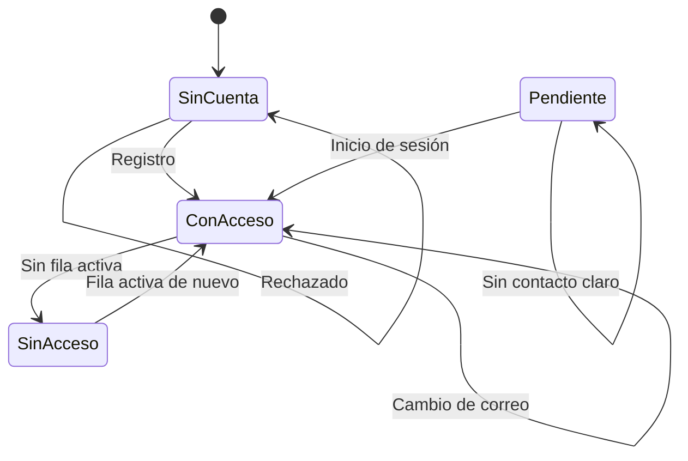

# Análisis: inicio de sesión de terceros en el portal de tickets

Spec de negocio para [`REQUERIMIENTO.md`](./REQUERIMIENTO.md). Plan técnico en [`PLAN.md`](./PLAN.md). Versión 4 (2026-10-08): sin marca extra en los contactos, correo repetido validado en el código y cuentas viejas que se asocian solas al iniciar sesión. Ajuste del 2026-10-08: la migración nunca cambia la empresa de una cuenta que ya la tiene (R-A), así que no hay respaldo.

## 0. Qué ya existe

| Pieza de SIIAN                                             | Qué hace hoy                                                                                                                              | Conclusión                                                                                                                    |
| ---------------------------------------------------------- | ----------------------------------------------------------------------------------------------------------------------------------------- | ----------------------------------------------------------------------------------------------------------------------------- |
| Contactos del tercero (Información tributaria → contactos) | Por cada empresa (SIIAN, DCAPITAL, IPLAS…) lista a las personas de contacto, con tipo, teléfono, **correo**, principal y activo           | **Fuente de verdad única** del acceso al portal: quién entra, con qué correo y a qué empresa. Es lo que pide el requerimiento |
| La misma lista, en otros módulos                           | Factura electrónica, nómina electrónica, pagaré, cartera y cobranzas leen estos contactos (por ejemplo, el contacto principal del emisor) | **No se toca su estructura ni se le agregan candados**: el correo repetido se controla en el portal (R-C)                     |
| Empresas de una persona en el portal                       | Ya se calculan desde esa lista (filas activas), pero sin mirar el correo                                                                  | Se reutiliza para saber en qué empresa es contacto una persona                                                                |
| Registro en el portal                                      | Pide documento, correo, contraseña y **la empresa**                                                                                       | Deja de pedir la empresa: sale del contacto                                                                                   |
| Login en el portal                                         | Usa el correo guardado en la cuenta; si no hay empresa, la pide                                                                           | Usa el correo **actual del contacto**. Si la persona no es contacto activo de su empresa, **no entra**. Nunca pide empresa    |
| Autorización del tercero para el portal                    | Otra lista que habilita al tercero                                                                                                        | Sigue igual, no está en el pedido                                                                                             |
| Tickets                                                    | Atados a la cuenta del portal                                                                                                             | No se tocan: cortar el acceso no borra nada                                                                                   |

## 1. Regla central

**Una cuenta del portal = una persona en una empresa.** La lista de contactos dice, siempre en vivo, si esa persona puede entrar y con qué correo:

- **Si tiene acceso:** solo mientras la persona tenga una fila de contacto **activa** en esa empresa.
- **Con qué correo entra:** el correo de esa fila activa, **hoy**. Si en SIIAN se le cambia el correo, desde ese momento entra con el nuevo (misma contraseña, misma cuenta, mismos tickets) y **el viejo deja de funcionar**. Da igual cómo lo cambien: editando la misma fila, o creando otra fila e inactivando la vieja (H9, H11).
- **Qué pasa si la fila se borra y se vuelve a crear:** la cuenta **se recupera sola**, con la misma contraseña y los mismos tickets. La cuenta no depende de la fila puntual sino de la persona y la empresa.
  - **Para recuperarla**, la fila nueva se crea en **la misma empresa** y seleccionando **el mismo documento**. El grid busca la persona por documento o nombre, y el documento es único en terceros. **El correo puede ser otro:** entra con el de la fila nueva, porque el correo siempre se lee del contacto, no de la cuenta. Solo tiene que cumplir R-C (no estar activo en otro contacto).
  - **Borrar la fila no borra a la persona**, solo la saca de los contactos de esa empresa. La persona (el tercero) tampoco se puede eliminar mientras tenga cuenta en el portal.
  - **Si la fila nueva se crea en otra empresa**, no se recupera esa cuenta: es otra cuenta (R-A).
- **Un correo, un contacto:** el correo con el que entra tiene que apuntar a **un solo contacto activo** (una persona en una empresa). Si apunta a más de uno, no se puede saber a quién pertenece: el sistema no deja entrar ni registrarse y manda a soporte (R-C).

| Transición           | Condición / efecto                                                                                                                                                                                           |
| -------------------- | ------------------------------------------------------------------------------------------------------------------------------------------------------------------------------------------------------------ |
| Registro             | Documento + correo + contraseña. El correo es de **un solo** contacto activo, ese contacto es de esa persona y esa persona todavía no tiene cuenta en esa empresa. La empresa sale del contacto              |
| Rechazado            | El correo no está en ningún contacto activo, es de otra persona, está en más de un contacto, ya tiene cuenta en esa empresa ("use recuperar contraseña"), o tiene una cuenta vieja sin empresa ("pendiente") |
| Cambio de correo     | En SIIAN se cambia el correo del contacto. Desde ese momento entra con el correo nuevo y el viejo deja de funcionar, también en la sesión abierta                                                            |
| Sin fila activa      | Se inactiva o se borra el contacto, o se cambia la persona de la fila. Se corta en la siguiente acción, incluso con la sesión abierta                                                                        |
| Fila activa de nuevo | Se reactiva el contacto, o se crea uno nuevo para la misma persona en la misma empresa. Entra con la misma cuenta y la misma contraseña                                                                      |
| Pendiente            | Cuenta vieja **sin empresa** (R-B). Al iniciar sesión con el correo de un contacto activo, la cuenta queda asociada a la empresa de **ese** contacto y entra. Si el correo no es de ningún contacto activo, no entra y se le pide contactar a soporte e indicar su empresa |

## 2. Hallazgos

- **H1. Causa del error del punto 3.** Hoy una persona solo puede tener **una cuenta en todo el portal**: el documento es único en la tabla de usuarios. Pasa a ser una cuenta por persona **y empresa**.
- **H2. El correo del registro nunca se compara con el del contacto.** Cualquiera con el documento de un contacto activo se registra con cualquier correo.
- **H3. Usuarios actuales (base demo, de pruebas).** De 14 cuentas, 8 no tienen empresa y solo 2 son contacto activo de la empresa de su cuenta. Otras 4 tienen empresa, pero la persona no figura como contacto de ella.
- **H4. Ya hubo correos repetidos en contactos** (en demo: la misma persona cargada dos veces, y un correo en dos empresas). No se bloquean con un candado en la base; se detectan al entrar (R-C).
- **H5. La lista de contactos es compartida.** La usan factura electrónica, nómina electrónica, pagaré, cartera y cobranzas, y el código se despliega en todas las instalaciones. Un candado de correo único en esa lista puede bloquear casos válidos de otros módulos (por ejemplo, un contador con el mismo correo para varias empresas).
- **H6. La sesión dura 8 horas.** Revisar el acceso solo en el login dejaría a la persona adentro hasta 8 h. Por eso se revisa en cada acción.
- **H7. El ticket no guarda su empresa.** La empresa de un ticket se calcula con la empresa de la cuenta que lo radicó. Como la cuenta es "persona en empresa", no cambia de empresa y los tickets no se mueven, ni siquiera en la migración (H10).
- **H8. Solo el cliente dueño puede reasignar sus tickets.** Ningún agente de SIIAN puede cambiar el dueño de un ticket del portal. Si al dueño se le corta el acceso, sus tickets abiertos no los puede pasar nadie.
- **H9. En el grid, las filas se borran y se rehacen.** En demo, la persona 7 de SIIAN tiene una fila inactiva con su correo viejo y una activa con el nuevo: el cambio de correo se hizo **creando otra fila**. Si la cuenta dependiera de una fila puntual, estos usos normales le harían perder la cuenta.
- **H10. Hay cuentas con empresa cuya persona ya no es contacto activo de ella** (en demo, las cuentas 1 y 12; la 1 con 6 tickets abiertos). **No se mueven:** si la migración las pasara a la empresa donde hoy es contacto, sus tickets se irían con ella a otra empresa. Por R-A quedan sin acceso, con sus tickets visibles para los compañeros de su empresa. Si soporte vuelve a cargar a la persona como contacto de esa empresa, recupera la cuenta; si ahora es contacto de otra, se registra allí con otra cuenta.
- **H11. Un correo viejo no debe seguir entrando.** Si el cambio de correo se hace creando otra fila, la fila vieja (inactiva) conserva el correo viejo. Si el login lo buscara ahí, el correo viejo seguiría entrando. Por eso **solo un contacto activo da acceso**; las filas inactivas sirven únicamente para mostrar "acceso deshabilitado" a quien quedó sin contacto.
- **H12. El listado de tickets calcula la empresa desde los contactos, no desde la cuenta.** La vista del listado (`soporte_soportevistaticketoscliente`) toma la empresa con el menor id entre los contactos activos de la persona; el detalle y el tablero usan la empresa de la cuenta. Con una persona en dos empresas, el listado puede mostrar una empresa y el detalle otra; si se inactiva el contacto, la empresa queda vacía y sus tickets desaparecen del listado de la empresa, lo que contradice el punto 4 del requerimiento. Por eso la empresa de la cuenta **no decide el acceso** (eso lo hace el contacto), pero **sí ancla** a qué empresa pertenecen la cuenta y sus tickets. La vista del listado pasa a usar la empresa de la cuenta, igual que el detalle y el tablero.

## 3. Reglas decididas

- **R-A. Cambiar de empresa es tener otra cuenta.** Si alguien pasa de DCAPITAL a IPLAS, se inactiva su contacto en DCAPITAL y se crea uno en IPLAS. Se registra de nuevo en IPLAS (con un correo distinto, R-C). La cuenta de DCAPITAL queda sin acceso, con sus tickets en DCAPITAL. Si vuelve a DCAPITAL, recupera esa cuenta. **La empresa de una cuenta solo se escribe al crearla y al completar una cuenta vieja sin empresa (R-B); nunca se cambia una que ya la tiene, tampoco en la migración (H10).**
- **R-B. Cuentas viejas: se limpian una sola vez y soporte las parametriza.**
  1. **Migración de una vez:** solo toca las cuentas **sin empresa**. Las que ya tienen empresa no cambian, sean o no contacto de ella (R-A, H10).
     - Si la persona es contacto activo de **una sola** empresa (y no tiene ya otra cuenta en ella), la cuenta queda asociada a esa empresa en la migración.
     - Si no, sigue "sin empresa" hasta que soporte parametrice los contactos. Mientras tanto sus tickets no aparecen en el portal de ninguna empresa (H12); en SIIAN siguen visibles.
  2. **Soporte parametriza bien** los contactos (persona, empresa, correo). Es el trabajo que ya hacen.
  3. **Al iniciar sesión**, una cuenta sin empresa se asocia sola a la empresa del contacto activo que tiene ese correo (R-C garantiza que es uno solo, así que el correo ya decide la empresa). Si el correo no es de ningún contacto activo, no entra y ve: "Su cuenta no está asociada a ninguna empresa. Contacte a soporte e indique la empresa a la que pertenece." Soporte carga el contacto en esa empresa con el correo que corresponda y en el siguiente inicio de sesión la cuenta queda asociada.
  4. **Mientras la cuenta no se asocie, no puede crearse otra:** si intenta registrarse de nuevo, se rechaza con "Ya tiene una cuenta registrada pendiente de asociar a una empresa. Contacte a soporte e indique la empresa a la que pertenece."

  Ningún caso pierde datos: los tickets están atados a la cuenta.
- **R-C. Correo repetido: se valida en el código, no con un candado en la base.** Cada persona o empresa usa un correo **distinto** (lo pide el requerimiento). Si aun así un correo activo coincide con más de un contacto (una persona en otra empresa u otra persona), el login y el registro responden: "El correo está asignado a más de un contacto activo. Contacte a soporte." La misma persona cargada dos veces en la misma empresa **no** es ambigua: es la misma cuenta. Para pasar un mismo correo de una empresa a otra, se inactiva en una y se activa en la otra.
  *Por qué no un candado en la base:* esa lista la comparten otros módulos (H5), y un candado los bloquearía. Costo: el conflicto se descubre cuando alguien intenta entrar, no al guardar el contacto.
- **R-D. Cortar el acceso es suspender, no borrar.** Así trabajan las herramientas de soporte conocidas (ver Referencias):

  | En SIIAN | Equivale a | Efecto |
  |---|---|---|
  | Inactivar o borrar el contacto | *Suspend* (Zendesk) / *Revoke access* (Jira) | Reversible: al reactivar o recrear el contacto vuelven la misma cuenta y la misma contraseña. Tickets intactos |

  No hay un "borrado definitivo" de la cuenta desde la lista de contactos. Jira y Freshdesk lo tienen como acción aparte y con advertencia. Acá no hace falta: la cuenta sin contacto no entra.

  **Quien queda suspendido y entra con su último correo conocido** ve "Su acceso al portal fue deshabilitado. Contacte a soporte." (solo si la contraseña es correcta; si no, "credenciales incorrectas").

  **Tickets abiertos de quien pierde el acceso:** se quedan como están. Los compañeros de la empresa los siguen viendo en solo lectura y el agente los atiende y los cierra como hoy. Que un agente cambie el dueño desde SIIAN (lo que en Zendesk hace el agente al cambiar el *requester*) queda como incremento aparte (H8).

## 4. Preguntas abiertas

Ninguna que cambie el enfoque. Al migrar en producción, pasarle a soporte la lista de cuentas que quedan sin acceso (H10) y sin empresa (R-B), para que revisen los contactos.

## 5. Fuera de alcance

- Lista de autorización del tercero para el portal (sigue igual).
- Trasladar tickets entre cuentas o empresas.
- Que el cliente cambie su correo desde el portal: el correo se cambia **solo** en SIIAN.
- Pantalla o reporte en SIIAN para ver quién tiene cuenta o cuáles quedaron sin asociar: soporte se entera cuando la persona escribe. Si las solicitudes crecen, pasa a ser un incremento.
- Candado de correo único en la base de datos o marca de "contacto del portal" en los contactos: se evaluaron y se descartaron (R-C). Si aparecen choques reales, se retoman.
- Aviso en el grid de contactos al guardar un correo que ya está activo en otro contacto ("no podrá entrar al portal"), sin bloquear el guardado. Por ahora soporte corre una consulta de correos repetidos antes de desplegar (PLAN, Tarea 5) y los corrige parametrizando bien los contactos. Si los conflictos se vuelven frecuentes, pasa a ser un incremento.
- Recuperar la contraseña de una cuenta que todavía no se asoció a una empresa.
- Que un agente cambie el dueño de un ticket desde SIIAN (R-D, H8): es el siguiente incremento.
- Avisarle a la persona que perdió el acceso: Zendesk tampoco avisa, lo hace el agente por su cuenta.

## 6. Verificación

- Registro con documento + correo de un contacto activo: entra sin elegir empresa, y la empresa es la del contacto.
- Mismo documento con el correo de su contacto en **otra** empresa: se crea una segunda cuenta.
- Correo que no está en ningún contacto activo, o que es de otra persona: rechazado.
- Correo en dos contactos activos distintos: rechazado con "contacte a soporte". Correo en dos filas de la misma persona y empresa: se acepta.
- En SIIAN se cambia el correo del contacto: el login con el correo nuevo funciona con la misma contraseña, el viejo falla, y la sesión abierta se corta en la siguiente acción.
- Se inactiva el contacto viejo y se crea otro con correo nuevo: el correo nuevo entra y el viejo falla.
- Se borra el contacto y se recrea igual: vuelve a entrar con la misma cuenta, contraseña y tickets.
- Inactivar el contacto: sale del portal en la siguiente acción; reactivarlo: vuelve a entrar. Sus tickets siguen visibles en SIIAN. Con su último correo y su contraseña ve "acceso deshabilitado".
- Cuenta vieja sin empresa que entra con el correo de un contacto activo: queda asociada a la empresa de ese contacto y entra con sus tickets, aunque la persona sea contacto de varias empresas. Con un correo que no es de ningún contacto activo: no entra y ve el mensaje de "indique su empresa a soporte". Si intenta registrarse de nuevo: rechazado con "pendiente".
- Migración: ninguna cuenta con empresa cambia. De las cuentas sin empresa, las de persona con un solo contacto activo quedan asociadas a esa empresa y el resto sigue sin empresa.
- El correo de la cuenta guardado se actualiza al correo vigente del contacto cuando la persona inicia sesión.
- Un compañero sin contacto activo no aparece en los destinos de reasignación.
- Persona contacto de dos empresas, con una cuenta en cada una: el listado y el detalle de cada ticket muestran la misma empresa, la de la cuenta que lo radicó. Al inactivar su contacto, sus tickets siguen en el listado de la empresa (H12).

## 7. Referencias

- Zendesk: suspender a un usuario no borra sus tickets, no puede entrar ni crear nuevos, y al quitar la suspensión recupera sus credenciales y accesos. [Suspending and unsuspending end users](https://support.zendesk.com/hc/en-us/articles/4408889293978-Suspending-and-unsuspending-end-users), [Understanding and allowing user suspension](https://support.zendesk.com/hc/en-us/articles/8009733465370-Understanding-and-allowing-user-suspension)
- Zendesk: los tickets cerrados conservan la organización que tenían al cerrarse; el agente puede cambiar el *requester*. [Updating ticket requesters and organizations](https://support.zendesk.com/hc/en-us/articles/4408886900506-Updating-ticket-requesters-and-organizations), [Managing users in multiple organizations](https://support.zendesk.com/hc/en-us/articles/4408838309530-Managing-users-in-multiple-organizations)
- Jira Service Management: sacar a un cliente de la organización le quita el acceso pero no borra la cuenta; borrar es permanente y recomiendan revocar en su lugar. [Remove a customer from an organization](https://support.atlassian.com/jira-service-management-cloud/docs/remove-a-customer-from-an-organization/), [Revoke access for portal-only customers](https://support.atlassian.com/user-management/docs/revoke-access-for-portal-only-customers/), [Delete a customer account](https://support.atlassian.com/jira-service-management-cloud/docs/delete-a-customers-account/)
- Freshdesk: un contacto bloqueado no puede crear tickets; el borrado normal no toca sus tickets. [Manage Customer Data in Freshdesk](https://support.freshdesk.com/support/solutions/articles/50000010165-manage-customer-data-in-freshdesk)
