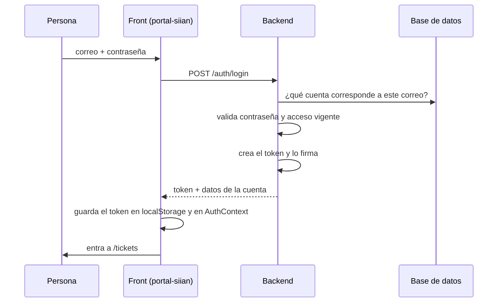
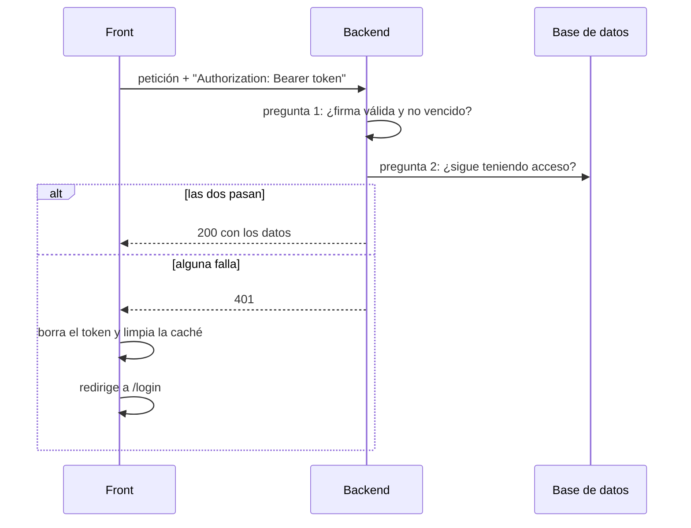

# Explicación: cómo funciona el token entre el front y el backend

Esta nota explica el concepto, sin entrar en el código línea por línea. Al final hay un mapa de archivos por si querés ir a verlo.

## 1. La idea en una frase

El token es un **pase de acceso con firma**. El backend lo entrega al iniciar sesión, el front lo guarda y lo muestra en cada petición. El backend **no recuerda** quién entró: cada vez que llega un pase, lo revisa desde cero.

Analogía: un carné con foto y sello. El guardia de la puerta no lleva una lista de quién entró hoy; mira el carné y comprueba que el sello sea auténtico. Nuestro cambio fue agregar un paso más: después de mirar el sello, el guardia también llama a recepción para confirmar que esa persona **todavía trabaja ahí**.

## 2. Qué lleva el token

Un JWT trae datos y una firma:

| Dato (claim) | Para qué sirve |
|---|---|
| `portal_id` | Id de la cuenta del portal |
| `email` | Correo con el que entró |
| `portal_tercero` | La persona |
| `portal_empresa` | La empresa de la cuenta |
| Vencimiento | Por defecto 8 horas (`PortalJwtHoras` en `Web.config`) |

La **firma** se calcula con una clave secreta que solo tiene el servidor (`PortalJwtSecret`). Si alguien cambia un dato del token, la firma deja de coincidir y el backend lo rechaza. Por eso el front puede guardar el token sin poder falsificarlo.

Ojo: la firma garantiza que **el token no fue alterado**, no que **la persona todavía tenga permiso**. De esa diferencia sale todo lo demás.

## 3. Las dos preguntas que hace el backend

Cada vez que llega un token, `ValidarToken` hace dos comprobaciones distintas:

| Pregunta | Se resuelve con | Qué detecta |
|---|---|---|
| **1. ¿El token es auténtico y no venció?** | Matemática (firma y fecha). No consulta la base de datos. | Token falsificado, alterado o vencido |
| **2. ¿Esta persona sigue teniendo acceso hoy?** | Consulta a la base de datos (nuestro agregado) | Contacto inactivado o borrado, correo cambiado, correo repetido |

Sin la segunda pregunta, un token firmado seguiría funcionando hasta que venza (8 horas) aunque soporte ya hubiera quitado el acceso. Eso era el hueco que vimos con el cambio de correo.

La pregunta 2 tiene tres condiciones, y si falla cualquiera el token se rechaza:

1. La cuenta está activa y su persona es contacto **activo** de su empresa.
2. El correo del token sigue siendo el de ese contacto (si lo cambiaron, ya no coincide).
3. Ese correo no está hoy en más de un contacto activo (el login también lo rechazaría).

## 4. Flujo completo

### 4.1 Al iniciar sesión

El front **no** decodifica ni revisa el token. Solo lo guarda.

### 4.2 En cada petición (ver tickets, crear ticket, etc.)

### 4.3 Qué hace el front con el 401

1. Un interceptor de `axios` (`client.js`) agrega el token a cada petición.
2. Si la respuesta es **401**, el interceptor lanza el evento `auth:logout`. Excepción: un 401 en `/auth/login` no lo lanza, porque ahí significa "contraseña incorrecta", no "sesión caída".
3. `AuthContext` escucha ese evento y llama a `cerrarSesion`: borra el token del `localStorage`, limpia la caché de consultas y deja `token = null`.
4. `PrivateRoute` ve que ya no hay token y redirige a `/login`.

Un **403** no cierra la sesión: es lo que devuelve el login con los mensajes de "contacte a soporte", y se muestra en el alert.

## 5. Quién decide: el backend

`PrivateRoute` solo mira que **exista** un token en `localStorage`. No sabe si está vencido ni si el acceso sigue vigente. Por eso, cuando soporte inactiva a alguien:

- La persona **sigue viendo la pantalla** hasta su siguiente petición al servidor.
- Esa petición recibe 401, y recién ahí el front la saca.

**Ojo: la "siguiente petición" no siempre la hace la persona.** El front también pide datos solo. `TanStack Query` (`queryClient.ts`) trae por defecto `refetchOnWindowFocus` activo y un `staleTime` de 30 segundos (0 en el resumen de tickets): cuando la persona vuelve a la pestaña del portal después de más de 30 segundos, recarga los datos sin que haga clic. Esa petición automática es la que recibe el 401 y la manda a `/login`. Pasa, por ejemplo, al cambiar el correo en SIIAN (otra pestaña) y volver al portal. También se recargan al montar una pantalla y al reconectar la red.

Es el comportamiento esperado, y el front no valida nada por su cuenta. Si el front decidiera el acceso, bastaría con editar el `localStorage` en el navegador para saltarse la regla. Toda regla de acceso vive en el backend; el front solo reacciona a lo que el backend responde.

## 6. El chat en tiempo real (SignalR)

El chat no usa peticiones normales: abre una conexión que queda abierta.

- El token viaja como `access_token` al conectar.
- El hub (`SoporteHub`) lo valida con el mismo `ValidarToken` cuando la persona **se une** a un ticket o al portal (`UnirseATicket`, `UnirseAlPortal`).
- Si el acceso ya no está vigente, el hub responde "No autorizado" y la persona no recibe nada.

**Límite conocido:** la validación ocurre al unirse. Una conexión que ya estaba unida antes de que inactivaran el contacto sigue recibiendo mensajes hasta que se desconecte (cierre de pestaña, corte de red o reconexión). Al reconectar vuelve a pasar por la validación y queda afuera. Si hace falta cerrarla de inmediato, habría que desconectar a la persona desde el servidor en el momento de inactivar el contacto. No está en el alcance de esta tarea.

## 7. Qué cuesta y qué alternativas hay

- **Costo:** cada petición autenticada hace 2 consultas a la base de datos (acceso vigente y correo repetido). Es el precio de que los cambios de soporte surtan efecto de inmediato.
- **Alternativa 1: tokens de vida corta (por ejemplo 15 minutos) con renovación.** Menos consultas, pero el acceso se corta con retraso de hasta 15 minutos, y hay que construir la renovación.
- **Alternativa 2: lista de tokens revocados.** Soporte al inactivar revoca los tokens de esa cuenta. Es más trabajo y no cubre el cambio de correo ni el correo repetido sin lógica extra.
- Se eligió la consulta en vivo porque el volumen del portal es bajo y la regla ("el acceso depende de la lista de contactos hoy") es la que pidió el requerimiento.
- El token se guarda en `localStorage`. Es práctico, pero cualquier script que corra en la página podría leerlo. Es una decisión previa a esta tarea y no la tocamos aquí.

## 8. Resumen de qué pasa en cada escenario

| Qué hace soporte | Qué le pasa a la persona con sesión abierta | Dónde se detecta |
|---|---|---|
| Inactiva o borra el contacto | Su siguiente petición da 401 y vuelve a `/login` | Pregunta 2, condición 1 |
| Le cambia el correo al contacto | Igual: 401 y vuelve a `/login`. Entra con el correo nuevo | Pregunta 2, condición 2 |
| Pone su correo en otro contacto activo | Igual: 401 y, al entrar, el login le dice que contacte a soporte | Pregunta 2, condición 3 |
| No hace nada | Sigue entrando hasta que el token venza (8 horas) | Pregunta 1 |
| Reactiva el contacto | El mismo token vuelve a funcionar si no venció | Pregunta 2 |

## 9. Mapa de archivos

| Qué                                       | Dónde                                                                           |
| ----------------------------------------- | ------------------------------------------------------------------------------- |
| Crear y validar el token                  | `PruebaPostgreSQL/Helpers/PortalJwtHelper.cs` (`GenerarToken`, `ValidarToken`)  |
| Filtro que protege los controladores      | `PruebaPostgreSQL/Filters/PortalApiAuthorizeAttribute.cs`                       |
| Consulta de acceso vigente                | `Blip.Data/Soporte/SoporteUsuarioSistemaActorNegocio.cs` (`TieneAccesoVigente`) |
| Correo repetido                           | `Negocio/Soporte/SoporteUsuarioSistemaActorNegocio.cs` (`CorreoEsAmbiguo`)      |
| Login                                     | `PruebaPostgreSQL/Controllers/WebApi/Portal/PortalAuthWebApiController.cs`      |
| Chat                                      | `PruebaPostgreSQL/Hubs/SoporteHub.cs`                                           |
| Front: agrega el token y reacciona al 401 | `portal-siian/src/api/client.js`                                                |
| Front: guarda y borra la sesión           | `portal-siian/src/context/AuthContext.jsx`                                      |
| Front: protege las rutas                  | `portal-siian/src/components/PrivateRoute.jsx`                                  |
