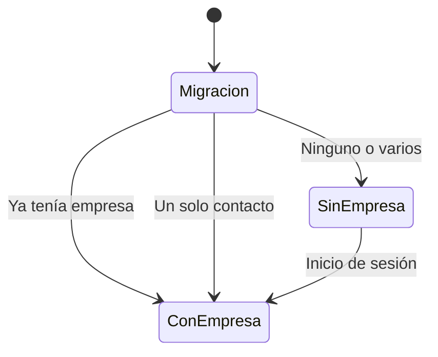
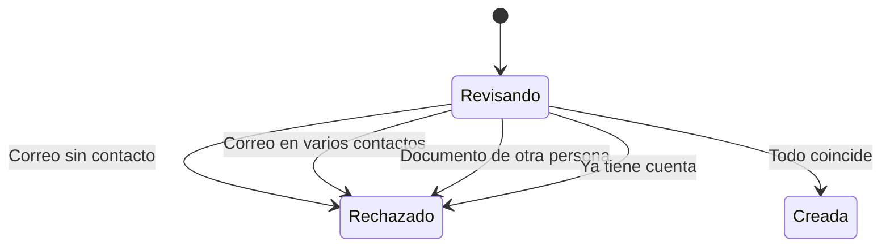
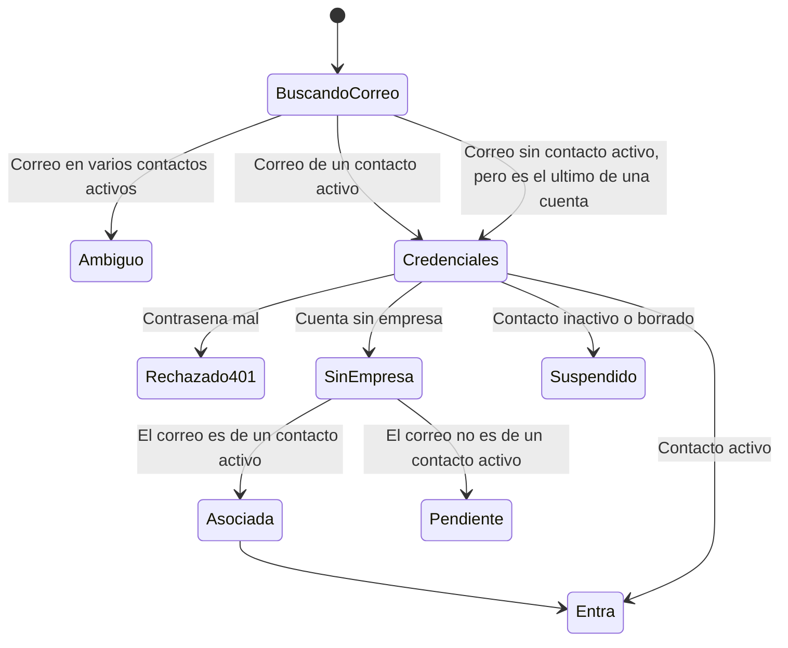

# Explicación: inicio de sesión de terceros

Cómo funciona cada etapa, primero en negocio. Plan técnico en [`PLAN.md`](./PLAN.md). Versión alineada con `ANALISIS.md` v4.

## Etapa 1: base de datos y consulta de acceso

### Qué cambia para el negocio

Hoy el portal permite **una sola cuenta por persona** y **un solo correo por cuenta** en todo el portal. Eso impide que la misma persona tenga cuenta en dos empresas (SIIAN y DCAPITAL, por ejemplo).

Después de esta etapa:

- Una cuenta es **una persona en una empresa**. La misma persona puede tener varias cuentas, una por empresa, con **correos distintos**.
- Existe **una sola pregunta** que decide si alguien puede entrar: *¿esta persona es hoy un contacto activo de esa empresa?* Todo lo demás (login, sesión abierta, chat, correos) usa esa misma pregunta.
- El correo con el que entra es el que tiene hoy su contacto **activo**. Si se cambia en SIIAN, el viejo deja de servir.
- Aún nada cambia para el usuario final: esta etapa solo prepara la base. El registro y el login se tocan en las etapas 2 y 3.

### Qué pasa con las cuentas de hoy

| Paso | Qué ocurre |
|---|---|
| Migración | Se corre una sola vez y solo toca las cuentas **sin empresa**: si la persona es contacto activo de **una sola** empresa, la cuenta queda asociada a ella; si no, sigue "sin empresa". Las cuentas que ya tienen empresa nunca cambian. |
| Con empresa | Entra con el correo de su contacto. Si la persona ya no es contacto activo de esa empresa, queda sin acceso y sus tickets siguen en esa empresa; si soporte la vuelve a cargar como contacto, recupera la cuenta. Si ahora trabaja en otra empresa, se registra allí con otra cuenta. |
| Sin empresa | Soporte parametriza el contacto (persona, empresa, correo). Cuando la persona inicia sesión con el correo de un contacto activo, la cuenta queda asociada a la empresa de ese contacto y entra con sus tickets. Si su correo no es de ningún contacto, ve "contacte a soporte e indique su empresa". |

Mientras una cuenta está "sin empresa", sus tickets no aparecen en el portal de ninguna empresa; en SIIAN los agentes los siguen viendo. Por eso el listado de tickets del portal pasa a tomar la empresa **de la cuenta**, igual que el detalle y el tablero: hoy la calcula desde los contactos y puede mostrar una empresa distinta a la del detalle, o perder los tickets cuando se inactiva el contacto.

No se toca la lista de contactos ni se le pone ningún candado, porque la comparten factura electrónica, nómina, pagaré, cartera y cobranzas. Si un correo activo coincide con más de un contacto, el portal no deja entrar y manda a soporte.

### Casos raros

- Persona con contacto inactivo y contacto activo con correos distintos: manda el activo.
- Contacto borrado y vuelto a crear para la misma persona y empresa: la cuenta se recupera sola.
- Correo con mayúsculas o espacios en el contacto: se compara sin ellos.
- El correo viejo, tras crear un contacto nuevo e inactivar el viejo: ya no entra (solo cuenta un contacto activo).

## Etapa 2: registro sin empresa

### Qué cambia para el negocio

Hoy quien se registra en el portal elige su empresa de una lista. Después de esta etapa **nunca se le pregunta**: la empresa sale del correo, porque cada correo activo pertenece a un solo contacto (una persona en una empresa).

La persona escribe tres datos: **documento, correo y contraseña**. El sistema revisa, en este orden, y el primer fallo corta:

| Revisión | Si falla, el mensaje |
|---|---|
| El correo es de un contacto activo | "El correo ingresado no corresponde a un contacto activo. Contacte a soporte." |
| El correo es de un solo contacto | "El correo está asignado a más de un contacto activo. Contacte a soporte." |
| El documento es el de ese contacto | El mismo mensaje del primer punto, a propósito: no se revela de quién es el correo |
| La persona está autorizada para el portal | El mensaje que ya existe hoy |
| No tiene una cuenta vieja sin empresa | "Ya tiene una cuenta registrada pendiente de asociar a una empresa. Contacte a soporte e indique la empresa a la que pertenece." |
| No tiene ya cuenta en esa empresa | "Ya tiene una cuenta registrada para esta empresa. Use la opción de recuperar contraseña." |

Si todo coincide, se crea la cuenta **con la empresa de ese contacto**.

### Casos raros

- La misma persona en dos empresas, con un correo distinto en cada una: puede registrarse dos veces, una por correo. Son dos cuentas separadas.
- El correo escrito con mayúsculas o espacios, o cargado así en el contacto: se compara sin ellos.
- La misma persona cargada dos veces en la misma empresa con el mismo correo: no es ambiguo, es la misma cuenta.

## Etapa 3: iniciar sesión y mantener el acceso

### Qué cambia para el negocio

El acceso ya no es un permiso que se da una vez: **se comprueba en vivo**. Una persona entra al portal mientras figure como contacto **activo** de su empresa, con el correo que tiene hoy ese contacto. Si soporte inactiva o borra el contacto, la persona pierde el acceso en su siguiente movimiento, aunque tenga la sesión abierta. Si lo reactiva, vuelve a entrar con la misma cuenta y los mismos tickets.

Al iniciar sesión, el sistema decide así (el primer caso que aplique corta):

| Situación | Resultado |
|---|---|
| Correo de un solo contacto activo y contraseña bien | Entra |
| Contraseña mal | "Credenciales incorrectas" (siempre antes que cualquier otro aviso, para no revelar el estado de la cuenta) |
| Correo en varios contactos activos | "El correo está asignado a más de un contacto activo. Contacte a soporte." |
| Cuenta vieja sin empresa, correo de un contacto activo | Se le asigna la empresa de ese contacto y entra (la empresa la decide el correo, no cuántas empresas tenga la persona) |
| Cuenta vieja sin empresa, correo que no es de un contacto activo | "Su cuenta no está asociada a ninguna empresa. Contacte a soporte e indique la empresa a la que pertenece." |
| Contacto inactivo o borrado | "Su acceso al portal fue deshabilitado. Contacte a soporte." |

**Después de entrar**, cada petición (tickets, chat) vuelve a comprobar el contacto: si lo inactivaron, la petición se rechaza y el portal cierra la sesión. Lo mismo si el correo con el que entró pasa a estar en más de un contacto activo: se le piden credenciales de nuevo y el login le avisa que contacte a soporte.

**Correos y notificaciones**
- Si soporte cambia el correo del contacto, la persona entra con el nuevo; el viejo deja de servir.
- Recuperar contraseña usa la misma regla: solo se envía si la persona tiene acceso vigente. Si no, responde el mismo mensaje genérico de hoy (no revela si existe).
- Los avisos de cambio de estado de un ticket llegan solo a la cuenta dueña del ticket, y no llegan si está suspendida. Una persona con cuentas en dos empresas recibe cada aviso solo en el correo de la empresa del ticket.
- Un compañero suspendido no aparece como destino al reasignar un ticket.

### Casos raros

- Soporte borra el contacto y lo vuelve a crear (misma persona, misma empresa): vuelve a entrar con su misma cuenta, no se crea otra.
- Un correo que pasó de una persona a otra: gana la persona que lo tiene **activo** hoy.
- Los tickets de una cuenta suspendida **no se borran**; siguen en su empresa.
- Se elimina la pantalla de "Selecciona tu empresa": ya nunca se pregunta.
- **Una persona con dos correos activos en la misma empresa** (por ejemplo, de trabajo y personal): sigue siendo **una sola cuenta con dos formas de entrar**. Cualquiera de los dos correos inicia sesión en ella y no cuenta como correo repetido, porque es la misma persona y la misma empresa. La recuperación de contraseña y los avisos de ticket van al correo de la fila activa **más reciente**, sin importar con cuál entró. Para quitar una de las dos puertas, soporte inactiva esa fila: ese correo deja de servir (también con la sesión abierta) y el otro sigue funcionando. Se decidió **no** bloquear esto en el ingreso de terceros, porque esa pantalla y la tabla de contactos las usan otros módulos y una persona puede tener varios correos legítimos.

