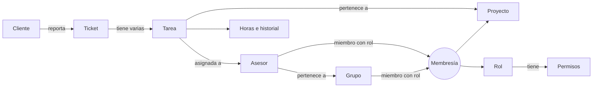
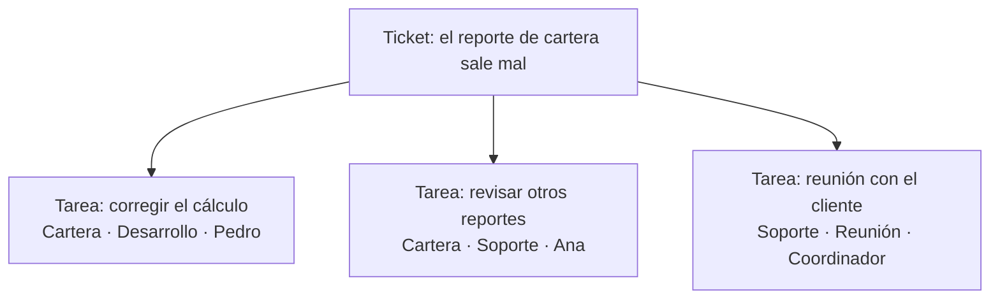
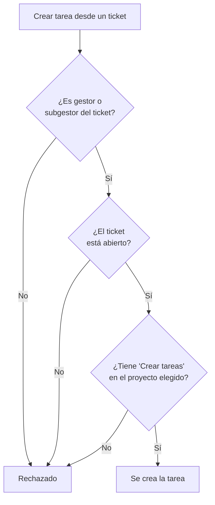
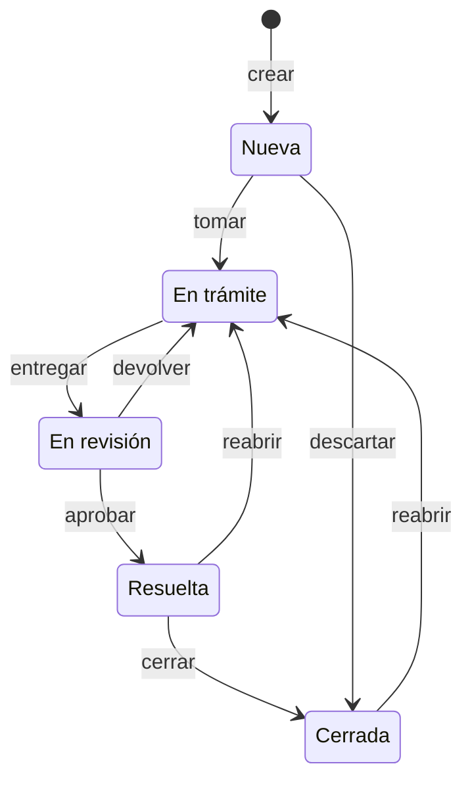
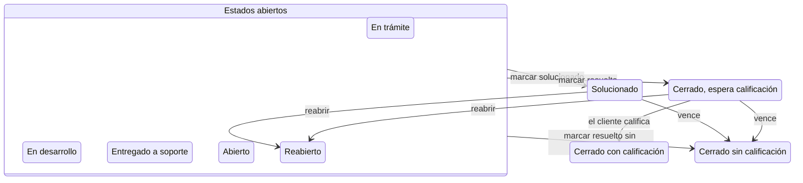
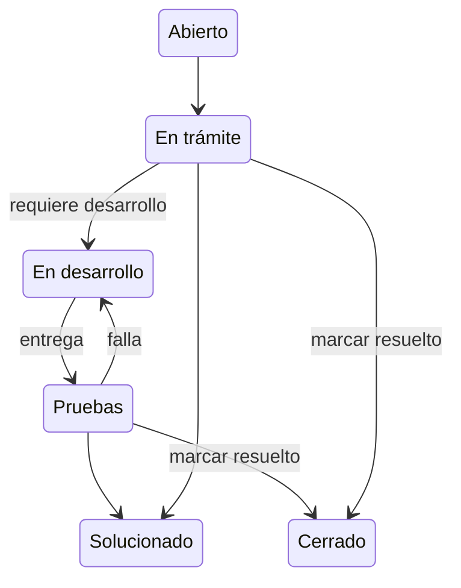
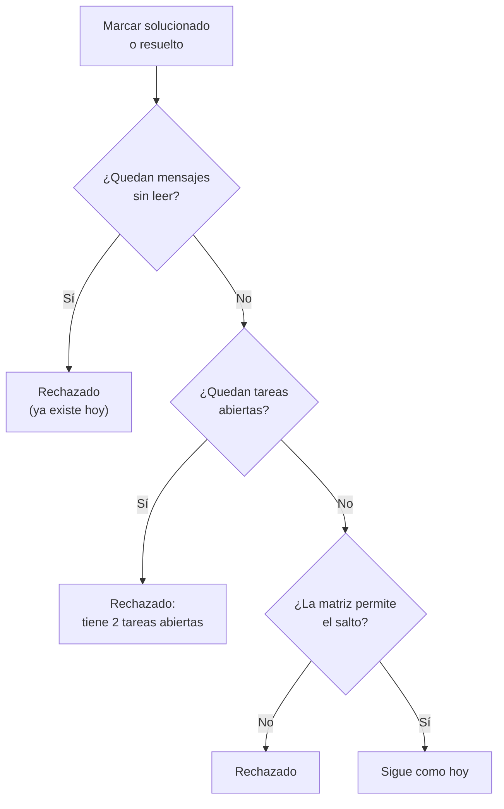
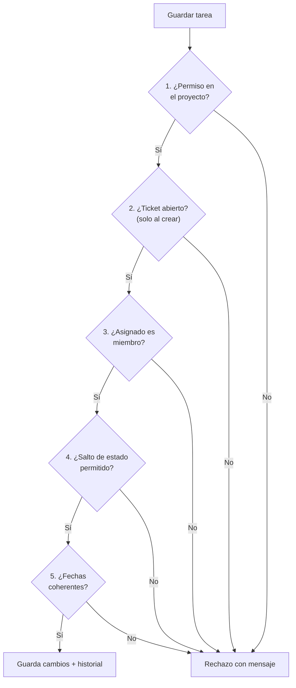
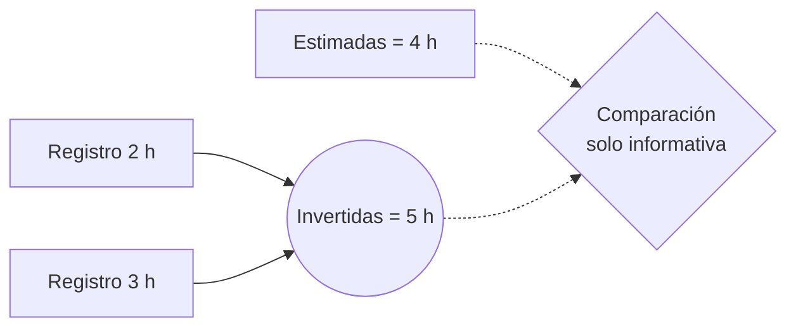

 # Análisis de negocio — Adoptar piezas de Redmine en el módulo de tickets

> Estado: **borrador para validar.** Explica qué se va a hacer y con qué reglas, sin código.
> Decisión: ADR-002 en [`ADR.md`](./ADR.md). Plan por fases: [`PLAN.md`](./PLAN.md). Pedido original: [`REQUERIMIENTO.md`](./REQUERIMIENTO.md).

## En una frase

El ticket sigue funcionando como hoy. Se le agregan **tareas** internas, cada una dentro de un **proyecto**; **grupos** y **roles por proyecto** sobre los asesores que ya existen; y reglas de **qué cambios de estado se permiten**, tanto en las tareas como en el propio ticket.

## Qué se toma de Redmine y qué ya existe

| Redmine | Qué hay hoy en SIIAN | Qué se hace |
|---|---|---|
| Usuarios | Los asesores de soporte | Se usan tal cual |
| Grupos | No hay | Se crean, sobre los asesores |
| Proyectos y roles por proyecto | No hay | Se crean |
| Petición (issue) | El ticket, pensado para el cliente | Se agrega la **tarea**: una pieza de trabajo interno, hija del ticket |
| Tipo, estado, asignado, horas | El ticket tiene su estado, no el resto | Van en la tarea |
| Prioridad | El ticket ya tiene prioridad | La tarea usa la del ticket |
| Flujo de trabajo | El ticket tiene algunas reglas fijas | Matriz para las tareas y matriz para el ticket |
| Comentarios | El chat del ticket tiene mensajes privados | Se usan esos |
| Campos personalizados, reglas de campo | No hay | Para después (sección 11) |
| Clientes | El portal: crean tickets, conversan, califican | Sin cambios |

---

## 1. Mapa de conceptos

| Concepto | Qué es | ¿Existe hoy? | Ejemplo |
|---|---|---|---|
| Ticket | Lo que reporta el cliente | Sí | "El reporte de cartera sale mal" |
| Tarea | Una pieza de trabajo interno de un ticket | **Nuevo** | "Corregir el cálculo del reporte" |
| Proyecto | Donde vive y se organiza el trabajo interno | **Nuevo** | "Cartera" |
| Asesor | Una persona del equipo de soporte | Sí | Ana |
| Grupo | Varios asesores, para darles acceso de una vez | **Nuevo** | "Equipo Desarrollo" |
| Rol | Un conjunto de permisos que vale dentro de un proyecto | **Nuevo** | Coordinador, Colaborador, Observador |
| Membresía | "En este proyecto, este asesor (o grupo) tiene este rol" | **Nuevo** | Ana es Coordinadora en "Cartera" |
| Tipo de tarea | La naturaleza del trabajo | **Nuevo** | Desarrollo, Soporte, Tarea, Reunión |
| Estado de tarea | En qué punto está la tarea | **Nuevo** | Nueva, En trámite, En revisión, Resuelta, Cerrada |
| Estado del ticket | En qué punto está el ticket para el cliente | Sí | Abierto, En desarrollo, Solucionado… |

**Un ticket puede tener varias tareas**, cada una con su asignado y su estado, y en proyectos distintos si el trabajo cruza áreas:

**Por qué la tarea no es el ticket:** el ticket necesita partirse en varias piezas de trabajo, cada una con su asignado y su estado. Eso exige una entidad hija, en cualquier diseño; así lo resuelve también Redmine con sus subtareas. Además, el estado del ticket está pensado para el cliente (portal, SLA, calificación) y el de la tarea para el equipo.

---

## 2. Dos accesos distintos: el del ticket y el del proyecto

El **ticket** conserva su acceso de hoy: lo ven y lo modifican su gestor y sus subgestores, más quien tenga el permiso de ver todos los tickets. Las **tareas** se rigen por el rol en su proyecto. Algunas acciones necesitan los dos:

| Acción | Qué se necesita |
|---|---|
| Ver o modificar el ticket | Ser su gestor o subgestor (como hoy) |
| Ver en el ticket el resumen de sus tareas | Acceso al ticket (H9) |
| Crear una tarea desde el ticket | Acceso al ticket **y** "Crear tareas" en el proyecto elegido |
| Ver una tarea completa | "Ver tareas" en su proyecto |
| Editar o cambiar el estado de una tarea | "Editar tareas" en su proyecto, respetando la matriz (sección 4) |
| Registrar horas | "Registrar horas" en su proyecto |
| Configurar grupos, roles, proyectos y matrices | Permiso de menú de Parámetros de soporte |

---

## 3. Permisos en un proyecto: unión de roles

**No hay roles globales.** En cada proyecto, el rol efectivo de un asesor sale de sumar los permisos de todas las fuentes que apliquen — no hay un solo "ganador". Así funciona Redmine: cada membresía (directa o por grupo) aporta su rol, y la persona termina con la unión de los permisos de todos los roles que le apliquen.

**De dónde sale el rol efectivo:**
1. Si el asesor fue agregado **directamente** al proyecto, aporta ese rol.
2. Por cada **grupo** del que sea miembro, si ese grupo también es miembro del proyecto, aporta el rol de ese grupo.
3. El rol efectivo es la **unión** de los permisos de todas esas fuentes.
4. Si ninguna fuente aplica, no ve las tareas del proyecto.

No hace falta que el directo "gane": si Ana es Colaboradora directa y además llega por un grupo Observador, simplemente tiene los permisos de ambos (que en este caso ya estaban incluidos en Colaborador). La unión solo suma algo nuevo cuando los roles no son uno subconjunto del otro.

| Ana en… | Directo | Por grupo | Rol efectivo | Por qué |
|---|---|---|---|---|
| Cartera | Coordinador | Observador (Observadores) | Coordinador | Unión: Coordinador ya incluye lo de Observador |
| Contabilidad | — | Observador (QA) | Observador | Solo por grupo |
| Nómina | Colaborador | — | Colaborador | Solo directo |
| Tesorería | — | Observador (QA), Colaborador (Dev) | Colaborador | Unión de ambos grupos (acá coincide con Colaborador porque incluye lo de Observador) |
| Crédito | — | — | — | No es miembro por ningún camino |

**Permisos** (catálogo fijo; el administrador arma roles combinándolos):

| Permiso | Coordinador | Colaborador | Observador |
|---|:-:|:-:|:-:|
| Ver tareas | ✓ | ✓ | ✓ |
| Crear tareas | ✓ | ✓ | |
| Editar tareas | ✓ | ✓ | |
| Eliminar tareas | ✓ | | |
| Registrar horas | ✓ | ✓ | |
| Ver horas | ✓ | ✓ | ✓ |
| Gestionar miembros | ✓ | | |

> Roles iniciales propuestos. El administrador puede crear otros. Si alguien necesita permisos de dos roles, se lo suma a otra membresía que aporte lo que falta, en vez de crear un rol combinado (H5).

---

## 4. Estados de la tarea y su matriz

Flujo **por defecto** propuesto:

| Transición | Quién (propuesta) | Qué pasa además |
|---|---|---|
| crear | Quien tenga "Crear tareas" | Arranca en Nueva |
| tomar, entregar | Colaborador, Coordinador | — |
| devolver, aprobar | Coordinador | — |
| cerrar, descartar | Coordinador | Se registra la fecha de cierre |
| reabrir | Coordinador | Se borra la fecha de cierre |

**La matriz:** para cada **Rol + Tipo**, el administrador marca qué saltos se permiten. Ejemplo, **Colaborador en Desarrollo**:

| Desde ↓ / Hacia → | Nueva | En trámite | En revisión | Resuelta | Cerrada |
|---|:-:|:-:|:-:|:-:|:-:|
| Nueva | = | ✓ | | | |
| En trámite | | = | ✓ | | |
| En revisión | | | = | | |
| Resuelta | | | | = | |
| Cerrada | | | | | = |

- `=`: quedarse en el mismo estado siempre se permite. Editar otros datos no exige un salto.
- La pantalla solo ofrece los estados permitidos, y el guardado lo vuelve a validar.
- "Cerrada" es una marca del estado, no un nombre: cualquier estado marcado como cerrado fija la fecha de cierre.

> Decisión ya tomada: el requerimiento no dice "por rol" para las transiciones, pero se hace por Rol + Tipo porque así funciona Redmine y es la forma simple de decir "solo el Coordinador cierra".

---

## 5. Estados del ticket y su matriz

### Hoy

El ticket ya tiene algunas reglas fijas: no se edita si está cerrado (salvo Solucionado), no se le pone un estado cerrado desde la edición, y a Solucionado solo se entra y se sale por su botón. Entre los estados abiertos se pasa libremente.

**El hueco:** marcar resuelto o solucionado no mira de qué estado viene el ticket. Un ticket "En desarrollo" se puede cerrar directo, sin que nadie haya probado el arreglo (H8).

### Con la matriz

Una matriz única dice qué cambios de estado del ticket se permiten. Ejemplo de lo que se busca:

"En desarrollo" no tiene salida directa a Solucionado ni a Cerrado: hay que pasar por Pruebas.

**A qué caminos aplica:**

| Camino | ¿Respeta la matriz? | Por qué |
|---|:-:|---|
| Editar el ticket | Sí | Lo hace una persona |
| Marcar solucionado | Sí | Ídem |
| Marcar resuelto (con o sin calificación) | Sí | Ídem |
| Reabrir desde el botón | Sí | Ídem |
| Cierre de vencidos | No | Es un proceso del sistema; no debe trabarse |
| Reapertura cuando el cliente escribe | No | La dispara el cliente |
| Calificación del cliente | No | Ídem |

**Reglas:**
- La matriz es **única**, no por rol: el ticket no pertenece a un proyecto, así que no hay rol de proyecto que aplicar (P5).
- Aplica **solo a tickets de soporte**: el catálogo de estados se comparte con las gestiones de CRM, que no deben verse afectadas (H7).
- Las reglas fijas de hoy **se mantienen**; la matriz se suma encima.
- Arranca **replicando lo que hoy se permite**, así nada se bloquea al desplegar. Después el administrador la ajusta (H1).

---

## 6. El acople entre el ticket y sus tareas

**Regla:** un ticket **no puede marcarse Solucionado ni Resuelto mientras tenga tareas abiertas.** Es el mismo tipo de control que ya existe hoy con los mensajes sin leer.

**Lo que no se acopla:**
- Cerrar la última tarea **no** cambia el estado del ticket. Lo decide el gestor.
- Reabrir el ticket **no** reabre sus tareas. Si hace falta más trabajo, se crea una tarea nueva o se reabre la que corresponda.
- No se crean tareas en un ticket Solucionado o cerrado (H10). Así, el cierre de vencidos nunca encuentra un ticket con tareas abiertas.

---

## 7. Crear y guardar una tarea

Toda creación o edición pasa por los mismos controles. Si uno falla, no se guarda nada; si todos pasan, los cambios y su historial se guardan juntos.

| # | Control | Mensaje (ejemplo) |
|---|---|---|
| 1 | Crear o editar tareas en ese proyecto (al crear, además, acceso al ticket) | "No tiene permiso para crear tareas en Cartera." |
| 2 | Ticket abierto, solo al crear | "No se pueden crear tareas en un ticket solucionado o cerrado." |
| 3 | Asignado miembro, solo al crear o al cambiar el asignado (H2) | "Pedro no es miembro de Cartera." |
| 4 | Salto permitido por la matriz | "No puede pasar de Nueva a Resuelta." |
| 5 | Fin igual o posterior al inicio | "La fecha de fin no puede ser anterior a la de inicio." |

**Historial:** cada campo que cambia queda registrado con valor anterior, valor nuevo, quién y cuándo. Es el historial de la tarea, aparte del historial del ticket.

---

## 8. Horas

- **Invertidas = suma de lo registrado.** Nunca se escriben a mano.
- Cada registro lleva quién, fecha, cantidad (mayor que cero) y un comentario.
- Pasarse de las estimadas **no bloquea**; solo se ve la diferencia.

---

## 9. Quién configura qué

| Qué | Quién |
|---|---|
| Grupos, roles y permisos de cada rol | Administrador (menú de Parámetros de soporte) |
| Tipos y estados de tarea | Administrador |
| Matriz de tareas y matriz del ticket | Administrador |
| Crear proyectos | Administrador |
| Agregar o quitar miembros de un proyecto | Miembros con "Gestionar miembros" |
| Crear, editar tareas y registrar horas | Miembros, según su rol |

No hay superusuario dentro de los proyectos: el administrador configura, pero para trabajar en un proyecto tiene que ser miembro.

---

## 10. Hallazgos y reglas derivadas

**H1 — Una matriz vacía congela los estados.** Si un rol no tiene saltos para un tipo, no puede mover sus tareas. Si la matriz del ticket arranca vacía, nadie puede cambiar el estado de ningún ticket. Por eso las dos arrancan con semilla: la de tareas con el flujo por defecto (sección 4), la del ticket replicando lo que hoy se permite.

**H2 — Sacar a alguien del proyecto no puede romper sus tareas.** Si "el asignado debe ser miembro" se revisara en cada guardado, una tarea asignada a un exmiembro ya no podría editarse. Se revisa solo al crear o al cambiar el asignado. Redmine hace lo mismo.

**H3 — No se borra lo que está en uso.** Estados, tipos, roles y grupos con datos asociados se desactivan, no se eliminan.

**H4 — Los permisos se revisan al guardar, no al abrir.** Si a alguien le quitan el rol con el formulario abierto, el guardado se rechaza.

**H5 — Cada membresía sigue siendo de un solo rol, pero la persona puede sumar varias.** Una fila de `proyectomiembro` (una membresía directa, o la de un grupo) trae un solo rol. Si alguien necesita permisos de dos roles a la vez, no hace falta inventar un "Colaborador revisor": se lo agrega también a un grupo que aporte el permiso que le falta, y la unión los junta.

**H6 — Un Observador puede quedar asignado.** Hoy cualquier miembro es asignable, incluso uno que no puede editar. Redmine tiene una marca por rol: "se le pueden asignar tareas". Ver P7.

**H7 — El catálogo de estados del ticket se comparte con CRM.** Las gestiones de CRM usan los mismos estados. La matriz del ticket filtra solo tickets de soporte.

**H8 — Hoy un ticket se puede cerrar desde cualquier estado abierto.** Marcar resuelto y marcar solucionado solo revisan que el ticket no esté ya cerrado y que no queden mensajes sin leer (`Negocio/Crm/GestionMaestroCRMActorNegocio.cs:219-234` y `:420-441`). No miran el estado de origen. Es el hueco que tapa la matriz del ticket.

**H9 — El gestor tiene que ver las tareas de su ticket aunque no sea miembro del proyecto.** Si no las ve, la regla del acople lo bloquearía sin que sepa por qué. En el ticket se muestra el resumen de sus tareas (asunto, proyecto, asignado, estado) a quien tenga acceso al ticket. Para ver o editar la tarea completa, rige el proyecto.

**H10 — No se crean tareas en tickets solucionados o cerrados.** Si se permitiera, un ticket Solucionado podría tener tareas abiertas, y el cierre de vencidos lo cerraría igual, porque no revisa el acople. Con esta regla, el acople se mantiene sin tocar ese proceso.

**H11 — El acceso al ticket también permite modificarlo.** La misma validación de "gestor o subgestor" se usa para ver, editar, escribirle al cliente y subir archivos (`Blip.Data/Crm/GestionMaestroCRMActorNegocio.cs:646`). Por eso no se les da acceso al ticket a los asignados de tareas: podrían escribirle al cliente. Ver P2.

**H12 — "Pruebas" no existe hoy.** Los estados del ticket tienen "En desarrollo" y "Entregado a gestión soporte" (agregados el 26-06-2026), pero no "Pruebas". Ver P1.

**H13 — Los comentarios internos ya existen.** El chat del ticket tiene mensajes privados, que el cliente no ve. Las tareas no necesitan notas propias en la v1. Pero solo los ve quien tiene acceso al ticket (H11).

**H14 — La prioridad es la del ticket.** El catálogo trae baja, media, alta y crítica; "Crítica" hace de "Urgente". La tarea la muestra y no tiene una propia, para que no haya dos prioridades que se contradigan (P3).

---

## 11. Para después

Analizado y decidido, pero fuera de la v1:

- **Reglas de campo** (obligatorio o solo lectura por Rol + Tipo + Estado). Confirmado que el requerimiento las pide ("obligatorios o editables") y que Redmine las tiene.
- **Campos personalizados.** El valor se guardaría como texto, igual que los campos dinámicos de terceros que ya existen. No se podrá cambiar el tipo de dato ni borrar una opción que ya tenga valores: solo desactivarla.
- **Tipos habilitados por proyecto**, **tareas sin ticket**, **subtareas**, **adjuntos propios** de la tarea y **notificaciones** al asignado.
- **Acceso de solo lectura al ticket** para los asignados de tareas (P2).

---

## 12. Preguntas abiertas

Cada pregunta trae una propuesta por defecto. Si no hay objeción, se sigue con esa.

| # | Pregunta | Propuesta |
|---|---|---|
| P1 | ¿"Pruebas" es un estado nuevo o es el actual "Entregado a gestión soporte"? | Reusar "Entregado a gestión soporte" si significa eso; si no, crear el estado |
| P2 | ¿El asignado de una tarea ve el ticket completo (chat, archivos)? | En v1 ve el resumen del ticket en su tarea. Si necesita el chat, el gestor lo agrega como subgestor, algo que ya existe |
| P3 | ¿La tarea tiene prioridad propia? | No, usa la del ticket |
| P4 | ¿Se crean tareas sin ticket, como una reunión interna? | No en v1 |
| P5 | ¿La matriz del ticket cambia según el asesor? | No, es única |
| P6 | ¿El flujo por defecto de la sección 4 sirve? | Sí, como punto de partida |
| P7 | ¿Se puede asignar una tarea a un Observador? | No: el rol lleva la marca "se le pueden asignar tareas" |
| P8 | ¿Las Reuniones usan el ciclo completo? | Ciclo corto: Nueva → Cerrada |
| P9 | ¿Se registran horas en una tarea cerrada, o a nombre de otro? | No en los dos casos |
| P10 | ¿Se elimina una tarea que tiene horas? | No, se cierra o se descarta |
