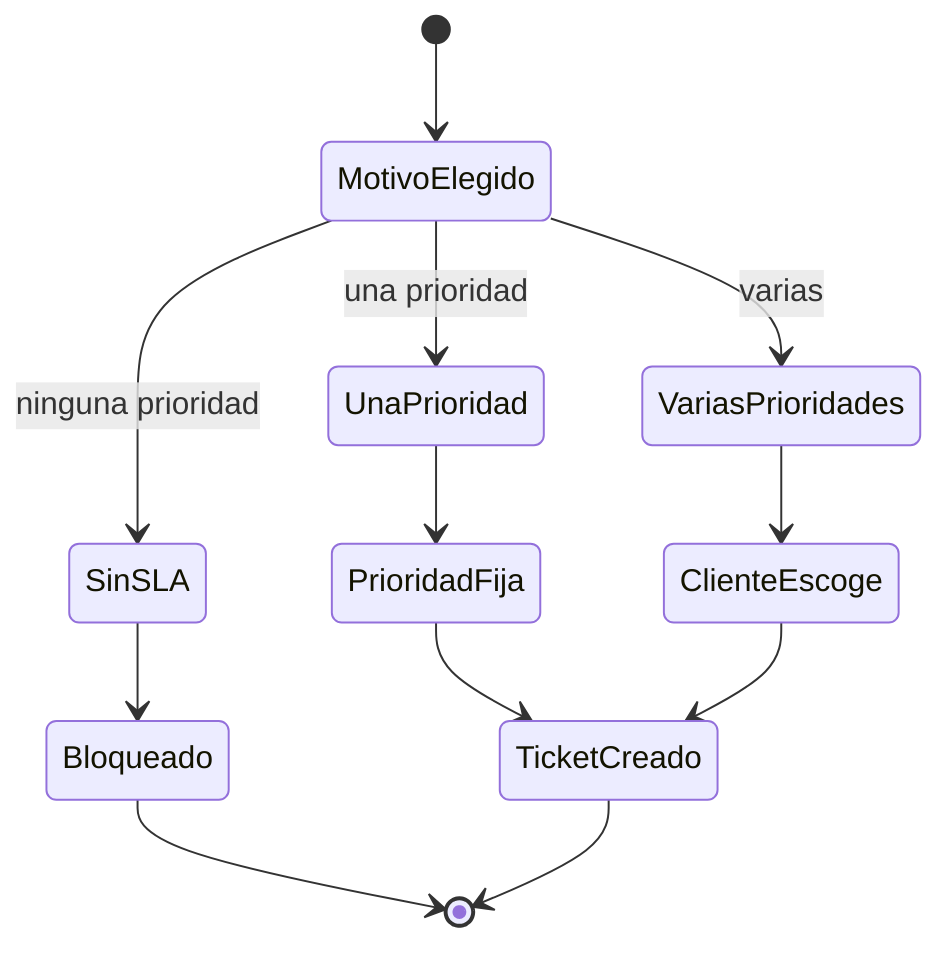

# Análisis: prioridades según el SLA parametrizado

Spec: [REQUERIMIENTO.md](./REQUERIMIENTO.md)

## 0. Qué ya existe

| Pieza | Qué hace hoy | Conclusión |
|---|---|---|
| Parametrización del SLA | Soporte define las horas máximas por motivo + prioridad, con activo/inactivo | Se reutiliza tal cual, es la fuente de verdad |
| Lista de prioridades del portal | Entrega todas las prioridades activas, sin mirar el motivo ni el SLA | Se cambia: pasa a depender del motivo |
| Selector de prioridad al crear ticket | Es opcional y se puede limpiar | Se cambia: obligatorio y filtrado |
| Cálculo de la fecha límite | Con horas hábiles. Sin prioridad, sin SLA o ante cualquier fallo asigna 72h planas | Se cambia: deja de existir el tiempo automático |
| Creación del ticket | Calcula la fecha límite en un solo punto | Se reutiliza: ahí se aplica la regla de rechazo |

## 1. Regla nueva

| Estado | Qué ve el cliente | Qué pasa |
|---|---|---|
| SinSLA / Bloqueado | Aviso de contactar a soporte | No se envía el ticket |
| UnaPrioridad | Prioridad ya seleccionada | Se crea con el tiempo de ese SLA |
| VariasPrioridades | Selector con solo las parametrizadas | Debe escoger una |

La misma regla se valida al crear el ticket, no solo en pantalla.

## 2. Hallazgos

- **H1.** La lista de prioridades no mira el motivo ni el SLA. Muestra opciones que luego no tienen tiempo. Origen del problema.
- **H2.** El selector permite dejar la prioridad vacía, y vacía equivale a 72h silenciosas.
- **H3.** El cálculo de la fecha límite se traga cualquier error y usa 72h. Un calendario mal configurado pasa sin que nadie se entere.
- **H4.** Solo hay un lugar que calcula la fecha límite, así que el cambio no se reparte en varios llamadores.
- **H5.** Con una sola prioridad en la empresa, la mayoría de motivos tendrán una sola opción: la pantalla debe resolverlo sin pedir un clic inútil.

## 3. Reglas confirmadas

- Sin SLA para el motivo: se bloquea y se pide contactar a soporte (decidido por el dueño del requerimiento).
- Un fallo del calendario también falla y avisa; no se inventa tiempo (decidido).
- Parametrizar los motivos es responsabilidad de soporte.

## 4. Verificación

Antes de desplegar:

- Listar los **motivos activos del portal que no tengan ningún SLA activo**. Cada uno quedará bloqueado al desplegar. Se pasa la lista a soporte para que parametricen o inactiven.

Después de construir, un caso por cada criterio 1 a 5 del requerimiento, con el resultado obtenido (captura o respuesta del servicio). La evidencia va en `IMPLEMENTACION.md`.
