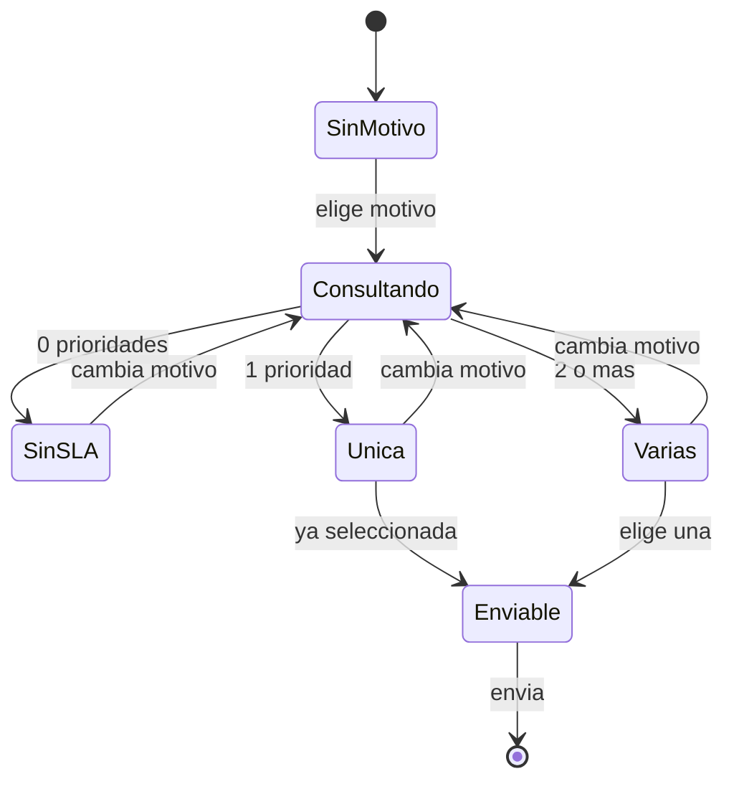

# Prioridades por SLA — Explicación por etapa

## Tarea 4: pantalla Nuevo Ticket

El cliente elige primero el motivo. La prioridad depende de ese motivo: solo se ofrecen las que
tienen SLA activo para él. Según cuántas haya, la pantalla se comporta distinto.

- **Sin motivo:** no se muestra la sección Prioridad.
- **0 prioridades:** aviso "comuniquese con soporte"; el botón de enviar queda deshabilitado.
- **1 prioridad:** aparece ya seleccionada; no hay nada que elegir.
- **2 o más:** el cliente debe escoger una; no puede dejarla vacía.
- **Cambia de motivo:** la prioridad elegida se descarta, porque podía no existir para el motivo nuevo.
