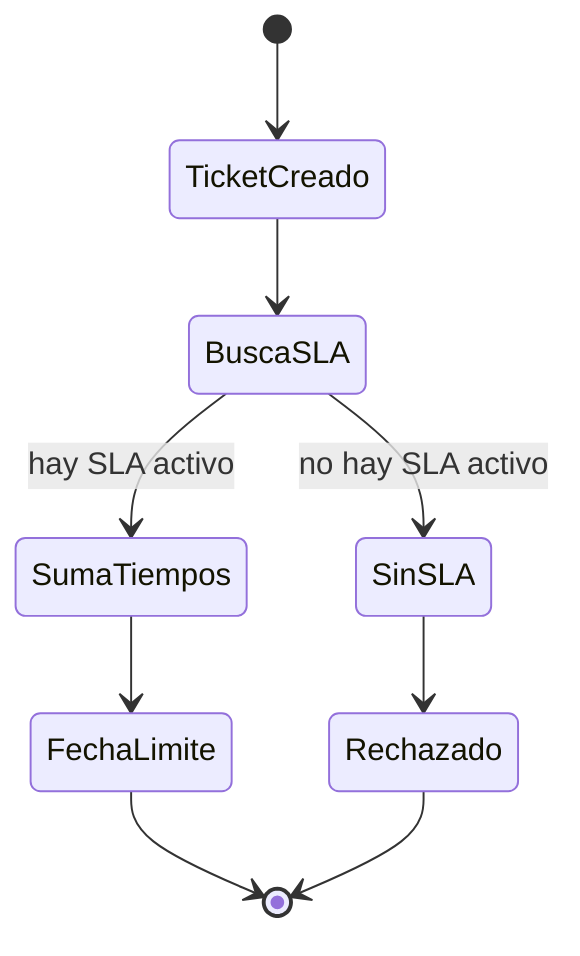

# Análisis: tiempo de respuesta en el SLA

Spec: [REQUERIMIENTO.md](./REQUERIMIENTO.md)

## 0. Qué ya existe

| Pieza | Qué hace hoy | Conclusión |
|---|---|---|
| Parametrización del SLA | Una fila por motivo y prioridad, con horas máximas y activo/inactivo | Se extiende: agrega horas de respuesta. Las horas máximas pasan a llamarse horas de resolución |
| Cálculo de la fecha límite | Al crear el ticket suma las horas máximas en horas hábiles (jornada y festivos del calendario de soporte). Se calcula en un solo punto | Se extiende: suma respuesta + resolución |
| Fecha límite del ticket | Se guarda una vez al crear. Soporte puede editarla a mano | Se reutiliza tal cual |
| Fecha de respuesta del ticket | Se carga a mano en el CRM; ningún proceso la llena. El portal la muestra como "fecha respuesta real" solo si tiene valor | No se toca (fuera de alcance) |
| Fecha estimada en el portal | El cliente ve la fecha límite como "estimada de respuesta" en el listado y el detalle, y se pinta vencida si ya pasó | Se reutiliza: ahí ve el total, sin cambios en el portal |
| Fecha de cierre del ticket | Marca el cierre definitivo | No se mezcla con la de respuesta |
| Semáforo de vencimiento (listado, detalle, dashboard) | Compara la fecha límite con la hora actual | Se reutiliza: refleja el total sin cambios |

## 1. Regla nueva

| Paso | Detalle |
|---|---|
| SumaTiempos | Horas de respuesta + horas de resolución del SLA |
| FechaLimite | Creación del ticket + total, contado en horas hábiles |
| SinSLA | Sin cambios respecto a [prioridades-por-sla](../prioridades-por-sla/) |

## 2. Hallazgos

- **H1.** Hay un solo punto que calcula la fecha límite, así que el cambio no se reparte entre varios llamadores.
- **H2.** Con la respuesta en 0 por defecto, los SLA que ya existen calculan igual que hoy. No hace falta migrar datos para desplegar.
- **H3.** El SLA se configura en horas. "1 día hábil" equivale a las horas de la jornada del calendario de soporte. Soporte debe hacer esa conversión al cargar.
- **H4.** Los estilos de semáforo de la pantalla de parametrización están definidos pero no se usan. Se dejan como están; limpiarlos no es parte de esto.
- **H5.** El portal llama "estimada de respuesta" a la fecha límite. Con el cambio, esa fecha es respuesta + resolución: el nombre ya no describe bien lo que muestra.
- **H6.** El indicador interno "respondió en SLA" compara la fecha de respuesta contra las horas máximas (que pasan a ser resolución) y en horas de calendario. Hoy siempre queda vacío porque nadie carga la fecha de respuesta; se deja como está.

## 3. Reglas confirmadas

- El tiempo de respuesta solo se suma; no se mide ni se registra la respuesta (dueño del requerimiento, 2026-10-14).
- Los tickets ya creados no se recalculan.
- El total se guarda en la fecha límite, que es la que ya ve el cliente. La fecha de respuesta y la de cierre no cambian (dueño del requerimiento, 2026-10-14).

## 4. Preguntas abiertas

Ninguna. Cerradas el 2026-10-14 por el dueño del requerimiento: la lectura de la tabla del acuerdo es correcta y el nombre "estimada de respuesta" del portal se deja como está (H5).

## 5. Verificación

- Antes y después: crear un ticket con un SLA existente (respuesta 0) y confirmar que da la misma fecha límite.
- Configurar un SLA con 2 + 4, crear un ticket y confirmar que la fecha límite es 6 horas hábiles después, cruzando la jornada si corresponde (por ejemplo, creado a las 4 p. m.).
- Pantalla: crear y editar un SLA con las dos horas y ver el total.
